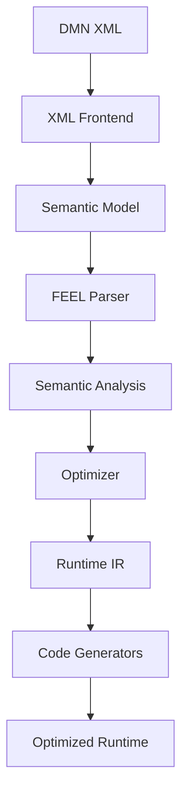
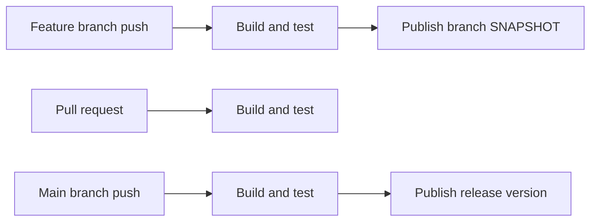

# DMN Compiler Toolkit

[](https://central.sonatype.com/artifact/io.finmsg.dmn/dmn-compiler)
[](LICENSE)
[](docs/tck-conformance.md)


High-performance compiler infrastructure for Decision Model and Notation (DMN).

The project compiles DMN models into an internal semantic representation that can later be validated, optimized, and translated into efficient runtime code.

<a id="contents-section-1"></a>
## Status

<!-- generated-toc:start -->
## Table of contents

- [Architecture](#contents-section-2)
- [Modules](#contents-section-3)
- [Requirements](#contents-section-4)
- [Build](#contents-section-5)
- [Generate FEEL parser sources](#contents-section-6)
- [Use a single module](#contents-section-7)
- [GitHub Packages](#contents-section-8)
- [Continuous Integration](#contents-section-9)
- [Design principles](#contents-section-10)
- [Documentation](#contents-section-11)
- [Roadmap](#contents-section-12)
- [License](#contents-section-13)
- [Project](#contents-section-14)
<!-- generated-toc:end -->

The project is a feature-rich DMN 1.3 / 1.5 / 1.6 compiler platform with a portable Protobuf middle-end IR (`DMNIR`) and concise `.decision` authoring DSL.

Current status & focus:

- **100.00% self-verified conformance across all 7 execution backends** (**3,407 / 3,407** pinned official OMG DMN TCK cases each on revision `5cd912f281831bc535e710aba435e16de198028a`, zero failures, errors, or compilation blocks); see the [TCK conformance record](docs/tck-conformance.md):
  - **Portable DMNIR Java (`dmnir -> java`)**: **3,407 / 3,407 (100.00%)** via 151 deduplicated `.dmnir` Protobuf artifacts + batch `javac`
  - **Standalone Rust (`dmnir -> rust`)**: **3,407 / 3,407 (100.00%)** directly from `.dmnir` with zero JVM runtime dependency
  - **Java Interpreter (`optimized-interpreter`)** & **Direct Generated Java (`optimized-generated-java`)**: **3,407 / 3,407 (100.00%)** each
  - **Spark SQL (`optimized-generated-sparksql-hybrid`)**: **3,407 / 3,407 native (100.00%, 0 fallback)**
  - **Generic gRPC (`optimized-generated-grpc`)**: **3,407 / 3,407 (100.00%)** over real HTTP/2 and binary Protobuf
  - **Model-specific Typed gRPC (`optimized-generated-typed-grpc`)**: **3,407 / 3,407 (100.00%)** across 3,510 completed typed RPCs
- **DMNIR → DMN 1.3 / 1.5 / 1.6 XML regeneration**: **3,407 / 3,407 (100.00%)** round-trip parity on each of DMN 1.3, 1.5, and 1.6 (151 / 151 artifacts) plus multi-file `dmn-models` suites
- **`.decision` Authoring DSL & CLI (`dmn-frontend-dsl`, `dmn-compiler-1.2.0-cli.jar`)**: ANTLR4 grammar (`DecisionDsl.g4`), canonical formatter, inline `test` blocks, and `check` / `format` / `test` / `compile` / `export` CLI; see the [Authoring DSL guide](docs/dsl.md)
- Static optimization passes (`dmn-optimizer`) enabled by default through `DmnCompiler`
- TCK and benchmarks isolated behind opt-in verification profiles to preserve fast builds

<a id="contents-section-2"></a>
## Architecture



The architecture separates parsing, semantic analysis, optimization, and runtime generation. Runtime execution is intentionally independent from the original DMN XML representation.

<a id="contents-section-3"></a>
## Modules

| Module | Description |
|---|---|
| `dmn-protobuf` | Protobuf definitions and generated Java classes for the semantic model |
| `dmn-ir-protobuf` | Portable structured DMNIR Protobuf schema (`0.0`–`0.11`) and generated Java bindings |
| `dmn-ir-codec` | Bounded wire decoding and semantic graph verification for portable DMNIR artifacts |
| `dmn-frontend-xml` | Namespace-aware DMN 1.3/1.5/1.6 XML reader and semantic round-trip writer based on VTD-XML |
| `dmn-frontend-dsl` | ANTLR4-backed `.decision` authoring DSL parser (`DecisionDsl.g4`), canonical formatter, and DMN 1.6 protobuf lowerer |
| `dmn-feel-parser` | ANTLR4 parser for DMN FEEL expressions |
| `dmn-semantic-analysis` | Reference resolution, type analysis, DMN validation, and dependency ordering |
| `dmn-runtime-ir` | Immutable Runtime IR with structural, constant, and value-reference lowering |
| `dmn-runtime` | Deterministic interpreter for executable Runtime IR |
| `dmn-optimizer` | Constant folding, algebraic simplification, and rule pruning passes |
| `dmn-compiler` | Compiler orchestration, DMNIR producer/adapter/XML exporter, inline test runner, and standalone CLI (`dmn-compiler-*-cli.jar`) |
| `dmn-generator-java` | High-performance Java source code generator directly from Runtime IR |
| `dmn-generator-sparksql` | Spark SQL CTE generator with verified native execution of all 3,407 pinned official TCK cases |
| `dmn-grpc` | Generic and strongly-typed Protobuf schema & gRPC service adapter generator |
| `dmn-smoke-test` | Downstream consumer integration smoke tests |
| `dmn-generator-rust` | Standalone Rust crate generating zero-JVM Rust code directly from `.dmnir` (3,407/3,407 TCK cases) |
| `dmn-tck` / `dmn-tck-runner` | Opt-in pre-compiled `.dmnir` archive (151 artifacts) and OMG DMN TCK runner across all 7 backends |
| `dmn-benchmarks` | Opt-in JMH microbenchmarks & DataFaker reference model workloads |
| `dmn-models` | Opt-in benchmark models and streaming ingestion fixtures |

Planned modules include Go/C++ code generators and IDE/LSP tooling.

<a id="contents-section-4"></a>
## Requirements

- JDK 25
- Maven 3.9 or later

<a id="contents-section-5"></a>
## Build

```bash
mvn clean verify
```

The command builds the default reactor and runs its unit/integration tests. Additional gates are
explicit:

```bash
mvn -Ptck verify          # optimized interpreter, generated Java and Spark SQL TCK
mvn -Ptck -Dtck.backend=grpc -Dtck.timeoutSeconds=120 verify # generic gRPC TCK
mvn -Pbenchmarks verify   # benchmark support modules
```

<a id="contents-section-6"></a>
## Generate FEEL parser sources

The FEEL parser module generates Java sources from ANTLR grammars.

```bash
mvn -Pgenerate-code clean verify
```

<a id="contents-section-7"></a>
## Use a single module

Example:

```bash
mvn -pl dmn-feel-parser -am test
```

`-am` also builds required upstream modules.

<a id="contents-section-8"></a>
## GitHub Packages

Snapshot and release artifacts are published to GitHub Packages.

Repository:

```text
https://maven.pkg.github.com/finmsg-io/dmn-compiler-toolkit
```

Example Maven repository configuration:

```xml
<repositories>
    <repository>
        <id>github</id>
        <url>https://maven.pkg.github.com/finmsg-io/dmn-compiler-toolkit</url>
    </repository>
</repositories>
```

Example dependency:

```xml
<dependency>
    <groupId>io.finmsg.dmn</groupId>
    <artifactId>dmn-compiler</artifactId>
    <version>1.2.0</version>
</dependency>
```

GitHub Packages requires authentication. Add credentials to `~/.m2/settings.xml`:

```xml
<settings>
    <servers>
        <server>
            <id>github</id>
            <username>YOUR_GITHUB_USERNAME</username>
            <password>YOUR_GITHUB_TOKEN</password>
        </server>
    </servers>
</settings>
```

The token requires package read permission. Published releases on Maven Central require no configuration or authentication.

<a id="contents-section-9"></a>
## Continuous Integration

GitHub Actions performs the following operations:



Feature branch versions use a branch-specific suffix, for example:

```text
1.0.0-feature-initiate-SNAPSHOT
```

<a id="contents-section-10"></a>
## Design principles

- Semantic model instead of an XML-shaped runtime model
- Compilation before execution
- Runtime independence from XML parsing
- Explicit compiler stages
- Extensible code-generation backends
- Protobuf-based stable model contracts
- Performance as a primary design goal
- Small, independently testable modules

<a id="contents-section-11"></a>
## Documentation

The documentation site is located in the `docs` directory and is built with MkDocs.

Key references are the [architecture overview](docs/architecture.md), the normative
[architecture specification](docs/architecture/architecture-spec.md), the
[ADR index](docs/architecture/adr/generall-adr.md), and the project
[glossary](docs/glossary.md).

For commercial strategy, market sizing, and the Strategyzer Business Model Canvas (v2.0), see [`dmn-compiler-toolkit-business-model-canvas`](https://github.com/finmsg-io/dmn-compiler-toolkit-business-model-canvas). For incubation tracks and research proposals, see [`dmn-compiler-toolkit-ideation`](https://github.com/finmsg-io/dmn-compiler-toolkit-ideation).

Install MkDocs:

```bash
pip install mkdocs mkdocs-material
```

Run locally:

```bash
mkdocs serve
```

Build the static site:

```bash
mkdocs build
```

<a id="contents-section-12"></a>
- [x] Add compiler facade and import model resolver (`dmn-compiler`)
- [x] Lower FEEL expressions and decision tables into Runtime IR instructions (`dmn-runtime-ir`)
- [x] Implement static optimizer passes (`dmn-optimizer`)
- [x] Generate optimized Java code (`dmn-generator-java`)
- [x] Add performance benchmarks & DataFaker realistic workloads (`dmn-benchmarks`)
- [x] Generate pure Spark / Databricks SQL CTE queries (`dmn-generator-sparksql`)
- [x] Generate dynamic and strongly-typed gRPC services (`dmn-grpc`)
- [x] Add multi-file DMN sample suites and Java streaming ingestion API (`dmn-models`)
- [x] Add portable Protobuf DMNIR (`dmn-ir-protobuf`, `dmn-ir-codec`), DMN 1.3/1.5/1.6 XML regeneration, and standalone Rust generator (`dmn-generator-rust`, 3,407/3,407 TCK cases)
- [x] Add `.decision` Authoring DSL (`dmn-frontend-dsl`), inline tests, and standalone CLI (`dmn-compiler-1.2.0-cli.jar`)
- [ ] Add additional native language backends (Go, C++) and IDE/LSP plugins

<a id="contents-section-13"></a>
## License

This project is licensed under the [Apache License 2.0](LICENSE).

<a id="contents-section-14"></a>
## Project

Developed under the `finmsg.io` GitHub organization.

- **Commercial Strategy & Business Model Canvas:** [`dmn-compiler-toolkit-business-model-canvas`](https://github.com/finmsg-io/dmn-compiler-toolkit-business-model-canvas)
- **Product Ideation & Research Proposals:** [`dmn-compiler-toolkit-ideation`](https://github.com/finmsg-io/dmn-compiler-toolkit-ideation)
