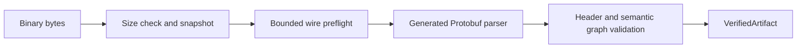

# `dmn-ir-codec`

Bounded binary reader and structural/semantic verifier for the experimental portable scalar DMNIR
profiles. It accepts **schema 0.0**, semantics `finmsg-dmnir-scalar/0` and capability `dmnir.scalar`,
or **schema 0.1**, semantics `finmsg-dmnir-scalar-expressions/0` and ordered capabilities
`dmnir.scalar`, `dmnir.scalar-expressions`. Header combinations are exact.
Schema **0.2** uses semantics `finmsg-dmnir-records/0` and ordered capabilities `dmnir.scalar`,
`dmnir.scalar-expressions`, `dmnir.records`. It adds named-record type/field validation.
Schema **0.3** uses `finmsg-dmnir-local-bindings/0` and the ordered 0.2 capabilities followed by
`dmnir.local-bindings`. It validates sequential lexical scope, binding identity, local result types,
source variable IDs and bounded declarations/references. Forward/self references and scope escape
are rejected before consumers derive local frames or slots.
Schema **0.4** uses `finmsg-dmnir-dates/0` and appends `dmnir.date` to the ordered 0.3 capabilities.
It checks civil component presence, Gregorian validity, the nonzero signed year range and date
type compatibility. DATE types and literals require 0.4, including dates in unused declarations.

## Purpose and boundaries

`DmnIrArtifactReader` converts untrusted binary bytes into a `VerifiedArtifact`. The generated
Protobuf parser alone is insufficient: this module checks wire budgets, compatibility and the
linked graph before a consumer receives successful validation evidence.

Production dependencies are [dmn-ir-protobuf](../dmn-ir-protobuf/README.md) and `protobuf-java`.
The codec does not depend on XML, FEEL parsing, semantic analysis, compiler orchestration or the
execution runtime. It neither executes decisions nor retrieves external imports.



## Usage

```java
import io.finmsg.dmn.dmnir.codec.DmnIrArtifactReader;
import io.finmsg.dmn.dmnir.codec.DmnIrValidationException;

var reader = new DmnIrArtifactReader();
try {
    var verified = reader.read(artifactBytes);
    var artifact = verified.artifact(); // immutable generated Protobuf message
    // Pass verified to a consumer that supports this profile.
} catch (DmnIrValidationException failure) {
    System.err.println(failure.code() + " at " + failure.path());
}
```

Only the reader can construct the successful wrapper. `read` snapshots the caller's array before
preflight and parsing, preventing changes between passes. Reader configuration is immutable;
validation state is local to each call. Validation does not execute the artifact or prove that
every future backend supports it; consumers must enforce their own supported profile.

## Validation policy

- Reject unknown fields, duplicate singular/oneof members, incorrect wire types and malformed or
  truncated data. Unlike permissive Protobuf decoding, unknown fields are not silently retained.
- Require the exact supported schema/profile/capability header; reject unsupported versions and capabilities.
- Check model/element identity uniqueness, variables and scalar typing, decimal grammar/limits,
  bundled imports, resolved references, declared dependencies and cross-model access.
- Require an evaluation schedule containing each decision exactly once, after its decision
  dependencies. Reject cycles, missing references and invalid ordering without recursive graph traversal.
- Preserve explicit null and exact numeric values. There is no implicit fallback for unknown nodes.
- Profile 0.1 validates unary/binary/conditional children, operator signatures and every nested
  reference, including unselected branches. These nodes are rejected under a 0.0 header.
- Profile 0.2 validates non-empty acyclic named records, scalar/record type exclusivity, imported
  type visibility, field membership/result types and same-record conditional assignments.
  Record definitions and fields count toward declaration budgets. Potential expanded type size
  is bounded by the message budget and record depth by the depth budget before consumer layout derivation.

Failures carry a stable category code and indexed artifact path. Diagnostic reasons do not echo
payload values. Null Java arguments and invalid limit configuration are ordinary caller errors.
The reader is binary-only; it does not accept Protobuf Text Format or implement canonical encoding.

## Default limits

`DmnIrLimits.defaults()` configures these per-read budgets:

| Budget | Default |
| --- | ---: |
| Artifact bytes | 4 MiB |
| Message depth | 32 |
| Message occurrences | 50,000 |
| Field occurrences | 200,000 |
| UTF-8 bytes per string | 16,384 |
| Models | 128 |
| Declarations (including record definitions/fields and local bindings) | 10,000 |
| Reference occurrences | 50,000 |
| Decimal coefficient digits | 4,096 |
| Absolute decimal scale | 4,096 |

Pass a custom `DmnIrLimits` to `new DmnIrArtifactReader(limits)` when needed. Configured depth
cannot exceed 64. Wire budgets are checked before generated message allocation; numeric and
graph validity are checked after decoding. These are explicit resource bounds, not a blanket
guarantee against all application-level resource exhaustion.

## Build and tests

From the repository root, using JDK 25 / Maven 3.9.12:

```powershell
mvn -Pformat -pl dmn-ir-codec -am verify
```

JUnit tests cover accepted artifacts, compatibility failures, malformed/truncated/unknown wire
data, limit boundaries, seeded malformed inputs, decimal constraints, imports/references,
dependency cycles/schedules, reader reuse and diagnostics. Codec tests do not measure execution
backend routing or official DMN TCK conformance.

## Consumers and remaining scope

The compiler module provides scalar production and runtime adaptation. Execution uses the
existing runtime; code generation is a downstream concern. The codec does not serialize source
models, synthesize DMN XML or provide the authoring DSL. Broader expressions, stable wire
compatibility and independent Rust validation/execution remain future work.

- [DMNIR guide](../docs/dmnir.md): supported profile, APIs and limitations.
- [Schema README](../dmn-ir-protobuf/README.md): messages and exact decimal representation.
- [ADR-0026](../docs/architecture/adr/adr-0026-structured-portable-dmnir.md): architecture.
