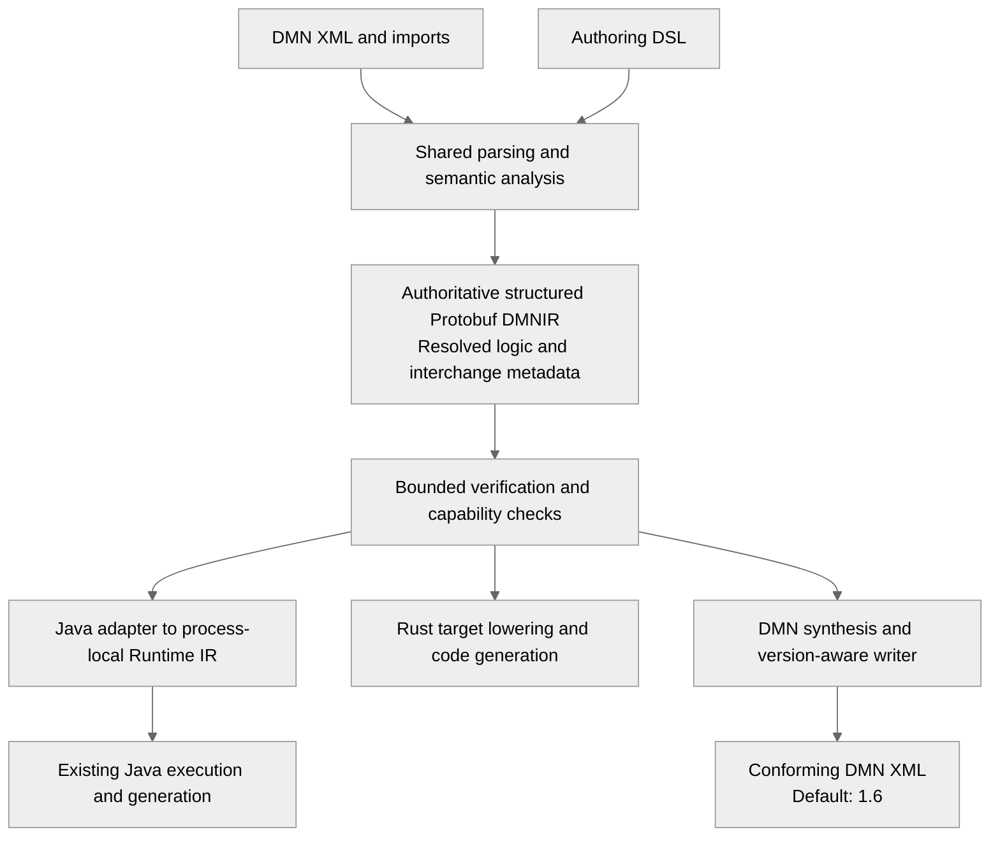

# ADR-0026 — One Authoritative Structured Portable DMNIR

| Field | Value |
| --- | --- |
| Status | Accepted |
| Decision | ADR-0026 |
| Date | 2026-11-03 |
| Approval | User selected Option A after reviewing the alternatives |
| Delivery target | 1.2.0; implementation remains incremental |

## Context

DMNIR must contain sufficient resolved decision semantics for independent code generators,
including Rust, and sufficient structure to synthesize standards-conforming DMN XML, defaulting
to DMN 1.6. A concise DSL and DMN XML must converge through the shared semantic pipeline.

The current process-local Runtime IR omits some source identities and declarations needed for
interchange. Optimized graphs can also discard authoring structure. Serializing the current
Java records cannot by itself meet the export requirement.

[ADR-0025](adr-0025-runtime-ir-persistence-and-compatibility-boundary.md) requires a separate
versioned persistence contract. It does not require that portable data copy the process-local
Runtime IR layout. The alternatives reviewed were a single structured resolved representation,
separate canonical/executable sections, an execution graph with reverse synthesis, and an
execution graph with embedded original sources.

## Decision

Use **one authoritative, typed, resolved and structured DMNIR encoded with Protobuf**, with
portable declaration and interchange metadata. This is Option A from the alternatives review.

1. Decision logic has one authoritative representation in the artifact. Do not require a second
   stored canonical policy or executable policy whose behavioral equivalence must be proved.
2. Resolve types, references, operations, function binding and dependencies before emission.
   Retain structured expressions, tables, functions and declarations needed by the supported
   portable profile. Code generators do not parse DMN XML or FEEL source or repeat semantic
   name resolution.
3. Keep stable model/element identities, namespaces, named declarations and required interchange
   metadata distinct from generated dense execution slots. The DSL need not expose wire tags,
   slots or compiler-generated identities to authors.
4. Consumers may derive target-specific Runtime IR and optimizations. Such derived graphs are
   local implementation artifacts, not a second authoritative policy in the portable package.
   A persistent optimized cache would require a separate compatibility and trust decision.
5. Generate DMN from the same authoritative graph and metadata, without original source files.
   Default new DMNIR export to 1.6; other supported versions require explicit feature mappings.
   Preserve observable semantics for the admitted profile. Normalized equivalent output is
   allowed; original XML syntax, comments, diagram layout and expression spelling are not
   promised.
6. The wire schema is independently versioned and does not reuse semantic protobuf messages,
   Java record shapes, Java serialization, enum ordinals or traversal ordinals as contracts.
   Keep schema/codec dependencies out of the execution runtime.
7. Apply ADR-0025's explicit IDs, capability negotiation, bounded validation, integrity metadata,
   deterministic encoding and major/minor compatibility requirements. Define canonical content
   identity explicitly; Protobuf deterministic serialization alone is insufficient.
8. Reject unsupported operations, profiles and export mappings explicitly. A successful
   Protobuf parse is not proof that the graph is safe, supported or semantically valid.

This decision selects the representation architecture. It does not accept a complete schema,
field allocation, module graph, DSL grammar or backend conformance claim. Those contracts must
be delivered in bounded slices with executable evidence. The 1.2.0 target is not a release claim.

## Alternatives

| Alternative | Reason not selected |
| --- | --- |
| Canonical model plus separate executable section | Duplicates decision logic and requires a consistency/trust policy; independent structural checks and checksums cannot prove behavioral equivalence |
| Executable graph only with reverse synthesis | Loses structure/identities and requires a proven reverse mapping for every admitted optimization and operation |
| Executable graph plus embedded original DMN/DSL | Useful for provenance, but source retention alone does not provide an independent intermediate-semantics-to-DMN transformation |

## Consequences

- Rust and future generators receive compiler-resolved semantics without depending on the JVM
  compiler or the DMN frontend.
- One graph supplies both code generation and export, reducing the risk of divergent policies.
- Portable DMNIR retains more structure than a minimal machine-oriented execution graph;
  generators and adapters perform their own target lowering.
- The portable graph cannot simply serialize all destructive process-local optimizations.
  Any portable normalization must retain a defined equivalent DMN export mapping.
- Java needs an explicit portable-to-process-local adapter. The existing execution runtime and
  its public behavior remain unchanged by accepting this decision.
- Scalar, table, imported-BKM and lexical-scope fixtures must prove feasibility before a stable
  wire version is declared. Compatibility, exact values and hostile-input verification are
  required deliverables rather than assumed properties of Protobuf.
