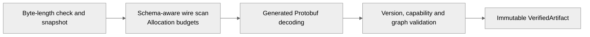
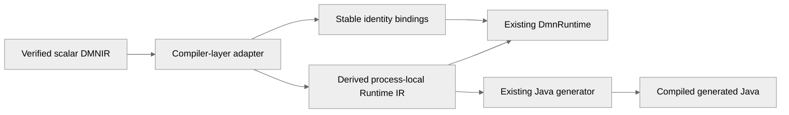

# Experimental portable DMNIR

The `dmn-ir-protobuf` module defines the experimental structured scalar wire contract.
`dmn-ir-codec` adds bounded decoding and validation for five exact experimental profiles:

| Schema | Semantics | Required capabilities, in order |
| --- | --- | --- |
| 0.0 | `finmsg-dmnir-scalar/0` | `dmnir.scalar` |
| 0.1 | `finmsg-dmnir-scalar-expressions/0` | `dmnir.scalar`, `dmnir.scalar-expressions` |
| 0.2 | `finmsg-dmnir-records/0` | `dmnir.scalar`, `dmnir.scalar-expressions`, `dmnir.records` |
| 0.3 | `finmsg-dmnir-local-bindings/0` | `dmnir.scalar`, `dmnir.scalar-expressions`, `dmnir.records`, `dmnir.local-bindings` |
| 0.4 | `finmsg-dmnir-dates/0` | `dmnir.scalar`, `dmnir.scalar-expressions`, `dmnir.records`, `dmnir.local-bindings`, `dmnir.date` |
| 0.5 | `finmsg-dmnir-tables/0` | `dmnir.scalar`, `dmnir.scalar-expressions`, `dmnir.records`, `dmnir.local-bindings`, `dmnir.date`, `dmnir.tables` |
| 0.6 | `finmsg-dmnir-field-constraints/0` | `dmnir.scalar`, `dmnir.scalar-expressions`, `dmnir.records`, `dmnir.local-bindings`, `dmnir.date`, `dmnir.tables`, `dmnir.field-constraints` |
| 0.7 | `finmsg-dmnir-scalar-collections/0` | `dmnir.scalar`, `dmnir.scalar-expressions`, `dmnir.records`, `dmnir.local-bindings`, `dmnir.date`, `dmnir.tables`, `dmnir.field-constraints`, `dmnir.scalar-collections` |

This implements the first scalar slice of [ADR-0026](architecture/adr/adr-0026-structured-portable-dmnir.md).
The reader validates without executing. `DmnIrRuntimeAdapter` in `dmn-compiler` now derives and
executes scalar process-local Runtime IR from a verified artifact. `DmnIrScalarProducer` produces
this profile from supported DMN source models. `DmnIrScalarDmnExporter` synthesizes DMN 1.6 for
the explicitly admitted profiles. DSL authoring, Rust generation, broader DMN export,
canonical hashing and stable wire compatibility
remain later delivery work.

## Produce an artifact from DMN

```java
import io.finmsg.dmn.compiler.dmnir.DmnIrScalarProducer;

var verified = new DmnIrScalarProducer().produce(source, resolver);
byte[] artifactBytes = verified.artifact().toByteArray();
// A later process can read these bytes without the original sources or resolver.
```

The compiler-layer producer reuses the existing model loader, FEEL parsing, semantic analysis
and unoptimized lowering. It supports scalar literals, global references and admitted structured
operations, including bundled
imports. It retains model/element/variable IDs and names, import aliases and location hints,
and converts resolved execution addresses to portable identities. Models, declarations and
dependencies are sorted; the topological schedule has stable identity-based tie-breaking.
Equivalent declaration reordering produces identical bytes. This does not define a general
canonical hashing contract.

`DmnIrProductionException` distinguishes `SOURCE_INVALID` (with compiler diagnostics),
`UNSUPPORTED_PROFILE` (with an optional element identity), and `ARTIFACT_INVALID` (with the
reader exception as cause). No partial output is returned. The producer rejects unsupported
types/declarations (including scalar aliases, collections and constraints), tables, BKMs and decision
services. Supported named records select profile 0.2. Unsupported source expressions
are rejected before lowering: normalization cannot silently widen the profile. Emitted artifacts must
pass the existing reader and its default resource limits. Source parsing uses existing compiler
limits; this producer does not promise bounded allocation before source compilation.

XML vocabulary, source formatting, documentation, labels, diagrams and source locations are not
retained by this experimental profile. It is a semantic scalar subset, not a lossless XML archive.
Original XML and FEEL source text are not embedded in the artifact.

## Structured scalar expressions (schema 0.1)

Schema 0.1 adds recursive unary, binary and conditional nodes, using explicit portable operator
numbers. Arithmetic admits numeric operands; ordered comparisons admit numeric pairs or string
pairs; equality admits scalar pairs. Logical operators accept boolean/null operands. Conditional
branches must match the declared result type or be null. String concatenation, temporal arithmetic,
collections and dynamic types remain outside this profile. Runtime null values of a declared
numeric/boolean/string input remain supported.

The producer emits 0.0 for literal/reference-only graphs and 0.1 for admitted structured graphs.
Header/capability combinations are exact; neither version is inferred from parser success. Old
0.0 readers reject 0.1 artifacts. A 0.0 header cannot authorize new nodes. The reader validates all
children and all nested references, including unselected branches, under the same wire budgets.
Unknown operators, absent children and incompatible signatures fail before execution/codegen.

Source admission precedes lowering so unsupported operations cannot disappear through the
lowerer's type-proven-null normalization. For example, statically typed `null + 1` remains
unsupported, while a nullable numeric input in `Amount + 1` is admitted. The existing parser uses
`not(...)`; its built-in invocation is mapped explicitly to the portable unary NOT operation.
Source unary `+` is not supported by that parser; the wire operation remains supported and exports
as its parenthesized numeric operand, which preserves its identity semantics. Other admitted
operations export as parenthesized FEEL. Execution delegates to existing runtime semantics.

This covers isolated Traffic Violation arithmetic/condition expressions. Complete model support
still needs records/field access, lexical contexts and decision tables.

## Named records and field access (schema 0.2)

Profile 0.2 adds named record definitions, scalar/record type references and resolved field-access
nodes. It admits non-empty acyclic records whose fields use the existing four scalar types or
other bundled named records. Record inputs, global record references, nested fields and
same-record/null conditional results are supported. Record construction, equality, anonymous/open
contexts, collections, temporal fields and constraints remain outside this profile.

Types retain namespace-qualified record IDs; same-shape definitions remain distinct. Fields retain
names, optional source IDs and declaration order. Field access is addressed by its source's named
record type and field name. Consumers derive local field indexes; indexes are not wire identities.
Producer type identity comes from analyzed declarations and bindings before Runtime IR expands
named types structurally. Existing literal/reference and scalar-expression models retain 0.0/0.1.

The verifier rejects cycles, unresolved/import-invisible types, duplicate IDs/names, missing or
simultaneous scalar/record selections, unknown fields and incompatible field/result types. It
validates unused definitions too. The declaration budget includes record definitions and fields.
The message budget also bounds potential expanded record size across definitions and record-typed
variable/expression uses; record nesting is bounded by the configured depth. This prevents a small
shared type DAG from causing unbounded downstream expansion. Runtime layouts are memoized locally.

Record input coercion delegates to the existing runtime. All declared fields must be present;
explicit null field values are accepted. Missing fields or rejected coercions make the record value
null; extra entries are accepted and retained. Host maps are not deep-copied. These are native
runtime observations for the tested profile, not an independent input-conversion implementation.

The exporter synthesizes named `itemDefinition`/`itemComponent` declarations, optional field IDs,
namespace-correct type QNames and field-access FEEL. XML type prefixes are generated independently
of FEEL import aliases. Exported fixtures pass official DMN 1.6 XSD validation and runtime parity
after recompilation. Generated Java and separate-JVM artifact execution are also tested.

An existing `DmnCompiledModel` facade conversion uses `Map.copyOf` for context values and throws
when a context field is null. Record null-field parity is therefore checked through the existing
Runtime IR interpreter and generated Java, bypassing that Protobuf/native conversion. The portable
adapter preserves these values; the facade issue is not fixed by this slice.

This supports unconstrained records such as `tDriver` and `tFine`. Complete Traffic Violation
still needs date/constraint retention, decision tables and local context bindings.

## Boxed contexts and local bindings (schema 0.3)

The 0.3 profile adds sequential boxed contexts with named intermediate bindings and a required
final unnamed result. Local references resolve by decision-local binding identity. Consumers
derive frame depth and slots; these execution addresses are not serialized. Existing scalar and
record profiles remain unchanged for models without boxed contexts.

Each value sees ancestors and earlier bindings; self/forward references and scope escapes fail
validation. Binding IDs are unique within a decision; variable names are unique within a context.
Optional source variable IDs retain model-wide uniqueness. Nested contexts can shadow names with
distinct IDs. Scalar/record types, declaration/reference budgets and expansion limits also apply
to local nodes. Global references inside any value or result remain decision dependencies.

The producer uses analyzed boxed expressions and resolved lexical declaration paths. The adapter
derives existing context/local-reference Runtime IR; the exporter reconstructs boxed XML contexts
with retained variable names/IDs. Export rejects names that would capture another identity and
boxed contexts embedded in FEEL-only operand positions. Anonymous context values, closures,
loops, tables, dates and constraints are not added by this profile. Full Traffic Violation and
the DSL/Rust proof remain separate work.

## Civil dates (schema 0.4)

The date profile stores a timezone-free Gregorian year, month and day. Each component requires
explicit presence. The year range is −999,999,999 through 999,999,999 with year zero excluded.
The codec rejects impossible calendar days and requires 0.4 for date literals or DATE types,
including unused record declarations. Date/date ordering and existing scalar equality are
supported. Native input conversion delegates to the existing runtime.

The producer accepts valid FEEL date literals and `date` calls with one constant date string.
Consumers can use dates across imported decisions, nested record fields and local bindings.
DMN 1.6 export emits `typeRef="date"` and date constructors. For positive extended years it uses
the FEEL spelling without a leading plus, while the Java execution constant uses its ISO spelling.
The lexical boundary follows the [DMN 1.6 specification](https://www.omg.org/spec/DMN/1.6/PDF)
and its referenced [XML Schema datatypes](https://www.w3.org/TR/xmlschema-2/#date).
Dynamic date constructors, date arithmetic, time, date-time and durations remain outside 0.4.

## Decision tables (schema 0.5)

A decision carries one body, either an expression or a decision table. The table stores ordered
input columns, output columns and rules. The runtime derives rule indexes from that order.
`UNIQUE` requires at most one matching rule, `FIRST` selects the earliest match, and `ANY`
requires all matching rules to produce equal results. With no matches, each output uses its
default expression or null. One output produces a scalar. Multiple named outputs produce a
named record whose fields match the columns in declaration order, including null fields.

Each input entry is a wildcard or a disjunction of typed comparisons and bounded ranges. A
group can negate its match result. A bare scalar test becomes equality. Ordered tests use
matching number, string or date types. Range boundaries independently include or exclude
their endpoints. Cells can read resolved dependencies, including record fields. The bounded
reader validates these references, column types, rule widths, IDs and allocation budgets.

Artifact-only DMN 1.6 export renders the cells as FEEL and retains table, column and rule IDs
when available, as well as input labels. Clause value domains, rule annotations, item constraints,
other hit policies, aggregation, candidate-bound predicates and boxed cells remain outside the table profile.

## Scalar field constraints (schema 0.6)

A named record field can declare a domain for boolean, number, string or civil-date values.
The artifact stores the domain on the field as structured unary tests with constant endpoints.
Explicit null uses the existing unary-test matching rules. Constraints on collections, whole
records and top-level scalar aliases remain outside the profile.

Portable runtime and generated Java check domains on structurally accepted record inputs and
decision results. They visit nested fields in declaration order and report the first violation
as `DmnEvaluationException` with an escaped field path such as `/Permit/Expiry`. The rejected
value is omitted from the diagnostic. A null record has no fields to check. The regular DMN
compiler and Spark keep their existing execution behavior for source models.

DMN 1.6 export emits the same domain as `typeConstraint`. Source models may declare it using
`allowedValues` or `typeConstraint`. A decision whose name is never rendered in FEEL can retain
an XML-safe display name such as `Should the driver be suspended?`.

## Named scalar collections (schema 0.7)

A named collection declaration retains its model namespace, item-definition ID and scalar element
type. Inputs, decision results, record fields and boxed locals can reference that declaration.
The bounded reader checks direct imports and exact collection identities. A constructor carries
the named collection type even when the list is empty.

Portable runtime and generated Java preserve ordering, duplicates and null members. A null
collection differs from an empty list. A valid scalar supplied to a collection input uses the
existing singleton promotion at the input boundary. The producer uses the expected named type
for a FEEL list constructor in a decision result, local binding or conditional branch.

Artifact-only DMN 1.6 export emits the collection item definition with `isCollection="true"`,
a child `typeRef` and the original identity. It renders ordered elements as FEEL list syntax.
Nested collections, lists of records, constrained collections, filters, indexing, collection-valued
table cells and list functions remain outside this profile.

## Read an artifact

```java
import io.finmsg.dmn.dmnir.codec.DmnIrArtifactReader;
import io.finmsg.dmn.dmnir.codec.DmnIrValidationException;

try {
    var verified = new DmnIrArtifactReader().read(artifactBytes);
    var artifact = verified.artifact();
    // Immutable generated Protobuf message; no evaluation occurs here.
} catch (DmnIrValidationException failure) {
    // Stable code and indexed artifact path, without untrusted payload values.
    System.err.println(failure.code() + " at " + failure.path());
}
```

The reader snapshots the caller's byte array after checking its length. It first scans known
wire fields without allocating generated messages or materializing strings. It then decodes the
same snapshot and validates the graph. Only successful validation creates a `VerifiedArtifact`;
its constructor is private and the retained message is immutable. Reader instances have immutable
configuration and fresh per-read state.

The byte-array API bounds allocations inside the reader. Callers loading files or network data
must also bound that ingestion before building the byte array. The reader never fetches imports;
location hints remain inert metadata. Required imported models must be present in the artifact.



## Default limits

Pass a `DmnIrLimits` record to the reader constructor to select a different resource policy.
All budgets must be positive, except absolute scale may be zero. Maximum depth is capped at 64.

| Limit | Default | Enforcement |
| --- | --- | --- |
| Artifact bytes | 4 MiB | Before snapshot allocation |
| Message depth | 32 | Before generated decoding |
| Message occurrences | 50,000 | Before generated decoding |
| Field occurrences | 200,000 | Before generated decoding |
| UTF-8 bytes per string | 16,384 | Before string materialization |
| Models | 128 | Before generated decoding |
| Declarations, including record definitions/fields and local bindings | 10,000 | Before generated decoding |
| Reference occurrences | 50,000 | Before generated decoding and during graph validation |
| Decimal coefficient digits | 4,096 | Before numeric conversion; no numeric expansion occurs in the reader |
| Absolute decimal scale | 4,096 | Before numeric conversion, including overflow-safe rejection of minimum signed scale |

Reference occurrences include declared dependencies, expression references and schedule entries.
The message/field budgets also bound metadata such as repeated imports and capability labels.
The coefficient grammar is `0|-?[1-9][0-9]*`, using ASCII digits, with explicit signed scale.
The reader preserves scale and trailing coefficient zeros, including negative scale.

## Accepted scalar graph

- Non-empty model and declaration IDs/names, unique namespace per model, and unique IDs within
  each model, including variable IDs when present. Declaration names and variable names each
  have their own uniqueness check.
- Bundled imports with non-empty unique aliases. Cross-model dependencies/references require
  a direct import. Imported location hints do not affect resolution.
- Explicit null, boolean, number and string types, with DATE added in 0.4. The profiles build on
  typed unary/binary/conditional expressions, named records/fields and scoped local bindings.
  All scalar types permit null. Other literal values must match their declared scalar type.
- Expression references must appear among the decision's declared dependencies. Unused declared
  requirements are retained. Duplicate and self dependencies are rejected.
- Each decision appears exactly once in the schedule. Decision dependencies precede their
  consumers, detecting cycles without recursive graph traversal. Inputs are outside the schedule.

These checks establish validity for the experimental portable profiles. Collections beyond named scalar lists,
functions, broader constraints and temporal values beyond civil dates remain outside this schema.

## Strict compatibility and diagnostics

The reader rejects unknown fields, duplicate singular/oneof selections, wrong wire types,
out-of-range scalar encodings, malformed UTF-8, incompatible wire/semantic versions, unknown
required capabilities, and unsupported expression/type alternatives. Generic Protobuf decoding
may accept some of those inputs; this experimental profile intentionally has a stricter policy.
No canonical-byte or semantic-content-digest guarantee follows from that policy.

Validation is fail-fast and deterministic for the same bytes and limits. Diagnostics identify an
indexed path such as `artifact.models[0].decisions[1].dependencies[0]`. Codes distinguish limits,
malformed Protobuf, unknown fields, compatibility, identities/imports, types, literals/references,
dependencies and schedule errors. They do not include model payload values.

Changing a supported schema/profile requires explicit version/capability policy changes and
compatibility evidence. This reader must not silently start accepting future operations.

## Adapt and execute the scalar artifact

```java
import io.finmsg.dmn.compiler.dmnir.DmnIrRuntimeAdapter;
import io.finmsg.dmn.compiler.dmnir.DmnIrRuntimeAdapter.ElementId;
import io.finmsg.dmn.dmnir.codec.DmnIrArtifactReader;
import java.math.BigDecimal;
import java.util.Map;

var verified = new DmnIrArtifactReader().read(artifactBytes);
var adapted = new DmnIrRuntimeAdapter().adapt(verified);
var values = adapted.evaluate(Map.of(
    new ElementId("urn:example:root", "amount"), new BigDecimal("123.4500")));
var result = values.get(new ElementId("urn:example:root", "result"));
```

The sample IDs must match the artifact's declarations. The adapter accepts a `VerifiedArtifact`,
not an unchecked generated message. It independently pins the exact supported 0.0 through 0.7 profiles. It derives
local slots deterministically by namespace and element ID, preserves the verified schedule, and
lowers the supported expression graph into the existing Runtime IR records. No XML or FEEL parsing occurs
on this path. The original verified artifact remains available through `source()`; the derived
Runtime IR is not another stored authoritative policy.

`inputs()` and `decisions()` provide immutable binding maps. Each binding preserves the source
element name, optional variable ID, variable name, type and local slot. Callers use the
namespace-qualified **element ID**, not the variable ID, display name or compiler-assigned slot.
`runtimeModel()` exposes the derived graph for existing runtime/code-generation integration.
Slots are local implementation details and must not become external persisted identities.

`evaluate` requires every bundled input exactly by its declared identity. Unknown and missing
identities fail before evaluation. Explicit null values are distinct from omitted inputs; use
a null-permitting map when supplying null. A null-typed input accepts only null. Other input
coercions follow the existing `DmnRuntime` native-value policy, including incompatible values
coercing to null and supported singleton-list coercion. Use `BigDecimal` for exact decimal inputs.
These binding errors are new adapter API errors, not changes to the existing compiler facade.

Evaluation returns an unmodifiable, deterministically ordered map containing all bundled decision
results, including explicit null entries. Each call allocates fresh evaluation state; native
host objects are not deep-copied. Decimal constants retain coefficient/scale exactly using a
bounded scientific representation rather than expanding exponents. Raw string contents are
preserved without reparsing or unescaping.



Tests execute artifact-only scalar graphs and compare them with equivalent DMN 1.6 compilation
through the existing pipeline, in lowered and optimized modes. Additional evidence covers import
identity isolation, declaration reordering, nullable/default values, exact scale, raw strings and
concurrent calls. A generated-Java test consumes adapted Runtime IR, compiles the generated source
and compares its results with the interpreter. This is scalar-profile evidence, not complete DMN
conformance. Producer tests additionally cover actual DMN-to-artifact compilation, reloading
in a separate JVM with only artifact bytes, import identity isolation and generated-Java execution.

## Export a scalar artifact to DMN 1.6

```java
import io.finmsg.dmn.compiler.dmnir.DmnIrScalarDmnExporter;

var bundle = new DmnIrScalarDmnExporter().export(verified);
String rootXml = bundle.documents().get(bundle.rootDocument());
// documents() is an immutable map of relative filenames to XML strings.
// Encode strings as UTF-8 when saving them. The exporter performs no external writes.
```

The default is **DMN 1.6**. The overload accepting `DmnVersion` currently supports only
`DMN_1_6`; every other enum value fails with `DmnIrExportException.Category.UNSUPPORTED_VERSION`.
This does not change `DmnWriter`'s existing 1.5 fallback default for other callers.

The exporter consumes only the verified artifact and derives source declarations and FEEL
literal/reference/operation text from the portable graph. It reuses the existing XML writer with an explicit
1.6 namespace. No original XML or FEEL source is required. Models are sorted by business namespace
and assigned deterministic filenames such as `model-0000.dmn`; imports point to these files.
Retained import locations are hints and are not fetched or copied into output locations.

Export is deliberately narrower than reader acceptance:

- Model namespaces must be absolute URIs without fragments.
- IDs use the conservative ASCII subset `[A-Za-z_][A-Za-z0-9_.-]*` and remain unchanged.
- Variable names and import aliases use ASCII identifiers optionally separated by single spaces;
  FEEL keyword words are rejected. Variable names must equal their element names.
- Ambiguous declaration/import names and colliding required names are rejected. An imported
  expression reference must have exactly one alias for its namespace.
- Strings must contain XML 1.0 characters. Quotes, backslashes, newlines, carriage returns and
  tabs are escaped as FEEL string content before XML serialization.
- Retained attribute names must not contain tabs, carriage returns or newlines that XML
  attribute normalization would change.

Unrepresentable artifacts fail with `UNREPRESENTABLE_ARTIFACT` and an optional stable element
identity; no partial bundle is returned. The reader already rejects duplicate IDs within a model.
Names outside this initial admission policy can remain valid executable artifacts but are not
yet exportable. Normalized FEEL decimal spelling preserves numeric value; XML lexical fidelity
and incidental scale after reparsing are not guaranteed.

Tests validate exported documents against local copies of the [official DMN 1.6 schema set](https://www.omg.org/spec/DMN/1.6/)
using the JDK XSD validator, then recompile through lowered/optimized compiler modes and compare
scalar execution results. Imported bundles, explicit nulls, exact decimals and escaped Unicode
strings are covered. Generated-Java tests also execute code recompiled from exported DMN.
This is structural and behavioral evidence for tested scalar exports; an independent DMN engine
has not yet been used, and this is not a complete DMN conformance claim.

## Build and test

```powershell
mvn -Pformat -pl dmn-ir-codec -am verify
```

The codec's production dependencies are the dedicated schema bindings and `protobuf-java`.
It has no dependency on DMN XML, FEEL parsing, semantic analysis, compiler orchestration or the
execution runtime. Tests use JUnit and actual serialized artifacts, including deterministic
malformed-input vectors and resource boundaries.

Adapter tests are in `dmn-compiler`; generated-source parity is in `dmn-generator-java`:

```powershell
mvn -Pformat -pl dmn-generator-java -am verify
```

The compiler layer depends on the codec and schema contracts. `dmn-runtime` and `dmn-runtime-ir`
gain no dependency on portable Protobuf bindings or the codec. Java generator production
dependencies are unchanged; its existing test dependency on the compiler supplies the adapter.
