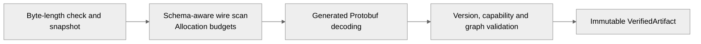
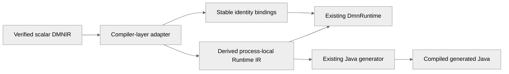

# Experimental portable scalar DMNIR

The `dmn-ir-protobuf` module defines the experimental structured scalar wire contract.
`dmn-ir-codec` adds bounded decoding and validation for **schema 0.0**, semantic profile
`finmsg-dmnir-scalar/0`, and required capability `dmnir.scalar`.

This implements the first scalar slice of [ADR-0026](architecture/adr/adr-0026-structured-portable-dmnir.md).
The reader validates without executing. `DmnIrRuntimeAdapter` in `dmn-compiler` now derives and
executes scalar process-local Runtime IR from a verified artifact. `DmnIrScalarProducer` produces
this profile from supported DMN source models. `DmnIrScalarDmnExporter` synthesizes DMN 1.6 for
an explicitly admitted scalar subset. DSL authoring, Rust generation, broader DMN export,
canonical hashing and stable wire compatibility
remain later delivery work.

## Produce an artifact from DMN

```java
import io.finmsg.dmn.compiler.dmnir.DmnIrScalarProducer;

var verified = new DmnIrScalarProducer().produce(source, resolver);
byte[] artifactBytes = verified.artifact().toByteArray();
// A later process can read these bytes without the original sources or resolver.
```

The compiler-layer producer reuses the existing model loader, FEEL parsing, semantic analysis
and unoptimized lowering. It supports scalar literals and global references, including bundled
imports. It retains model/element/variable IDs and names, import aliases and location hints,
and converts resolved execution addresses to portable identities. Models, declarations and
dependencies are sorted; the topological schedule has stable identity-based tie-breaking.
Equivalent declaration reordering produces identical bytes. This does not define a general
canonical hashing contract.

`DmnIrProductionException` distinguishes `SOURCE_INVALID` (with compiler diagnostics),
`UNSUPPORTED_PROFILE` (with an optional element identity), and `ARTIFACT_INVALID` (with the
reader exception as cause). No partial output is returned. The producer rejects unsupported
types, named type declarations, tables, BKMs and decision services. Arithmetic is rejected even
when constant-foldable: optimization cannot silently widen the profile. Emitted artifacts must
pass the existing reader and its default resource limits. Source parsing uses existing compiler
limits; this producer does not promise bounded allocation before source compilation.

XML vocabulary, source formatting, documentation, labels, diagrams and source locations are not
retained by this experimental profile. It is a semantic scalar subset, not a lossless XML archive.
Original XML and FEEL source text are not embedded in the artifact.

## Read an artifact

```java
import io.finmsg.dmn.dmnir.codec.DmnIrArtifactReader;
import io.finmsg.dmn.dmnir.codec.DmnIrValidationException;

try {
    var verified = new DmnIrArtifactReader().read(artifactBytes);
    var artifact = verified.artifact();
    // Immutable generated Protobuf message; no evaluation occurs here.
} catch (DmnIrValidationException failure) {
    // Stable code and indexed artifact path, without untrusted payload values.
    System.err.println(failure.code() + " at " + failure.path());
}
```

The reader snapshots the caller's byte array after checking its length. It first scans known
wire fields without allocating generated messages or materializing strings. It then decodes the
same snapshot and validates the graph. Only successful validation creates a `VerifiedArtifact`;
its constructor is private and the retained message is immutable. Reader instances have immutable
configuration and fresh per-read state.

The byte-array API bounds allocations inside the reader. Callers loading files or network data
must also bound that ingestion before building the byte array. The reader never fetches imports;
location hints remain inert metadata. Required imported models must be present in the artifact.



## Default limits

Pass a `DmnIrLimits` record to the reader constructor to select a different resource policy.
All budgets must be positive, except absolute scale may be zero. Maximum depth is capped at 64.

| Limit | Default | Enforcement |
| --- | --- | --- |
| Artifact bytes | 4 MiB | Before snapshot allocation |
| Message depth | 32 | Before generated decoding |
| Message occurrences | 50,000 | Before generated decoding |
| Field occurrences | 200,000 | Before generated decoding |
| UTF-8 bytes per string | 16,384 | Before string materialization |
| Models | 128 | Before generated decoding |
| Input and decision declarations combined | 10,000 | Before generated decoding |
| Reference occurrences | 50,000 | Before generated decoding and during graph validation |
| Decimal coefficient digits | 4,096 | Before numeric conversion; no numeric expansion occurs in the reader |
| Absolute decimal scale | 4,096 | Before numeric conversion, including overflow-safe rejection of minimum signed scale |

Reference occurrences include declared dependencies, expression references and schedule entries.
The message/field budgets also bound metadata such as repeated imports and capability labels.
The coefficient grammar is `0|-?[1-9][0-9]*`, using ASCII digits, with explicit signed scale.
The reader preserves scale and trailing coefficient zeros, including negative scale.

## Accepted scalar graph

- Non-empty model and declaration IDs/names, unique namespace per model, and unique IDs within
  each model, including variable IDs when present. Declaration names and variable names each
  have their own uniqueness check.
- Bundled imports with non-empty unique aliases. Cross-model dependencies/references require
  a direct import. Imported location hints do not affect resolution.
- Explicit null, boolean, number and string types; literal or resolved global-reference expressions.
  All scalar types permit null. Other values must have matching scalar types; no implicit
  number/string coercion is introduced.
- Expression references must appear among the decision's declared dependencies. Unused declared
  requirements are retained. Duplicate and self dependencies are rejected.
- Each decision appears exactly once in the schedule. Decision dependencies precede their
  consumers, detecting cycles without recursive graph traversal. Inputs are outside the schedule.

These checks establish validity for this experimental scalar profile, not full DMN/FEEL or XML
schema conformance. Temporal values, collections, tables, functions and lexical frames are not
represented by this slice's wire schema.

## Strict compatibility and diagnostics

The reader rejects unknown fields, duplicate singular/oneof selections, wrong wire types,
out-of-range scalar encodings, malformed UTF-8, incompatible wire/semantic versions, unknown
required capabilities, and unsupported expression/type alternatives. Generic Protobuf decoding
may accept some of those inputs; this experimental profile intentionally has a stricter policy.
No canonical-byte or semantic-content-digest guarantee follows from that policy.

Validation is fail-fast and deterministic for the same bytes and limits. Diagnostics identify an
indexed path such as `artifact.models[0].decisions[1].dependencies[0]`. Codes distinguish limits,
malformed Protobuf, unknown fields, compatibility, identities/imports, types, literals/references,
dependencies and schedule errors. They do not include model payload values.

Changing a supported schema/profile requires explicit version/capability policy changes and
compatibility evidence. This reader must not silently start accepting future operations.

## Adapt and execute the scalar artifact

```java
import io.finmsg.dmn.compiler.dmnir.DmnIrRuntimeAdapter;
import io.finmsg.dmn.compiler.dmnir.DmnIrRuntimeAdapter.ElementId;
import io.finmsg.dmn.dmnir.codec.DmnIrArtifactReader;
import java.math.BigDecimal;
import java.util.Map;

var verified = new DmnIrArtifactReader().read(artifactBytes);
var adapted = new DmnIrRuntimeAdapter().adapt(verified);
var values = adapted.evaluate(Map.of(
    new ElementId("urn:example:root", "amount"), new BigDecimal("123.4500")));
var result = values.get(new ElementId("urn:example:root", "result"));
```

The sample IDs must match the artifact's declarations. The adapter accepts a `VerifiedArtifact`,
not an unchecked generated message. It independently pins the scalar 0.0 profile. It derives
local slots deterministically by namespace and element ID, preserves the verified schedule, and
lowers literals/references into the existing Runtime IR records. No XML or FEEL parsing occurs
on this path. The original verified artifact remains available through `source()`; the derived
Runtime IR is not another stored authoritative policy.

`inputs()` and `decisions()` provide immutable binding maps. Each binding preserves the source
element name, optional variable ID, variable name, type and local slot. Callers use the
namespace-qualified **element ID**, not the variable ID, display name or compiler-assigned slot.
`runtimeModel()` exposes the derived graph for existing runtime/code-generation integration.
Slots are local implementation details and must not become external persisted identities.

`evaluate` requires every bundled input exactly by its declared identity. Unknown and missing
identities fail before evaluation. Explicit null values are distinct from omitted inputs; use
a null-permitting map when supplying null. A null-typed input accepts only null. Other input
coercions follow the existing `DmnRuntime` native-value policy, including incompatible values
coercing to null and supported singleton-list coercion. Use `BigDecimal` for exact decimal inputs.
These binding errors are new adapter API errors, not changes to the existing compiler facade.

Evaluation returns an unmodifiable, deterministically ordered map containing all bundled decision
results, including explicit null entries. Each call allocates fresh evaluation state; native
host objects are not deep-copied. Decimal constants retain coefficient/scale exactly using a
bounded scientific representation rather than expanding exponents. Raw string contents are
preserved without reparsing or unescaping.



Tests execute artifact-only scalar graphs and compare them with equivalent DMN 1.6 compilation
through the existing pipeline, in lowered and optimized modes. Additional evidence covers import
identity isolation, declaration reordering, nullable/default values, exact scale, raw strings and
concurrent calls. A generated-Java test consumes adapted Runtime IR, compiles the generated source
and compares its results with the interpreter. This is scalar-profile evidence, not complete DMN
conformance. Producer tests additionally cover actual DMN-to-artifact compilation, reloading
in a separate JVM with only artifact bytes, import identity isolation and generated-Java execution.

## Export a scalar artifact to DMN 1.6

```java
import io.finmsg.dmn.compiler.dmnir.DmnIrScalarDmnExporter;

var bundle = new DmnIrScalarDmnExporter().export(verified);
String rootXml = bundle.documents().get(bundle.rootDocument());
// documents() is an immutable map of relative filenames to XML strings.
// Encode strings as UTF-8 when saving them. The exporter performs no external writes.
```

The default is **DMN 1.6**. The overload accepting `DmnVersion` currently supports only
`DMN_1_6`; every other enum value fails with `DmnIrExportException.Category.UNSUPPORTED_VERSION`.
This does not change `DmnWriter`'s existing 1.5 fallback default for other callers.

The exporter consumes only the verified artifact and derives source declarations and FEEL
literal/reference text from the portable graph. It reuses the existing XML writer with an explicit
1.6 namespace. No original XML or FEEL source is required. Models are sorted by business namespace
and assigned deterministic filenames such as `model-0000.dmn`; imports point to these files.
Retained import locations are hints and are not fetched or copied into output locations.

Export is deliberately narrower than reader acceptance:

- Model namespaces must be absolute URIs without fragments.
- IDs use the conservative ASCII subset `[A-Za-z_][A-Za-z0-9_.-]*` and remain unchanged.
- Variable names and import aliases use ASCII identifiers optionally separated by single spaces;
  FEEL keyword words are rejected. Variable names must equal their element names.
- Ambiguous declaration/import names and colliding required names are rejected. An imported
  expression reference must have exactly one alias for its namespace.
- Strings must contain XML 1.0 characters. Quotes, backslashes, newlines, carriage returns and
  tabs are escaped as FEEL string content before XML serialization.
- Retained attribute names must not contain tabs, carriage returns or newlines that XML
  attribute normalization would change.

Unrepresentable artifacts fail with `UNREPRESENTABLE_ARTIFACT` and an optional stable element
identity; no partial bundle is returned. The reader already rejects duplicate IDs within a model.
Names outside this initial admission policy can remain valid executable artifacts but are not
yet exportable. Normalized FEEL decimal spelling preserves numeric value; XML lexical fidelity
and incidental scale after reparsing are not guaranteed.

Tests validate exported documents against local copies of the [official DMN 1.6 schema set](https://www.omg.org/spec/DMN/1.6/)
using the JDK XSD validator, then recompile through lowered/optimized compiler modes and compare
scalar execution results. Imported bundles, explicit nulls, exact decimals and escaped Unicode
strings are covered. Generated-Java tests also execute code recompiled from exported DMN.
This is structural and behavioral evidence for tested scalar exports; an independent DMN engine
has not yet been used, and this is not a complete DMN conformance claim.

## Build and test

```powershell
mvn -Pformat -pl dmn-ir-codec -am verify
```

The codec's production dependencies are the dedicated schema bindings and `protobuf-java`.
It has no dependency on DMN XML, FEEL parsing, semantic analysis, compiler orchestration or the
execution runtime. Tests use JUnit and actual serialized artifacts, including deterministic
malformed-input vectors and resource boundaries.

Adapter tests are in `dmn-compiler`; generated-source parity is in `dmn-generator-java`:

```powershell
mvn -Pformat -pl dmn-generator-java -am verify
```

The compiler layer depends on the codec and schema contracts. `dmn-runtime` and `dmn-runtime-ir`
gain no dependency on portable Protobuf bindings or the codec. Java generator production
dependencies are unchanged; its existing test dependency on the compiler supplies the adapter.
