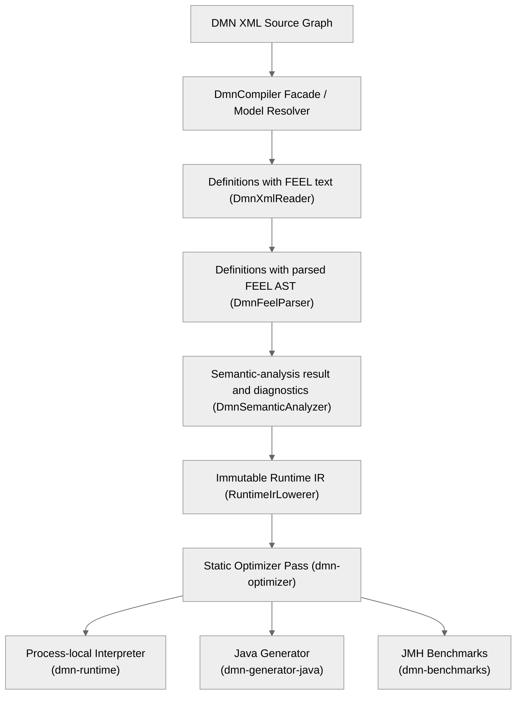

# DMN Compiler Toolkit

<!-- generated-toc:start -->
## Table of contents

- [Current implementation](#contents-section-1)
- [Design goals](#contents-section-2)
<!-- generated-toc:end -->

The DMN Compiler Toolkit is a performance-oriented compiler infrastructure for Decision Model and Notation (DMN).

It parses DMN XML once, creates an immutable protobuf semantic model, parses FEEL into protobuf AST nodes, performs semantic analysis, and lowers the validated model into an execution-oriented Runtime IR.

Start with the [architecture overview](architecture.md), explore our [toolkit assets and evidence](architecture/toolkit-assets-and-differentiators.md), consult the normative
[architecture specification](architecture/architecture-spec.md) for the intended system, the
[ADR index](architecture/adr/generall-adr.md) for design rationale, and the
[glossary](glossary.md) for shared terminology.

## Current implementation

The repository contains an active multi-module Maven reactor. The canonical inventory and
module-specific limitations are maintained on the [modules page](modules.md); the
[capability maturity page](capabilities.md) distinguishes established, incubating, and planned
functionality. This page intentionally does not duplicate that inventory.

The implemented pipeline is:

Cross-model compilation, Runtime IR lowering, optimization, process-local interpretation, Java
generation, gRPC adapters, Spark SQL generation, multi-file model ingestion, the data-quality
corpus, TCK execution, and JMH benchmarks are implemented. Implementation does not by itself imply
public-production maturity or identical backend coverage; consult the
[capability maturity page](capabilities.md), [TCK conformance record](tck-conformance.md), and
[roadmap](roadmap.md) for the verified boundaries and current work.

The optimized Spark SQL backend now executes **3,391/3,391 pinned official TCK
cases natively (100%)**, with zero fallback, failed cases, compilation blocks or
errors (2026-10-26). See the [conformance record](tck-conformance.md) for the
configuration and retained per-case evidence.

The generic gRPC Evaluate API also achieved **3,391/3,391 official TCK passes
(100%)** on 2026-10-27. Every case crossed **real HTTP/2 and binary protobuf**,
executed generated Java, and returned its expected result: **3,391 completed RPC
responses, zero failures, errors or compilation blocks**. All eleven direct
invocations executed. This verifies the complete generic API path; typed services
are separate. See the [gRPC evidence](tck-conformance.md#generic-grpc-checkpoint-2026-10-27)
for the pinned suite, configuration and retained case-level results. Backend
checkpoints were measured separately.

Model-specific typed gRPC services now also pass **all 3,391 official cases
(100%)**, using **3,494 completed typed RPCs**. Every former failure, execution
error, unsupported invocation and compilation block is resolved. The directly
replaced typed contract preserves exact decimals, explicit nulls and nested
collections; typed clients must be regenerated. See the
[typed checkpoint](tck-conformance.md#typed-grpc-checkpoint-2026-10-29) for separate
case/call counts, provenance and retained evidence.

## Design goals

- Faithful DMN 1.5 model support
- Semantic model independent from XML implementation details
- Immutable protobuf messages between compiler stages
- Explicit depth-first passes using generated protobuf getters
- Structured, model-aware diagnostics
- Efficient Java code generation
- Extensible backend architecture
- Predictable runtime performance
