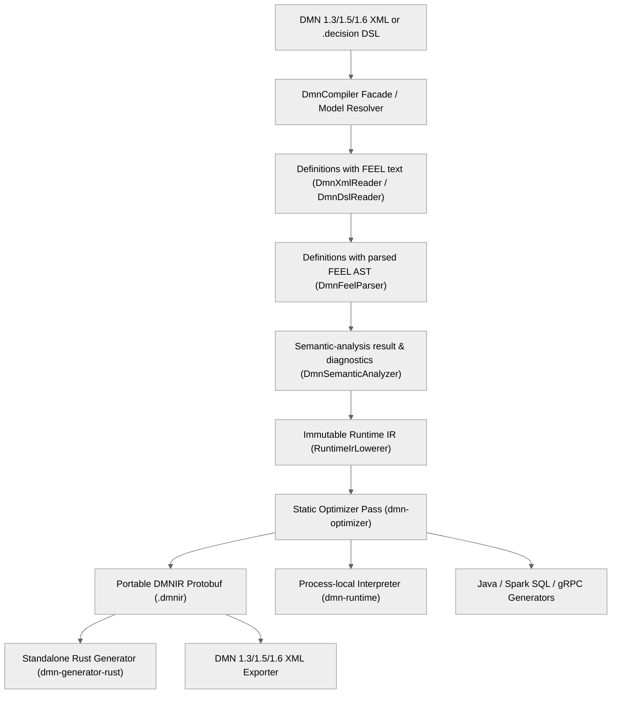

# DMN Compiler Toolkit

<!-- generated-toc:start -->
## Table of contents

- [Current implementation](#contents-section-1)
- [Design goals](#contents-section-2)
<!-- generated-toc:end -->

The DMN Compiler Toolkit is a performance-oriented compiler infrastructure for Decision Model and Notation (DMN).

It parses DMN XML once, creates an immutable protobuf semantic model, parses FEEL into protobuf AST nodes, performs semantic analysis, and lowers the validated model into an execution-oriented Runtime IR.

Start with the [architecture overview](architecture.md), explore our [toolkit assets and evidence](architecture/toolkit-assets-and-differentiators.md), consult the normative
[architecture specification](architecture/architecture-spec.md) for the intended system, the
[ADR index](architecture/adr/generall-adr.md) for design rationale, the
[glossary](glossary.md) for shared terminology, and the
[Business Model Canvas & Strategy](https://github.com/finmsg-io/dmn-compiler-toolkit-business-model-canvas) for enterprise commercialization.

## Current implementation

The repository contains an active multi-module Maven reactor. The canonical inventory and
module-specific limitations are maintained on the [modules page](modules.md); the
[capability maturity page](capabilities.md) distinguishes established, incubating, and planned
functionality. This page intentionally does not duplicate that inventory.

The implemented pipeline is:

Cross-model compilation, Runtime IR lowering, optimization, process-local interpretation, Java
generation, gRPC adapters, Spark SQL generation, multi-file model ingestion, the data-quality
corpus, TCK execution, and JMH benchmarks are implemented. Implementation does not by itself imply
public-production maturity or identical backend coverage; consult the
[capability maturity page](capabilities.md), [TCK conformance record](tck-conformance.md), and
[roadmap](roadmap.md) for the verified boundaries and current work.

All **7 execution backends** achieve **100.00% self-verified conformance (3,407 / 3,407 pinned official TCK cases each; 23,849 / 23,849 total executions, zero failures, errors or compilation blocks)** on official TCK revision `5cd912f281831bc535e710aba435e16de198028a` (2026-11-24):

- **Portable DMNIR Java (`dmnir -> java`)**: **3,407/3,407 (100.00%)** in `75.58 s` via `151` deduplicated `.dmnir` Protobuf artifacts + batch `javac`.
- **Standalone Rust (`dmnir -> rust`)**: **3,407/3,407 (100.00%)** across all `151` deduplicated `.dmnir` Protobuf artifacts with zero JVM dependency at runtime.
- **Java Interpreter (`optimized-interpreter`)** & **Direct Generated Java (`optimized-generated-java`)**: **3,407/3,407 (100.00%)** each.
- **Spark SQL (`optimized-generated-sparksql-hybrid`)**: **3,407/3,407 native (100.00%, 0 fallback)** in `409.2 s`.
- **Generic gRPC (`optimized-generated-grpc`)**: **3,407/3,407 (100.00%)** over real HTTP/2 and binary Protobuf (`3,407` completed RPCs in `84.20 s`).
- **Model-specific Typed gRPC (`optimized-generated-typed-grpc`)**: **3,407/3,407 (100.00%)** across **3,510 completed typed RPCs** with zero unsupported cases or compilation blocks.

See the [TCK conformance record](tck-conformance.md) for full provenance, reproduction commands, and retained historical 3,391-case checkpoints.

## Design goals

- Faithful DMN 1.5 model support
- Semantic model independent from XML implementation details
- Immutable protobuf messages between compiler stages
- Explicit depth-first passes using generated protobuf getters
- Structured, model-aware diagnostics
- Efficient Java code generation
- Extensible backend architecture
- Predictable runtime performance
