# Release 1.2.0 work package — DMNIR and decision authoring

Date: 2026-11-03; updated 2026-11-04. Status: active — bounded scalar and schema 0.1 expression slices complete and verified; broader release work remains.
Delivery owner: unassigned. Protobuf and **Option A** were approved on 2026-11-03.
Accepted representation architecture: [ADR-0026](../../docs/architecture/adr/adr-0026-structured-portable-dmnir.md).
Current branch: `feature/release-1.2-dmnir`. Wire fields and other detailed contracts remain in design.

## 1. Outcome and release scope

Deliver versioned **DMNIR** containing sufficient executable meaning for independent generators
and sufficient DMN-aligned information to regenerate conforming DMN. A concise `.decision` DSL
feeds the existing compiler semantics. DMN export defaults to **1.6**.

Mandatory outcomes:

- DMN XML and linked imports compile into a validated portable `.dmnir` artifact.
- An export-capable artifact alone generates valid DMN 1.6 without original source documents.
- Explicit target-version selection has a published feature matrix and deterministic rejection
  of unsupported versions/features. DMN 1.5 is the first additional candidate, reviewed in R12-00.
- DSL authoring supports types, inputs, literal decisions, decision tables, imports, reusable
  functions/BKMs, documentation and inline tests through shared semantic analysis.
- Formatter, precise diagnostics and CLI/API workflows make authoring practical.
- Java loads artifacts and demonstrates interpreter/generated-Java parity.
- Standalone Rust consumes artifacts and generates compilable executable Rust for a declared
  initial capability profile, without DMN XML, FEEL parsing or JVM compiler services.
- Determinism, bounded validation, compatibility fixtures and clean-consumer documentation.

Proposed initial Rust profile: exact numbers, booleans, strings, nulls, structured inputs,
dependencies, conditionals and a decision table. Unsupported operations must be rejected before
generation. Confirm this boundary in R12-00: full Rust FEEL/DMN conformance is not implied.

Toolkit release 1.2.0, DMN standard version, DSL version, wire version and semantic-runtime
version are independent version axes. No product version is changed by this planning task.

Deferred: Go/C++/Wasm, latency/zero-allocation promises, package registry, OR-Tools, LSP,
VS Code/KIE synchronization, graphical debugging and automatic diagram layout. Valid export
must not depend on automatic layout. Exact original XML/comments/layout recovery is not promised.

## 2. Source evidence and reconciliation

Ideation root: `C:\00-finmsg.io\dmn-compiler-toolkit-ideation`.

| Source | Contribution / required reconciliation |
| --- | --- |
| `doc/IDEA-003-portable-runtime-ir-artifact.md` | Portable executable meaning, capabilities, hostile-input handling and artifact lifecycle |
| `doc/IDEA-004-decision-authoring-dsl.md` | Canonical authoring model, stable identities, source authority and export fidelity |
| `doc/IDEA-010-native-multi-language-code-generation-and-visual-tooling.md` | Rust consumption proof; broader tooling remains deferred |
| `doc/SPEC-001-runtime-ir-protobuf.md` | Candidate execution layout; requires gap analysis against current production IR |
| `proto/dmn_ir_v1.proto` | Candidate schema; do not freeze field/operation IDs without reconciliation |
| `doc/SPEC-002-decision-authoring-dsl.md` | DSL and CLI proposals; replace its 1.5 default with requested 1.6 |
| `examples/credit_risk.decision` | Readability fixture requiring semantic review before positive acceptance use |

Observed toolkit baseline: parent POM is 1.1.0; immutable Runtime IR is process-local;
[ADR-0025](../../docs/architecture/adr/adr-0025-runtime-ir-persistence-and-compatibility-boundary.md)
requires a separate versioned persistence contract. XML reader/writer infrastructure, FEEL,
semantic analysis, Java/Spark generators and a conformance harness already exist. Inspection
is not fresh execution/conformance evidence.

The [roadmap](../../docs/roadmap.md) already includes authoring and reverse export ambitions.
R12-01 must reconcile broad lossless/decompiler wording with information lost by optimization.
XML validity, behavioral equivalence, TCK coverage and original-source fidelity are separate claims.

The credit-risk example combines UNIQUE with a catch-all rule: review overlapping matches and
choose the intended policy before adoption. SPEC-001's illustrative floating-point Rust arithmetic
is not an acceptable exact-number contract. Ideation proposals do not override accepted ADRs.

## 3. Accepted architecture and remaining contract gates

The user selected **Option A** after the alternatives review in section 11. The representation
architecture is accepted in ADR-0026; implementation is incremental and not yet complete.

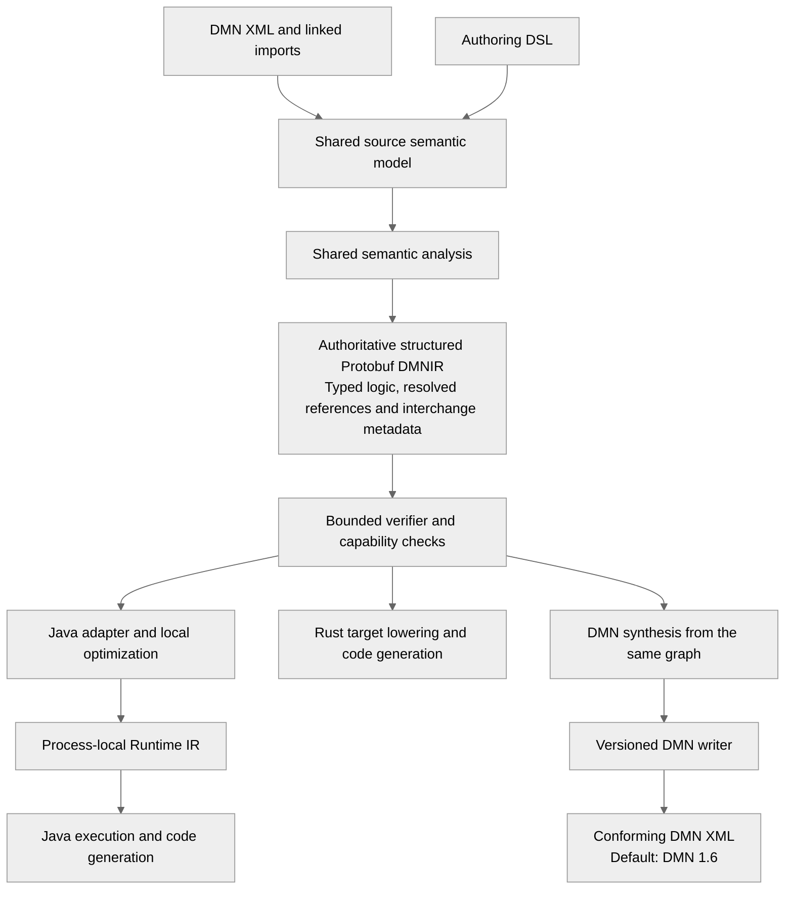

Decision logic is stored once. Portable DMNIR retains the structured operations and declarations
needed for standard DMN synthesis. Generated dense execution slots and aggressive optimizations
belong to derived consumer representations. Do not add mandatory separate export/execution
policies or use original source files as an export dependency. The source semantic model,
portable DMNIR and Java Runtime IR remain separate contracts.

Detailed contracts still required before their respective implementation slices:

1. Stable model/element identities, namespaces, declarations, import bindings, provenance,
   export classifications and mappings from source semantics to the resolved graph.
2. Protobuf ownership, package, field IDs, presence, exact values, bounds and compatibility.
   Do not reuse semantic protobuf messages or serialize Java records.
3. Version/capability policy, operation registry and canonical content identity. Validate one
   authoritative graph and its metadata; there is no pair of stored policies to reconcile.
4. Concrete acyclic module graph for schema/codec, verification/adapters, DSL frontend, export,
   CLI and Rust. Keep serialization dependencies out of the execution runtime.
5. APIs/CLI, diagnostics, import resolution, grammar/stability and measured consumer profiles.

Follow normative [architecture principles](../../docs/architecture/chapters/02-Architecture%20Principles.md):
AP-001/002/013 semantic correctness and standards alignment; AP-003/004/009 isolated passes and
acyclic dependencies; AP-005/008 immutability/determinism; AP-006/012 independent runtimes and
backends; AP-010/016 typed stable contracts; AP-014/017 tests/documentation; AP-019/020 security
and diagnostics. Map slices to relevant AR-001–AR-012 in the
[architecture specification](../../docs/architecture/architecture-spec.md), retaining their
existing UNREVIEWED status rather than silently accepting them.

## 4. Required contracts

- Inventory types, inputs, decisions, BKMs, linked imports, dependencies, evaluation order,
  global slots, lexical frames/captures, constants, expressions, tables and public outputs.
  Classify decision services, boxed expressions, host functions and optimizer-specific nodes
  as supported, capability-gated or rejected; never silently omit semantics.
- Specify decimal precision/rounding/errors without binary-float substitution; temporal precision,
  offsets/timezones and distinct duration kinds; missing versus null; ordering; FEEL coercion,
  equality, function binding, table hit policies, priority and aggregation.
- Define explicit wire IDs, reserved retired fields, schema/semantic versions, required features,
  model manifest, public identities and optional source maps. Java enum ordinals are not wire IDs.
- Specify cross-language canonical bytes: map/order rules, unknown fields, defaults/presence,
  numeric encoding, digest coverage and provenance excluded from identity. Protobuf deterministic
  serialization alone is not a cross-language canonicalization contract.
- Bound byte size, depth and counts; validate references, slots, cycles, types, operations,
  table arity and graph/metadata consistency before generation. Unknown required capabilities
  and incompatible semantic/major versions fail early with stable diagnostics.
- Define integrity and trust policy. Digests detect changes; they do not authenticate producers.
  Signing/key distribution is a separate optional deployment concern.
- Classify export as exact, normalized, extension or unavailable. Initial authoring profile
  admits standard exact/normalized constructs. Never silently downgrade or invent extensions.
- Export reconstructs IDs, names, namespaces, types, requirements, imports and FEEL/table logic.
  Require equivalent behavior, not original XML spelling/layout. Define version-specific rejection
  and one authoritative source per model; adopting edited generated DMN is an explicit workflow.

## 5. Work breakdown

Sizes are relative planning indicators (S/M/L), not dates. Assign an owner and ready slice contract
before implementing each item. R12-00 remains in progress; bounded implementation slices
R12-02a, R12-03a and R12-04a are complete, as recorded in sections 12–14. Their broader parent
work items remain incomplete.

| ID | Deliverable / affected responsibilities | Dependencies | Size | Exit evidence |
| --- | --- | --- | --- | --- |
| R12-00 | Inventory IR/optimizer/XML support; agree execution/export/DSL/Rust/version matrices and baseline | None | M | Every current node/operation classified; representative and negative corpus selected; exact commands/toolchains recorded |
| R12-01 | Representation decision, identity, dependency graph and roadmap reconciliation | 00 | L | Option A accepted in ADR-0026; detailed identity/module contracts remain open; preserve one authoritative graph and runtime isolation |
| R12-02 | Wire/schema, semantic value contract, operation registry, canonicalization and compatibility policy | 01 | L | Current-IR representability matrix and cross-language golden vectors, including incompatible versions/capabilities |
| R12-03 | Bounded codec and structural/semantic verifier | 02 | L | Deterministic encoding; malformed/truncated/oversized/unknown-node/bad-reference artifacts fail before codegen |
| R12-04 | Java export/load adapters and compiler facade | 03 | L | Linked DMN artifact loads in a separate process without source; interpreter/generated-Java parity over declared profile |
| R12-05 | Artifact-to-DMN transform and version-aware writer | 01, 04 | L | Artifact-only default 1.6 export; selected-version validation/rejection; official-schema and independent-reader checks; execution parity |
| R12-06 | DSL syntax laboratory, examples, grammar, fidelity and identity policy | 00, 01 | M | Scalar, table and imported-BKM examples reviewed; FEEL boundaries, escaping, nulls and hit policies unambiguous |
| R12-07 | DSL parser, canonical lowering, diagnostics and formatter | 06; 02 for artifact integration | L | Shared semantics, source ranges, bounded parsing, idempotent formatting and DMN/DSL parity; imports/functions covered |
| R12-08 | CLI/API, inline tests and user instructions | 04, 05, 07 | M | Fresh consumer can check/format/test/compile DSL and export DMN; tests excluded from production payload; documented errors/exit codes |
| R12-09 | Independent Rust validator/adapter, generator and runtime support | 03, 04 | L | Artifact-only consumer; generated crate compiles/runs; exact named value/error parity; unsupported features rejected up front |
| R12-10 | Compatibility, security, determinism and regression hardening | 05, 08, 09 | L | Old/new fixtures, canonical vectors, adversarial tests, clean consumers and existing-backend regression evidence |
| R12-11 | Release 1.2.0 readiness and compatibility/sample/release documentation | 10 | M | Reactor/conformance/docs/release gates pass; measured support/limitations recorded; publishing authorized separately |

The dependency graph follows the work-item table. Dashed edges identify the additional
artifact-integration dependency of R12-07.

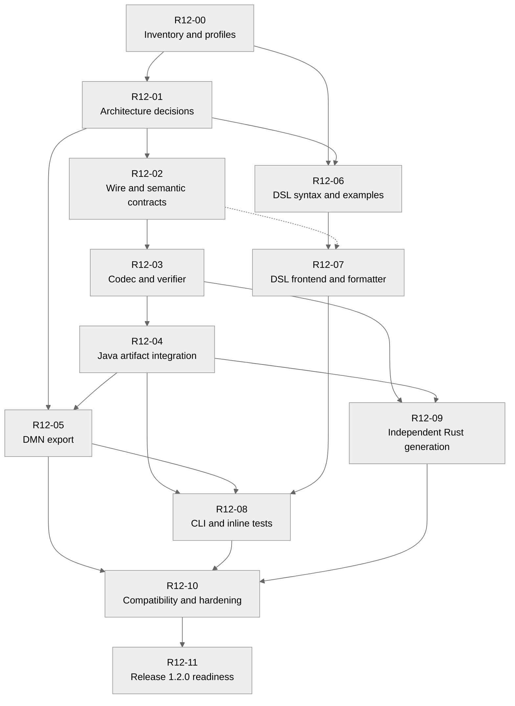

Dependencies do not authorize additional agents or simultaneous edits. Split rows into smaller
evidence-backed slices as necessary.

First vertical milestone: prove these paths with equivalent observable results.

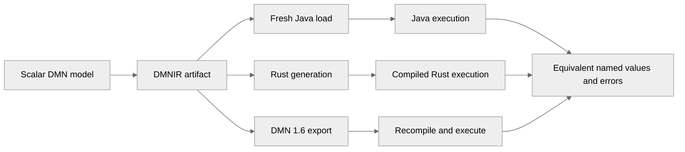

Expand to tables,
imports/BKMs and remaining declared features. Do not stabilize wire/DSL contracts from a toy alone.

## 6. Acceptance scenarios

1. Identical sources/options/toolchain produce identical canonical artifacts and digests.
   Declaration reordering preserves documented semantics and deterministic scheduling.
2. An export-capable artifact in a fresh directory, without original sources, exports DMN 1.6
   by default; schema validation, read-back and execution preserve named results/errors.
3. Unsupported target versions/features fail with model identity and feature/version diagnostics,
   without silently weakened output.
4. Equivalent DSL and DMN with structured types, tables and imported BKMs execute equivalently
   through shared FEEL/semantic analysis. DSL compilation does not require generated XML.
5. Formatting twice is unchanged. Invalid embedded FEEL, quoted names and ambiguous delimiters
   produce actionable diagnostics at original DSL ranges.
6. Rust receives only the artifact and generates a compilable crate executing supported decisions
   with exact Java-reference value/error parity, without XML/FEEL/JVM compiler services.
7. Decimal/temporal boundaries, null/missing, captures, table overlaps and imports either match
   semantics or fail capability negotiation. Rejections are not execution passes.
8. Hostile size/depth, invalid slots/cycles, unknown operations, corruption, incompatible versions
   and inconsistent declarations, bindings or graph metadata are rejected deterministically.
9. Optimized/unoptimized execution and exported DMN preserve declared behavior; missing original
   expressions and diagrams are never presented as recovered source.
10. Fresh external Java and Rust consumers reproduce the documented sample with pinned toolchains
    and schema, without repository-internal Java compiler object access.

## 7. Verification and release gates

Use the existing Maven/JUnit/TCK harness and
[evidence-backed method](../../docs/dev/evidence-backed-spec-driven-development.md).
R12-00 records precise commands, supported JDK/Rust toolchains, authoritative OMG schemas and
independent validator. Verify official version resources at implementation time. A DMN 1.5 TCK
result alone does not prove DMN 1.6 conformance.

Use `C:\10-tools\apache-maven-3.9.12\bin\mvn.cmd`. Run focused tests first, downstream checks
for shared changes, and the full reactor for schema/POM/module-contract changes. Compile/run
generated Java/Rust; test artifact and XML round trips, official-schema validation and independent
reading. Define canonical value/error comparison for decimal/temporal results; incidental JSON
spelling is not the semantic contract.

Release requires the full declared interpreter/Java/Spark conformance inventory and affected gRPC
integration. Report execution passes, expected rejections, failures, compilation/runtime errors
and unsupported cases separately. Spark native/fallback/unknown counts and rates use the actual
executable denominator; SQL-action rates remain separate from TCK cases. Rust publishes its own
supported denominator and rejected inventory. Subset success is not whole-DMN conformance.
Avoid repeating expensive unchanged verification.

For this documentation-only preparation: documentation/link validation, strict MkDocs and
`git diff --check`. Native/fallback counts and rates are not measured/applicable.

Each completed slice records commands, tool versions, revision, fixture inventory, outcomes,
limitations and evidence links. Update canonical specs/ADRs/roadmap/TODOs as decisions and code
justify it. Release publication requires explicit authorization under the guardrails.

## 8. Risks and readiness questions

| Risk / decision | Resolution gate |
| --- | --- |
| Distilled execution data cannot regenerate equivalent DMN | 01 chooses retained information; prove artifact-only export before schema stability |
| Export and execution adapters diverge | Derive both from one authoritative graph; 04/05/09/10 prove behavioral parity |
| Semantic protobuf loses authoring intent | 00/01 gap analysis before choosing reuse/extensions |
| Rust libraries diverge from FEEL semantics | 02/09 exact contract and boundary corpus; explicit rejection |
| Broad version claims exceed evidence | 00/05 per-version matrix and distinct XML/behavior/conformance evidence |
| DSL is concise but ambiguous/unpleasant | 06 readability review on business-shaped examples before stable grammar |
| Wire format creates maintenance obligations | 02/10 compatibility fixtures, owner and migration/deprecation policy |
| Release expands into IDE/native ecosystem | Keep deferred scope explicit; review additions before implementation |

## 9. Continuation prompt

Read `prompts/actual-task.md`, the general prompt, guardrails, this package, architecture principles,
ADR-0025 and referenced ideation inputs. Continue the active R12-00 inventory, baseline and profile review. Use accepted Option A from ADR-0026. Review remaining profile/version and wire-contract
questions at their slice gates; do not reopen the accepted representation choice.
Deliver the smallest ready vertical slice with executable evidence. Keep DMN 1.6 default export,
artifact-only DMN generation and independent Rust consumption mandatory. Do not freeze the draft
schema, inherit the old 1.5 default, infer whole-DMN coverage from a Rust subset, or publish
externally without authorization.


## 10. R12-00 inventory — 2026-11-03

Status: in progress. This is inspected source evidence and a proposed support matrix, not a
new schema or an accepted architecture decision. Baseline revision:
`3ca79721f85d4cf8b18400f8e0017cc0f8fe6740`; planning changes are uncommitted.

### Selected encoding and verified references

Protobuf is selected for the portable wire format. The schema remains separate from
`dmn-protobuf` semantic messages and from Java runtime records, as required by ADR-0025.
Reserve retired IDs, use explicit presence where zero is a valid slot/index, and reject unknown
required operations rather than accepting a decoded message as valid executable meaning.
[Protobuf's guide](https://protobuf.dev/programming-guides/proto3/) describes schema evolution;
[its canonicalization guidance](https://protobuf.dev/programming-guides/serialization-not-canonical/)
requires a format-specific identity algorithm rather than assuming deterministic encoding is canonical.

[OMG DMN 1.6](https://www.omg.org/spec/DMN/1.6/) lists the normative
[DMN16.xsd](https://www.omg.org/spec/DMN/20240513/DMN16.xsd), DMNDI 1.5 and DI/DC dependencies.
The schema dependency closure, local checksums and independent engine still need pinning.
The corresponding [DMN 1.5 resources](https://www.omg.org/spec/DMN/1.5/About-DMN)
provide the candidate additional export target. No full 1.6 behavior claim has been verified.

### Expression coverage matrix

Every sealed `RuntimeExpression` alternative is listed below. Portable Java/export scope is
proposed to cover all listed pure FEEL forms; until implemented, every row is **not verified**.
A draft analogue is only a shape match, not proof of field-level semantic completeness.
Rust v0 includes only the reviewed scalar/structured/table subset; other nodes require explicit
capability rejection. Listed scalar operations still require precise operator/type validation.

| Current Java expression | Ideation schema analogue | Proposed Rust v0 |
| --- | --- | --- |
| `RuntimeConstant` | constant | Include within declared scalar/structured profile |
| `RuntimeValueReference` | slot_ref | Include within declared scalar/structured profile |
| `RuntimeUnaryExpression` | unary | Include within declared scalar/structured profile |
| `RuntimeBinaryExpression` | binary | Include within declared scalar/structured profile |
| `RuntimeConditionalExpression` | if_expr | Include within declared scalar/structured profile |
| `RuntimeListExpression` | list | Reject pending later capability |
| `RuntimeFunctionCall` | builtin (built-ins only; named dispatch needs review) | Reject pending later capability |
| `RuntimeContextExpression` | context | Include within declared scalar/structured profile |
| `RuntimeLocalReference` | local_ref | Reject pending later capability |
| `RuntimePathExpression` | path | Include within declared scalar/structured profile |
| `RuntimeRangeExpression` | range | Reject pending later capability |
| `RuntimeFilterExpression` | filter | Reject pending later capability |
| `RuntimeBetweenExpression` | between | Reject pending later capability |
| `RuntimeInExpression` | in_expr | Reject pending later capability |
| `RuntimeInstanceOfExpression` | instance_of | Reject pending later capability |
| `RuntimeUnaryTestsExpression` | Missing explicit expression form | Reject pending later capability |
| `RuntimeForExpression` | for_expr | Reject pending later capability |
| `RuntimeQuantifiedExpression` | quantified | Reject pending later capability |
| `RuntimeFunctionDefinition` | Missing explicit expression form | Reject pending later capability |
| `RuntimeInvocationExpression` | call (named function versus target needs review) | Reject pending later capability |
| `RuntimeDescendantExpression` | Missing explicit expression form | Reject pending later capability |
| `RuntimeDecisionTableReference` | Missing explicit expression form | Reject pending later capability |
| `RuntimeRelationExpression` | Missing explicit expression form | Reject pending later capability |

Decision tables are a separate decision logic form, outside the 23 expression alternatives.
All seven policies exist in Java: UNIQUE, FIRST, PRIORITY, ANY, COLLECT, RULE_ORDER, OUTPUT_ORDER.
Proposed Rust v0 supports UNIQUE only; others fail capability validation. Java aggregation is an
optional SUM/MIN/MAX/COUNT; the draft's explicit LIST/UNSPECIFIED needs an intentional mapping.
The draft table output lacks Java's `allowedValues`, which carries priority ordering semantics.
The draft BKM lacks dependency and function-kind parity with `RuntimeBkm`.

All 13 binary operators, three unary operators and six unary-test comparison operators have
named analogues in the draft; map by explicit contract, never by Java enum ordinal. Unary tests
also include range/expression alternatives, negation and wildcard state. Preserve these invariants.
All 15 `RuntimeTypeKind` alternatives have draft analogues except generic `DURATION`; resolve
its relation to the two concrete duration kinds before schema readiness.

### Built-in registry reconciliation

All 90 current built-ins are classified below. Each has a draft name analogue and a different
numeric ID. This is an intentional-looking zero-reservation shift, not proof of compatibility.
Use an explicit mapping; neither registry is silently changed. Proposed portable Java scope
includes each operation under the shared semantic contract; Rust v0 rejects built-ins until
individually admitted by a subsequent capability. None is artifact-tested yet.

| Built-in | Java dispatch ID | Ideation wire ID | Rust v0 |
| --- | --- | --- | --- |
| `NOT` | 0 | 1 | Reject |
| `STRING` | 1 | 2 | Reject |
| `NUMBER` | 2 | 3 | Reject |
| `DATE` | 3 | 4 | Reject |
| `TIME` | 4 | 5 | Reject |
| `DATE_AND_TIME` | 5 | 6 | Reject |
| `DURATION` | 6 | 7 | Reject |
| `COUNT` | 7 | 8 | Reject |
| `SUM` | 8 | 9 | Reject |
| `MIN` | 9 | 10 | Reject |
| `MAX` | 10 | 11 | Reject |
| `ABS` | 11 | 12 | Reject |
| `SUBSTRING` | 12 | 13 | Reject |
| `SUBSTRING_BEFORE` | 13 | 14 | Reject |
| `SUBSTRING_AFTER` | 14 | 15 | Reject |
| `STRING_LENGTH` | 15 | 16 | Reject |
| `UPPER_CASE` | 16 | 17 | Reject |
| `LOWER_CASE` | 17 | 18 | Reject |
| `CONTAINS` | 18 | 19 | Reject |
| `STARTS_WITH` | 19 | 20 | Reject |
| `ENDS_WITH` | 20 | 21 | Reject |
| `MATCHES` | 21 | 22 | Reject |
| `REPLACE` | 22 | 23 | Reject |
| `SPLIT` | 23 | 24 | Reject |
| `FLOOR` | 24 | 25 | Reject |
| `CEILING` | 25 | 26 | Reject |
| `DECIMAL` | 26 | 27 | Reject |
| `ROUND_HALF_UP` | 27 | 28 | Reject |
| `ROUND_HALF_EVEN` | 28 | 29 | Reject |
| `SUBLIST` | 29 | 30 | Reject |
| `CONCATENATE` | 30 | 31 | Reject |
| `DISTINCT_VALUES` | 31 | 32 | Reject |
| `FLATTEN` | 32 | 33 | Reject |
| `REVERSE` | 33 | 34 | Reject |
| `INDEX_OF` | 34 | 35 | Reject |
| `YEARS_AND_MONTHS_DURATION` | 35 | 36 | Reject |
| `SORT` | 36 | 37 | Reject |
| `LIST_REPLACE` | 37 | 38 | Reject |
| `IS` | 38 | 39 | Reject |
| `MEAN` | 39 | 40 | Reject |
| `MEDIAN` | 40 | 41 | Reject |
| `MODE` | 41 | 42 | Reject |
| `STDDEV` | 42 | 43 | Reject |
| `SQRT` | 43 | 44 | Reject |
| `EXP` | 44 | 45 | Reject |
| `LOG` | 45 | 46 | Reject |
| `MODULO` | 46 | 47 | Reject |
| `EVEN` | 47 | 48 | Reject |
| `ODD` | 48 | 49 | Reject |
| `PRODUCT` | 49 | 50 | Reject |
| `ALL` | 50 | 51 | Reject |
| `ANY` | 51 | 52 | Reject |
| `INSERT_BEFORE` | 52 | 53 | Reject |
| `REMOVE` | 53 | 54 | Reject |
| `APPEND` | 54 | 55 | Reject |
| `UNION` | 55 | 56 | Reject |
| `LIST_CONTAINS` | 56 | 57 | Reject |
| `ROUND_UP` | 57 | 58 | Reject |
| `ROUND_DOWN` | 58 | 59 | Reject |
| `STRING_JOIN` | 59 | 60 | Reject |
| `DAY_AND_TIME_DURATION` | 60 | 61 | Reject |
| `GET_ENTRIES` | 61 | 62 | Reject |
| `GET_VALUE` | 62 | 63 | Reject |
| `RANGE` | 63 | 64 | Reject |
| `DAY_OF_YEAR` | 64 | 65 | Reject |
| `DAY_OF_WEEK` | 65 | 66 | Reject |
| `WEEK_OF_YEAR` | 66 | 67 | Reject |
| `MONTH_OF_YEAR` | 67 | 68 | Reject |
| `CONTEXT` | 68 | 69 | Reject |
| `CONTEXT_PUT` | 69 | 70 | Reject |
| `CONTEXT_MERGE` | 70 | 71 | Reject |
| `PMT` | 71 | 72 | Reject |
| `PMT2` | 72 | 73 | Reject |
| `NOW` | 73 | 74 | Reject |
| `TODAY` | 74 | 75 | Reject |
| `ROUND_HALF_DOWN` | 75 | 76 | Reject |
| `DURING` | 76 | 77 | Reject |
| `BEFORE` | 77 | 78 | Reject |
| `AFTER` | 78 | 79 | Reject |
| `MEETS` | 79 | 80 | Reject |
| `MET_BY` | 80 | 81 | Reject |
| `OVERLAPS` | 81 | 82 | Reject |
| `OVERLAPS_BEFORE` | 82 | 83 | Reject |
| `OVERLAPS_AFTER` | 83 | 84 | Reject |
| `FINISHES` | 84 | 85 | Reject |
| `FINISHED_BY` | 85 | 86 | Reject |
| `INCLUDES` | 86 | 87 | Reject |
| `STARTS` | 87 | 88 | Reject |
| `STARTED_BY` | 88 | 89 | Reject |
| `COINCIDES` | 89 | 90 | Reject |

### Structural gaps and export implications

- `RuntimeModel`, `RuntimeInput` and `RuntimeDecision` lack source names/namespaces; compiler
  `RuntimeModelIndex` has source-address information during lowering but is not a persistence API.
  Retain stable public identities before flattening. Reordering declarations need not preserve
  existing slot IDs; canonicalization must explicitly define the intended guarantee.
- `RuntimeCanonicalValue` uses BigDecimal, Java local date/time plus optional zone, and
  TemporalAmount. Define portable numeric and temporal representations instead of serializing
  those classes. The candidate raw-string constant/pool sentinel design needs presence validation.
- `RuntimeIrOptimizer` retains the model and adds constant/builtin traversal metadata;
  `dmn-optimizer/DmnOptimizer` separately applies semantic transformations. These are different
  optimization layers. Traversal ordinals must not become stable public identities.
- `RuntimeFunctionDefinition` distinguishes body/external/local-frame size; `RuntimeBkm` includes
  FEEL/JAVA/PMML kind. Portable core should reject JAVA/PMML and external bodies until an explicit
  host capability/policy exists; do not hide them inside a generic function call.
- `DmnWriter` writes semantic `Definitions`; no artifact-to-Definitions adapter exists.
  `DefinitionsWriter` currently defaults an absent model namespace to DMN 1.5. Implement the
  new DMNIR export default explicitly without casually changing the existing writer contract.
- DMN enums include 1.1–1.7, but namespace detection handles 1.2–1.6 only. Enum membership is
  not a supported-version guarantee. Proposed new export targets: default 1.6 and explicit 1.5;
  reject others until covered by a reviewed matrix and tests.

### Proposed corpus and baseline command

Reuse current fixtures: Traffic Violation for table behavior; `discount-calculation` for linked
imports; `loan-approval` for structured multi-model decisions; `ranked-loan-products` for priority
and lists (outside initial Rust); and focused Runtime IR tests for closures, relations, unary
tests and temporal boundaries. Add malformed artifact/version/limit fixtures in R12-03.
Review the ideation credit-risk UNIQUE/catch-all overlap before adopting it as a passing case.

Existing runner: Maven Surefire/JUnit 5. Focused baseline command (PowerShell):

```powershell
& 'C:/10-tools/apache-maven-3.9.12/bin/mvn.cmd' -o -B -ntp -pl dmn-runtime-ir -am `
  '-Dtest=RuntimeIrInvariantTest,RuntimeIrOptimizerTest,RuntimeIrLowererTest,RuntimeIrPipelineIntegrationTest' `
  '-Dsurefire.failIfNoSpecifiedTests=false' test
```

Toolchain inspected: Maven 3.9.12; Maven's JDK is Azul 25.0.2 under `C:/10-tools`, while PATH
Java is a separate Azul 25.0.2 installation. Rust/rustc and Cargo are 1.95.0. No standalone
`protoc` was found on PATH; the existing Maven protobuf plugin resolves its configured compiler.
Baseline log: `target/release-1.2-r12-00-baseline.log`. **BUILD SUCCESS: 27 tests, zero failures,
errors or skips; Maven exit 0.** The four selected Runtime IR suites ran; upstream modules
built successfully but their tests were not selected. This is not a full-reactor test run.
Native/fallback counts and rates: not measured/applicable to these Runtime IR tests.

### R12-01 initial proposal — superseded by accepted Option A

The initial recommendation was a two-section package. After reviewing alternatives, the user
selected Option A: one authoritative structured graph plus interchange metadata. ADR-0026 and
section 3 supersede the initial recommendation. No second stored policy is required.

R12-00 inventory and focused baseline evidence are recorded above. Remaining readiness work:
review the exact Java/export/Rust feature profiles, pin schema dependencies and independent
validation tooling, and finalize module/identity/capability contracts in the relevant slices.
Do not mark the complete R12-00 or R12-01 items done solely from the representation approval.

## 11. R12-01 alternatives review — Option A accepted

The user requested alternatives review before implementation, then selected **Option A** on
2026-11-03. Protobuf and the single resolved structured representation are accepted in ADR-0026.
The comparison below preserves the reviewed rationale; it is not implementation evidence.

### Comparison

| Alternative | Rust consumer | DMN generation from artifact | Main benefit | Main cost / risk |
| --- | --- | --- | --- | --- |
| A — One resolved, structured DMNIR plus interchange metadata | Typed expressions, explicit references, bindings and decision-table semantics; generator does target lowering | Export the same structured logic using stable identities, namespaces and declarations | One authoritative representation of decision logic; avoids duplicate policies | Must retain exportable structure and define target-independent normalization; cannot persist arbitrary destructive optimizations in the authoritative graph |
| B — Canonical export model plus separate executable graph | Consumes pre-lowered executable section | Export the retained canonical section | Strong authoring fidelity and freedom to optimize execution independently | Duplicated logic, larger artifact and a difficult consistency/trust contract |
| C — Executable graph only, with reverse synthesis | Consumes pre-lowered executable graph | Reconstruct normalized FEEL/DMN from slots, types and operations | Small execution-focused format | Every admitted operation needs a proven DMN mapping; lost names, types, imports and structure still require metadata; arbitrary optimized graphs may be unexportable |
| D — Executable graph plus embedded original DMN or DSL | Consumes pre-lowered executable graph | Return or recompile embedded sources | Convenient archival bundle and original-source access | Retains source/compiler dependence for conversion and may carry stale policy; weak fit for a distilled intermediate contract |

These are qualitative design trade-offs, not measured artifact-size or performance results.
All alternatives require versioning, capabilities, validation and exact semantic value contracts.
No alternative requires XML, ANTLR or semantic protobuf dependencies in the execution runtime.

### A — One resolved, structured representation

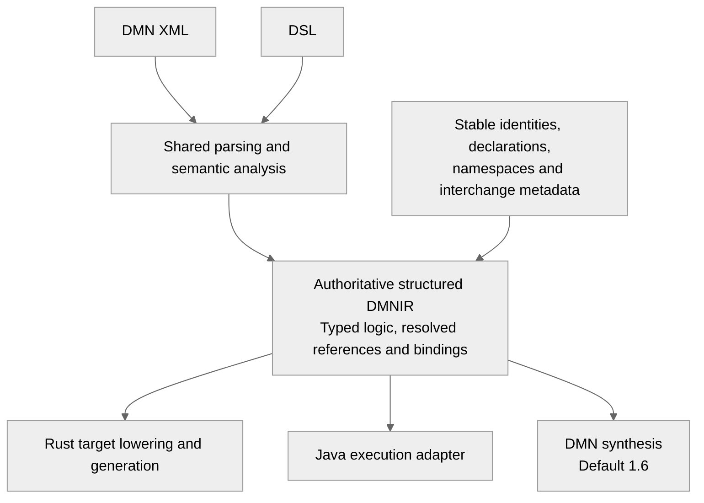

The graph is compiler-resolved, not raw FEEL text: types, operation identities, dependencies,
function binding and lexical references are explicit. Rust does not repeat FEEL parsing or
semantic analysis. Retain structured tables, contexts, functions and expressions with standard
DMN mappings. Stable source identities are distinct from dense execution slots.

The DSL remains an authoring frontend. It need not expose slots, wire tags or generated IDs.
Local execution adapters/generators may derive optimized graphs; those are not a second
authoritative policy in the portable artifact. DMN synthesis may normalize syntax and structure,
but must preserve declared observable behavior. The retained metadata is a dedicated portable
contract, not an embedded semantic-protobuf `Definitions` message.

### B — Two representations in one package

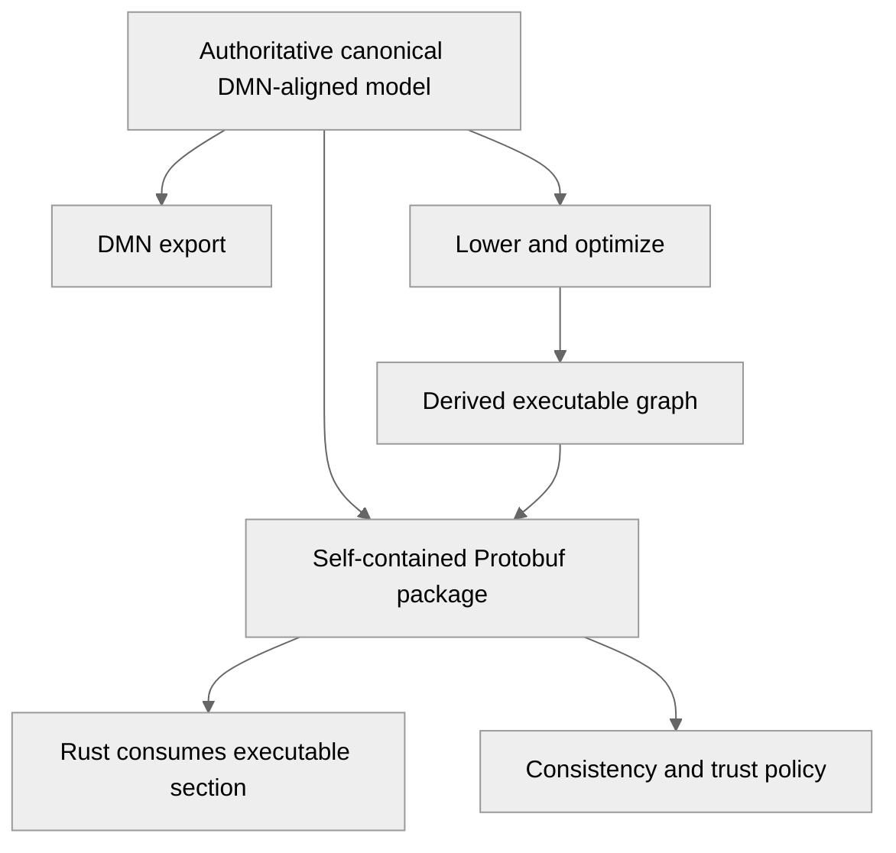

This is the initial recommendation from section 10. It fits consumers that need already optimized
execution graphs plus rich authoring preservation. The release must declare the authoritative
section and what happens when sections disagree. Checksums establish integrity, not behavioral
equivalence. A verifier checking each section independently cannot establish their equivalence.
Re-lowering, a restricted reproducible transformation, or an explicit trusted-producer policy is
needed; Rust-side verification must not quietly require the Java compiler. This cost deserves
review before committing to two sections.

### C and D — Reasons to limit their roles

C can be viable for a tightly bounded exportable instruction set, provided sufficient identities
and declarations survive. It becomes less lean as reverse synthesis grows to recover tables,
functions, imports and type declarations. It should not promise arbitrary optimized-IR export.

D is useful as an optional provenance/archive feature. Embedded original source alone does not
satisfy the goal of reconstructing standards-conforming DMN from defined intermediate semantics,
especially when changing DMN versions or when DSL/compiler versions are unavailable.

### Accepted selection and consequences

The accepted selection is **A for release 1.2**: one authoritative, typed, resolved and structured Protobuf DMNIR,
with enough portable declaration/interchange metadata to synthesize DMN 1.6. It directly serves
the user's distilled-format goal and avoids proving equivalence between two stored policies.
The initial two-section recommendation remains a viable B alternative if persistent aggressive
optimization or rich source fidelity is a higher priority than a single logic representation.

Consequences of accepted Option A:

- The portable graph is not identical to current process-local `RuntimeModel`; retain only the
  additional standard structure/metadata required by the agreed profiles.
- Existing Java execution adapts the graph into process-local Runtime IR. Rust performs target
  lowering from resolved operations, not DMN source interpretation or semantic name resolution.
- Optimize derived execution artifacts locally. Persisting an optional optimized cache becomes
  a separate compatibility/trust proposal rather than a mandatory release 1.2 section.
- DMN export guarantees valid normalized equivalent models for the declared portable profile;
  it does not recover original authoring syntax, comments or diagrams.
- R12-02 must prove feasibility with scalar, table, imported-BKM and lexical-scope fixtures before
  freezing a stable wire version. R12-04/05/09 adapters consume the same graph; section 3 now
  shows the accepted architecture. The diagram under B describes the rejected alternative only.

Decision recorded: **A approved**. Do not ask for the representation decision again.
The experimental scalar schema, bounded reader and execution adapter are implemented in
R12-02a/R12-03a/R12-04a below; broader expression capabilities remain future work.


## 12. First schema slice — R12-02a

Status: complete for this bounded scalar schema slice. Focused tests, formatting and
verification across the original and resumed reactor stages passed.
Architecture prerequisite: accepted ADR-0026. This bounded slice
establishes a compilable experimental scalar wire contract; it does not complete R12-02 or
claim model compilation, safe loading, DMN export or Rust execution.

### Observable outcome

A self-contained Protobuf artifact can represent a scalar model with named inputs and decisions,
exact literals and resolved global references. Generated bindings can round-trip this data
without original DMN/DSL sources, semantic protobuf messages or Java Runtime IR objects.
One typed structured expression is authoritative for each decision.

### Initial contract responsibilities

| Contract | Required meaning |
| --- | --- |
| Artifact header | Separate schema version, semantic profile and required capabilities; missing/unsupported values are validation failures |
| Model identity | Stable model ID, namespace and name; model namespace is distinct from the DMN standard XML namespace |
| Element identity | Stable source element ID, display name and variable name where they differ; no public slot identity |
| Input declaration | Element identity and resolved scalar type |
| Decision declaration | Identity, resolved type, explicit dependencies and one structured expression |
| Global reference | Unambiguous resolved model/element identity; imports retain enough binding metadata for later export |
| Expression | Resolved result type and an explicit node alternative; initially literal or global reference |
| Literal | Distinct null, boolean, string and exact-decimal alternatives; false/empty/zero must retain their node presence |
| Exact number | A specified decimal representation without float/double; bounds and normalization must be defined before codec readiness |

Do not add opaque FEEL source text as executable logic, a second export expression, XML payloads,
Java class names, or enum/traversal ordinals. Additional operations, tables, functions and lexical
binding forms follow in subsequent R12-02 slices before stable wire release.

### Acceptance scenarios and verification

1. Encode/decode a model with namespaced identities and two decisions referencing an input and
   a previous decision; all names, types, dependencies and resolved references survive.
2. Round-trip a decimal beyond binary64 precision and a nonzero fractional scale exactly.
3. Distinguish explicit null, false, empty string and numeric zero from an absent expression node.
4. Retain the artifact/profile information necessary for later bounded capability rejection.
5. Compile generated bindings using the existing pinned Protobuf toolchain. Test real binary
   round trips through the existing Maven/JUnit harness; do not rely only on descriptor snapshots.

The schema module must have no project production dependency on semantic protobuf, frontend,
semantic analysis or Runtime IR. A separate verifier/adapter owns executable validity; generated
Protobuf parsers alone must not be exposed as a safe model-loading API.

Verification scope: owning module and downstream consumers; full reactor if adding a module or
changing the parent POM. Documentation/link checks, strict MkDocs and diff checks also apply.
### Implemented experimental contract

- New default-reactor module: `dmn-ir-protobuf`. Production dependency: `protobuf-java` only;
  generated bindings use the parent's pinned protoc/runtime version 4.31.1. Tests use JUnit 5.
- Schema: [dmnir/v0/dmnir.proto](../../dmn-ir-protobuf/src/main/proto/dmnir/v0/dmnir.proto).
  Protobuf package `io.finmsg.dmn.dmnir.v0`; Java package `io.finmsg.dmn.dmnir.proto.v0`.
  The experimental header uses explicit schema major/minor `0.0`, semantics label
  `finmsg-dmnir-scalar/0` and capability `dmnir.scalar`. These labels describe this slice,
  not complete FEEL/DMN support. They do not freeze the eventual stable v1 contract.
- One typed expression per decision; initial node alternatives are literal and resolved global
  reference. Root model, bundled models/imports, declared dependencies and evaluation order
  carry stable namespace/element identities, without execution slots or a second logic graph.
- Identity preserves model/DRG names separately from variable IDs/names. Import locations are
  optional interchange hints, never source-loading instructions.
- Literal alternatives explicitly preserve null, false, empty string and zero. Initial scalar
  types are null, boolean, number and string. Message/oneof presence plus optional scalar fields
  distinguish absent nodes, absent decimal scale and absent schema-version components from zero.
- Decimal value is an ASCII integer coefficient times ten to the negative signed scale. Integer
  grammar is `0|-?[1-9][0-9]*`; no leading plus/zeros or negative zero. Scale/trailing coefficient
  zeros survive unchanged. Numeric equality is distinct from content/byte identity; no generic
  Protobuf canonical hashing is claimed. Bounded parsing and numeric expansion limits are
  explicitly verifier responsibilities and are not implemented by generated messages.

### Focused completion evidence

Command:

```powershell
& 'C:/10-tools/apache-maven-3.9.12/bin/mvn.cmd' -o -B -ntp -Pformat `
  -pl dmn-ir-protobuf -am spotless:apply test
```

Result: **BUILD SUCCESS; four tests, zero failures/errors/skips; Maven exit 0**.
Tests: [DmnIrWireContractTest](../../dmn-ir-protobuf/src/test/java/io/finmsg/dmn/dmnir/proto/v0/DmnIrWireContractTest.java).
The linked-model round trip includes distinct namespaces with the same element ID, a prior
local decision reference, import alias and separate variable names/IDs. Decimal vectors include
values beyond binary64 precision, negative fractional values, trailing zeros and negative scale.
Presence vectors distinguish all explicit default literals from absent nodes and zero versions
from missing version components. Unknown required capability labels survive decoding for a later
verifier to reject. Successful parsing intentionally does not assert artifact validity.
Log: `target/release-1.2-r12-02a-focused.log`.
Native/fallback counts and rates: not measured/applicable to this schema test run.

The initial full-reactor `-Pformat verify` was interrupted at the user's pause request during
`SparkSqlHybridIntegrationTest`; it did not finish. Log: `target/release-1.2-r12-02a-reactor.log`.
All modules before Spark completed their verification phases. The completed first Spark suite
reported 13 native SQL actions (100.00%), zero fallback (0.00%), zero unknown and zero failed;
the interrupted hybrid suite has no final routing totals, so no combined total is available.

On resume, no Maven/test JVMs remained. Refresh the current upstream artifacts locally without
rerunning their completed tests, then resume the remaining reactor modules:

```powershell
& 'C:/10-tools/apache-maven-3.9.12/bin/mvn.cmd' -o -B -ntp -DskipTests `
  -pl dmn-ir-protobuf,dmn-generator-java,dmn-optimizer -am install
& 'C:/10-tools/apache-maven-3.9.12/bin/mvn.cmd' -o -B -ntp -Pformat `
  -rf :dmn-generator-sparksql verify
```

The upstream local installation passed; it executes no tests and has no SQL routing denominator.
Logs: `target/release-1.2-r12-02a-resume-upstream.log` and
`target/release-1.2-r12-02a-reactor-resume.log`. Spark verification completed with **172 tests,
zero failures/errors/skips**; gRPC and smoke modules also completed successfully. Current-run
routing evidence from all four instrumented Spark suites is:

| Suite | Native actions | Fallback actions | Unknown | Completed-action denominator | Failed SQL actions |
| --- | --- | --- | --- | --- | --- |
| SparkSqlDmnIntegrationTest | 13 (100.00%) | 0 (0.00%) | 0 | 13 | 0 |
| SparkSqlHybridIntegrationTest | 2,952 (96.13%) | 119 (3.87%) | 0 | 3,071 | 60 |
| SparkSqlLiteralEscapingIntegrationTest | 50 (100.00%) | 0 (0.00%) | 0 | 50 | 0 |
| SparkSqlTemporalChainIntegrationTest | 19 (100.00%) | 0 (0.00%) | 0 | 19 | 0 |
| Sum | 3,034 (96.23%) | 119 (3.77%) | 0 | 3,153 | 60 |

These are the helper's completed SQL-action rates, with failed actions reported separately.
The 60 failed SQL actions are distinct from JUnit failures (zero in the Spark module).
Suites without instrumentation do not supply a routing denominator. These are
default-reactor checks, not the opt-in official TCK. Do not combine SQL actions from the aborted
run with the restarted suites or call this a single uninterrupted clean-reactor run.
Wire evolution fixtures, safe decoding, canonical identity, validation, Java execution/export
adapters and Rust generation remain future slices. Negative structural/semantic artifact
validation belongs to R12-03 and remains required.


### Final R12-02a verification and next action

The resumed Maven invocation exited **0 / BUILD SUCCESS**. Spark SQL, gRPC and smoke verification
passed; earlier modules completed before the user-requested pause. Combining completed suite
outcomes from both logs, with resumed results replacing restarted suites, gives **517 JUnit tests
across 51 suites, zero failures/errors/skips**. This is verification across interrupted/resumed
stages, not one uninterrupted clean build and not official TCK evidence.
Machine-readable run summary: `target/release-1.2-r12-02a-verification-summary.json`.

Additional checks: **73 repository tooling tests passed**; canonical documentation/link checks
passed for **13 modules**; strict MkDocs build and `git diff --check` passed. The produced schema
JAR contains `dmnir/v0/dmnir.proto` and generated `DmnIrArtifact` bindings. These checks do not
establish a stable wire version or semantic conformance of a generated backend.

At R12-02a completion, the next action was bounded scalar validation; section 13 records its
implementation. Execution adaptation remains a separate gate. Broader structured expressions,
tables, functions and lexical scopes remain in R12-02; their adapters, DMN 1.6 synthesis, DSL and
Rust proof remain later delivery work. No release/version bump, commit, push or publication was
performed for this slice.


## 13. Bounded scalar reader — R12-03a

Status: complete for this bounded scalar profile; focused, reactor, formatting and documentation checks passed.
Prerequisite: the experimental R12-02a scalar schema and accepted ADR-0026. This is a bounded
subset of R12-03, not a claim that future expression forms or the complete release are verified.

### Outcome and boundary

`dmn-ir-codec` reads bytes into an immutable verified-artifact wrapper only after bounded wire
and graph checks. It depends on `dmn-ir-protobuf` and `protobuf-java`, with no frontend, semantic
model, compiler or execution-runtime dependency. Runtime APIs remain unchanged. The schema
module remains generated-only. This module split implements the existing layer-isolation and
serialization-boundary requirements without introducing a second authoritative graph.

Canonical API/policy documentation: [experimental reader guide](../../docs/dmnir.md).
Implementation: [DmnIrArtifactReader](../../dmn-ir-codec/src/main/java/io/finmsg/dmn/dmnir/codec/DmnIrArtifactReader.java).

### Implemented policy

- Exact schema **0.0**, semantics `finmsg-dmnir-scalar/0`, required capability `dmnir.scalar`.
  Missing/duplicate capabilities, unsupported versions/features and unknown wire fields fail.
- Snapshot caller bytes after a byte-length check; scan known wire fields before generated
  decoding. Bound depth, message/field counts, string bytes, models, declarations and references.
  Reject duplicate singular/oneof selections, wrong wire types, overflowed lengths/scalars,
  malformed UTF-8 and truncated messages. No import locations are fetched.
- Validate model namespaces, model/element/variable identities and names, import aliases and
  bundled targets, direct-import visibility, declared dependencies, scalar types, literal forms,
  and exact decimal syntax/scale. Scalars are nullable; no other coercions are introduced.
- Preserve unused declared requirements. Reject duplicate/self dependencies and undeclared
  expression references. Validate a complete unique decision schedule and dependency ordering,
  rejecting cycles without recursive graph traversal.
- Return a wrapper whose constructor is private and whose artifact is immutable. Reader limits
  are immutable and per-read state is independent. Fail-fast diagnostics have stable codes and
  indexed paths without untrusted payload values or raw parser messages.
- Default budgets: 4 MiB input, depth 32 (configuration cap 64), 50,000 messages, 200,000 fields,
  16,384 UTF-8 bytes per string, 128 models, 10,000 declarations, 50,000 reference occurrences,
  4,096 coefficient digits and absolute scale 4,096. Numeric expansion is not performed.
  Configurable budgets describe reader allocations; callers must separately bound file/network
  ingestion before constructing a byte array.

Strict experimental wire acceptance is deliberately narrower than generic Protobuf parsing.
It is not a canonical-byte/digest contract, a signature/authentication mechanism, or full DMN
schema/FEEL conformance. Advanced expressions, tables, functions, temporal values, compiler
adapters, execution, DMN export and Rust generation remain subsequent work.

### Acceptance and focused evidence

Tests use the existing Maven/JUnit harness with real serialized artifacts. They cover linked
models and immutable results, nullable/default literals, exact decimals and signed scale,
compatibility/identity/import/type/reference/schedule rejection, cycles, overflow/truncation,
unknown/duplicate wire fields, exact byte/UTF-8/declaration/decimal boundaries, deterministic
failure diagnostics, reader reuse, and **500 deterministic malformed inputs**.

```powershell
& 'C:/10-tools/apache-maven-3.9.12/bin/mvn.cmd' -o -B -ntp -Pformat `
  -pl dmn-ir-codec -am spotless:apply test
```

Initial focused run: **14 codec + four wire tests passed**, zero failures/errors/skips.
Log: `target/release-1.2-r12-03a-focused.log`.
After adding deterministic malformed-input and exact-budget cases: **16 codec + four wire tests
passed**, zero failures/errors/skips. Log: `target/release-1.2-r12-03a-focused-final.log`.
Native/fallback counts and rates: not measured/applicable to either focused run.

### Completed verification

Full reactor command: `mvn -o -B -ntp -Pformat verify`.
Result: **BUILD SUCCESS; 533 JUnit tests, zero failures/errors/skips**.
Log: `target/release-1.2-r12-03a-reactor.log`.

Review then made scalar validation an explicit allowlist of the four current types so a future
schema enum extension cannot silently expand support. The final codec source and upstream wire
bindings passed **20 tests, formatting and verify**, with zero failures/errors/skips:
`mvn -o -B -ntp -Pformat -pl dmn-ir-codec -am spotless:apply verify`.
Log: `target/release-1.2-r12-03a-allowlist-verify.log`. This focused follow-up validates the final
codec change after the full run; no other production source changed. Native/fallback counts and
rates are not measured/applicable to that focused run. Do not add repeated focused tests to the
full-reactor total or describe the full run as occurring after the allowlist refinement.

Current full-run Spark SQL-action evidence from all four instrumented suites:

| Suite | Native actions | Fallback actions | Unknown | Completed-action denominator | Failed SQL actions |
| --- | --- | --- | --- | --- | --- |
| SparkSqlDmnIntegrationTest | 13 (100.00%) | 0 (0.00%) | 0 | 13 | 0 |
| SparkSqlHybridIntegrationTest | 2,952 (96.13%) | 119 (3.87%) | 0 | 3,071 | 60 |
| SparkSqlLiteralEscapingIntegrationTest | 50 (100.00%) | 0 (0.00%) | 0 | 50 | 0 |
| SparkSqlTemporalChainIntegrationTest | 19 (100.00%) | 0 (0.00%) | 0 | 19 | 0 |
| Sum | 3,034 (96.23%) | 119 (3.77%) | 0 | 3,153 | 60 |

These are completed-action rates, with failed actions separately accounted for. JUnit failures
and errors are zero. They are not official TCK case coverage. Although numerically equal to the
prior slice's totals, these figures were independently extracted from the current run's log.
Machine-readable summary: `target/release-1.2-r12-03a-verification-summary.json`.

Additional verification: **73 repository tooling tests passed**, documentation/link facts passed
for **14 modules**, strict MkDocs build passed, and `git diff --check` passed.
Logs: `target/release-1.2-r12-03a-tools.log` and `target/release-1.2-r12-03a-docs.log`.

Next functional slice: adapt verified scalar DMNIR into process-local Runtime IR and prove actual
execution parity, while retaining source identities for DMN synthesis. Broader R12-02/R12-03 and
all DMN export/DSL/Rust release gates remain open. No version bump, commit, push or publication.


## 14. Verified scalar execution adaptation — R12-04a

Status: complete for this bounded slice; focused execution, generated-Java and full-reactor
verification passed. Prerequisites: accepted Option A/ADR-0026 and the completed R12-02a/R12-03a scalar
wire/reader slices. This does not complete the broader R12-04 producer and advanced-feature scope.

### Outcome and architecture

The compiler-layer [DmnIrRuntimeAdapter](../../dmn-compiler/src/main/java/io/finmsg/dmn/compiler/dmnir/DmnIrRuntimeAdapter.java)
accepts a reader-created `VerifiedArtifact`, derives process-local Runtime IR, retains stable
identity bindings and delegates scalar evaluation to the existing `DmnRuntime`. No XML or FEEL
parsing occurs on the artifact execution path. The original verified graph remains available
through `source()` for later DMN synthesis; derived Runtime IR is not a second stored policy.

The existing `dmn-compiler` module gains downward dependencies on `dmn-ir-codec` and
`dmn-ir-protobuf`. Neither execution runtime nor Runtime IR gains a portable-schema dependency.
Java generator production dependencies are unchanged; its existing compiler test dependency
supplies the new adapter. No additional Maven module is introduced in this slice.

### Implemented behavior

- Pin schema 0.0, semantics `finmsg-dmnir-scalar/0` and the single `dmnir.scalar` capability
  independently at this consumer boundary. A future reader extension must not silently extend
  the adapter. Only verified literal/reference scalar graphs are admitted.
- Allocate deterministic dense local IDs/slots by namespace and source element ID. Preserve the
  artifact's validated schedule and dependencies. Lower constants/references into existing
  immutable Runtime IR records without altering their contracts.
- Preserve element names, optional variable IDs, variable names, types and source identities in
  binding maps. The public key is `ElementId(modelNamespace, elementId)`; variable IDs and local
  slots are not external addressing contracts. Duplicate element IDs across namespaces stay distinct.
- Evaluate all bundled decisions with fresh per-call slot state. Require all input identities;
  reject unknown or missing keys before evaluation. Explicit null differs from omission, and
  null-typed inputs require null. Other coercions are delegated to the existing runtime; no
  independent FEEL coercion engine is introduced.
- Preserve exact decimal coefficient/scale through bounded scientific lexical values rather than
  exponent expansion. Preserve raw string contents without quoting/unescaping them again.
  Results include explicit null entries and are returned in an unmodifiable ordered map.
  Native host objects are not deep-copied; use immutable inputs when sharing across calls.

The adapter's input-binding errors are new experimental API errors, not changes to existing
compiler/runtime caller behavior. The profile still excludes arithmetic nodes, tables, functions,
collections and temporal values. It is not a stable v1 wire or complete DMN conformance claim.

### Acceptance and evidence

[Adapter tests](../../dmn-compiler/src/test/java/io/finmsg/dmn/compiler/dmnir/DmnIrRuntimeAdapterTest.java)
cover artifact-only execution; exact decimal scale and negative scale; null, false and empty/raw
strings; retained IDs/names; imported identity isolation; deterministic declaration reordering;
immutable metadata/result maps; missing/unknown/null-typed input rejection; repeated and 20-way
concurrent evaluation. Observable scalar values and coercions match synthetic DMN 1.6 compilation
through both lowered and optimized modes. Imported-output parity is also checked. These fixtures
are paired definitions; no DMN-to-DMNIR producer is implemented by this test.

[Generated-Java parity](../../dmn-generator-java/src/test/java/io/finmsg/dmn/generator/java/DmnJavaGeneratorTest.java)
uses the `verifiedPortableArtifactGeneratesCompilableJavaWithScalarParity` test: artifact bytes
are validated/adapted, optimized companion metadata is derived, Java source is generated and
compiled with the JDK, then execution results are compared with the interpreter. Numeric
comparison is semantic decimal equality; it does not promise incidental scale or JSON spelling
identity after backend optimizations. Repeated generation produces identical source.

Initial focused command: `mvn -o -B -ntp -Pformat -pl dmn-compiler -am spotless:apply
-Dtest=DmnIrRuntimeAdapterTest -Dsurefire.failIfNoSpecifiedTests=false test`.
Result: **eight tests passed**, zero failures/errors/skips.
Log: `target/release-1.2-r12-04a-focused.log`.

After adding generated-source execution:

```powershell
& 'C:/10-tools/apache-maven-3.9.12/bin/mvn.cmd' -o -B -ntp -Pformat `
  -pl dmn-generator-java -am spotless:apply `
  '-Dtest=DmnIrRuntimeAdapterTest,DmnJavaGeneratorTest#verifiedPortableArtifactGeneratesCompilableJavaWithScalarParity' `
  '-Dsurefire.failIfNoSpecifiedTests=false' test
```

Result: **nine tests passed**, zero failures/errors/skips.
Log: `target/release-1.2-r12-04a-generator-focused.log`.
Native/fallback counts and rates are not measured/applicable to either focused run.

Full reactor passed with `mvn -o -B -ntp -Pformat verify` because dependencies and a public
shared adapter contract changed: **542 tests**, zero failures/errors/skips; all 15 reactor
projects succeeded. Log: `target/release-1.2-r12-04a-reactor.log`.
Machine-readable evidence: `target/release-1.2-r12-04a-verification-summary.json`.

Current-run Spark SQL action accounting includes all four instrumented suites:

| Suite | Native | Fallback | Unknown | Completed denominator | Failed SQL actions |
| --- | ---: | ---: | ---: | ---: | ---: |
| DmnIntegration | 13 | 0 | 0 | 13 | 0 |
| HybridIntegration | 2,952 | 119 | 0 | 3,071 | 60 |
| LiteralEscapingIntegration | 50 | 0 | 0 | 50 | 0 |
| TemporalChainIntegration | 19 | 0 | 0 | 19 | 0 |
| Total | 3,034 | 119 | 0 | 3,153 | 60 |

Native rate: **96.23%**; fallback rate: **3.77%**. The 60 failed SQL actions are separate
from the completed-action denominator and from JUnit failures. These are backend regression
metrics, not official TCK conformance results.

All **73 tooling tests** passed (`target/release-1.2-r12-04a-tools.log`). Strict MkDocs build
passed (`target/release-1.2-r12-04a-docs.log`); documentation verification passed for 14 modules
and 70 pages. Whitespace validation passed with `git diff --ignore-submodules=all --check`.

DMN-to-artifact emission, DMN 1.6 synthesis, DSL and Rust proof remain later work. No version
bump, commit, push or publication was performed.

## 15. Scalar DMN producer — R12-04b

Status: complete for this bounded scalar slice. Producer contract approved by the user's
subsequent “please continue”; focused and full-reactor verification passed.
This extends the completed scalar reader/adapter without widening schema 0.0 or its capability.

### Proposed boundary

Add an experimental `DmnIrScalarProducer` in `dmn-compiler`, alongside the runtime adapter.
Its `produce(DmnSource, DmnModelResolver)` entry point returns a reader-created
`VerifiedArtifact`; a convenience overload supports a model without imports. Reuse the existing
model loader, FEEL parser, model-set semantic analyzer and unoptimized Runtime IR lowerer.
Do not change existing `DmnCompiler.compile` behavior or add production dependencies.

Successful output preserves model/element/variable identities, names, import aliases and optional
location hints. Convert resolved runtime references back to namespace-qualified element IDs;
never serialize process-local slots. Serialize only scalar constants and global references.
Preserve exact decimals through coefficient and signed scale and retain explicit nulls/false/empty
strings. Run emitted bytes through the existing bounded reader before returning success.

Reject invalid source models, unsupported expressions/types and declarations that cannot be
represented faithfully by this profile. In particular, do not optimize arithmetic or function
calls into literals to bypass the profile. Do not silently drop BKMs, decision services, tables,
named type definitions or other semantic declarations absent from the scalar wire contract.
Original XML, source paths and FEEL source are not embedded in the artifact.

Proposed failure contract: a dedicated `DmnIrProductionException` with a stable category
(`SOURCE_INVALID`, `UNSUPPORTED_PROFILE`, `ARTIFACT_INVALID`), optional source element identity
and retained compiler diagnostics for source errors. No partial artifact is returned. Reader
limit/validation failures remain available as the cause. Producer ordering is deterministic by
model namespace and element identity; evaluation order is topological with stable tie-breaking.
This is repeatable producer output, not a universal canonical encoding or content-hash contract.

```mermaid
flowchart LR
    XML["DMN source + resolver"] --> Load["Existing loader and semantic analysis"]
    Load --> Lower["Unoptimized lowering + retained declarations"]
    Lower --> Profile["Scalar profile admission"]
    Profile --> Wire["One portable graph; stable identities"]
    Wire --> Read["Bounded reader"]
    Read --> Verified["VerifiedArtifact"]
    Verified --> Execute["Existing runtime adapter / Java generator"]
```

### Verification plan

Use the existing JUnit 5 / Maven Surefire harness. Focused command:
`mvn -o -B -ntp -Pformat -pl dmn-compiler -am test
-Dtest=DmnIrScalarProducerTest -Dsurefire.failIfNoSpecifiedTests=false`.

- Compile synthetic DMN 1.6 scalar fixtures into bytes, discard source/compiler results, reload
  with the reader and execute via the adapter. Compare against existing lowered/optimized DMN
  compilation; verify exact scalar values and coercion behavior.
- Cover imported references with repeated element IDs across namespaces, retained variable IDs,
  raw escaped/Unicode strings, null, false, empty strings and exact decimal boundaries.
- Require identical bytes for repeated production and reordered equivalent declarations/resolver
  entries. Verify schedule/dependencies through the reader, not incidental local slot numbering.
- Reject malformed DMN/FEEL, missing imports, arithmetic even when constant-foldable, tables,
  BKMs, decision services and unsupported types/declarations without returning partial output.
- Exercise existing reader resource limits on emitted artifacts. Produce bytes for a separate
  JVM consumer test to establish source-independent loading/execution.
- Add generated-Java compilation/execution parity for a produced artifact. Run the full reactor
  for the new public contract, tooling tests, strict docs and documentation verification.

### Implementation and current evidence

`DmnIrScalarProducer` and `DmnIrProductionException` are implemented in `dmn-compiler` without
new dependencies or changes to existing compiler entry points. The producer uses namespace-sorted
semantic models and the lowerer's declaration index to recover stable references, then sorts
wire declarations/dependencies and derives a stable topological schedule. The bounded reader
creates the returned verified wrapper. The XML archival metadata excluded by schema 0.0 remains
excluded: source formatting, labels, documentation, diagrams and source locations are not retained.

The initial five producer tests passed (`target/release-1.2-r12-04b-focused-retry.log`);
the original sandbox attempt was stopped after reporting access denial. An expanded run passed
nine producer tests plus generated-Java parity (`target/release-1.2-r12-04b-parity.log`).
Adding structural rejection cases exposed a table reaching lowering before profile admission:
the intermediate run had ten tests, one failure (`target/release-1.2-r12-04b-focused-final.log`).
Early table rejection fixed that producer-boundary failure. No existing lowering behavior changed.

Final focused command:

```powershell
& 'C:/10-tools/apache-maven-3.9.12/bin/mvn.cmd' -o -B -ntp -Pformat `
  -pl dmn-generator-java -am spotless:apply `
  '-Dtest=DmnIrScalarProducerTest,DmnJavaGeneratorTest#producedArtifactGeneratesExecutableJava' `
  '-Dsurefire.failIfNoSpecifiedTests=false' test
```

Result: **11 tests passed**, zero failures/errors/skips (ten producer tests, one generated-Java
test). Log: `target/release-1.2-r12-04b-parity-final.log`. Native/fallback routing counts and rates
are not measured/applicable to these focused compiler/generator runs.

Evidence includes exact decimal/null/false/empty-string execution, direct lowered/optimized DMN
parity, deterministic declaration reordering and repeat output, import identity isolation with
repeated IDs, retained import hints/variable IDs, malformed FEEL diagnostics, missing imports,
unsupported temporal inputs/named types/arithmetic/tables/BKMs/services and emitted-string reader
limits. A separate JVM receives only a binary artifact path and executes it; it receives no DMN
source or resolver. Generated Java consumes produced bytes, compiles and matches interpreter values.
Raw string/Unicode and negative-scale wire behavior are covered in the prior adapter slice;
dedicated producer lexical-boundary expansion remains future corpus work.

Full reactor command `mvn -o -B -ntp -Pformat verify` passed: **553 tests**, zero
failures/errors/skips; all 15 reactor projects succeeded.
Log: `target/release-1.2-r12-04b-reactor.log`.
Summary: `target/release-1.2-r12-04b-verification-summary.json`.

Current-run Spark SQL action accounting includes all four instrumented suites:

| Suite | Native | Fallback | Unknown | Completed denominator | Failed SQL actions |
| --- | ---: | ---: | ---: | ---: | ---: |
| DmnIntegration | 13 | 0 | 0 | 13 | 0 |
| HybridIntegration | 2,952 | 119 | 0 | 3,071 | 60 |
| LiteralEscapingIntegration | 50 | 0 | 0 | 50 | 0 |
| TemporalChainIntegration | 19 | 0 | 0 | 19 | 0 |
| Total | 3,034 | 119 | 0 | 3,153 | 60 |

Native rate: **96.23%**; fallback rate: **3.77%**. Failed SQL actions are separate from the
completed-action denominator and JUnit failures. These are regression metrics, not official
TCK conformance results.

All **73 tooling tests** passed (`target/release-1.2-r12-04b-tools.log`), strict MkDocs build
passed (`target/release-1.2-r12-04b-docs.log`) and documentation validation passed for 14 modules
and 70 maintained pages. Requested module READMEs were added in `dmn-ir-protobuf` and
`dmn-ir-codec`; their relative file targets and whitespace checks passed.
DMN synthesis, broader expressions, DSL and Rust remain outside this slice.

## 16. Artifact-only scalar DMN export — R12-05a

Status: complete for this bounded scalar subset. Contract approved by the user's subsequent
“please continue”; focused, downstream and full-reactor verification passed.
Prerequisites: completed scalar schema, reader, producer and execution adapter.

### Proposed outcome and boundary

Add `DmnIrScalarDmnExporter` in `dmn-compiler`, reusing its existing XML frontend dependency.
`export(VerifiedArtifact)` defaults to DMN 1.6; `export(VerifiedArtifact, DmnVersion)` supports
only explicitly implemented versions. Initially admit **1.6 only** and reject other enum values
before returning output. Additional versions require their own evidence; do not infer support
from the existing enum's entries. Do not change the existing writer's DMN 1.5 fallback default.

Return an immutable `ExportedDmnBundle` with a root document name and all bundled model documents
as UTF-8 XML. Document names are generated deterministically (`model-0000.dmn`, etc.) by sorted
model namespace. Treat retained import locations as source hints; regenerate locations to address
the exported bundle, never retrieve or write to original locations. The exporter performs no
filesystem/network writes. Expose document contents as immutable strings to avoid mutable arrays.

Synthesize `Definitions` from the authoritative portable graph and explicitly select the DMN 1.6
vocabulary URI. Reuse `DmnWriter` to escape XML and serialize. Emit FEEL scalar literals from
structured values, not original source text. Map stable references to correct local/imported
variable references and information requirements; retain IDs/names and import aliases where
representable. Preserve numeric value and observable behavior; normalized FEEL spelling and
incidental decimal scale after reparsing are not XML lexical-fidelity promises.

The current reader admits broader identity/name strings than standard XML IDs and unambiguous
FEEL variable references. Export must reject unrepresentable IDs, invalid XML characters,
ambiguous variable/import names and unsupported cross-model reference forms explicitly rather
than renaming stable identities or emitting invalid DMN. Specify these checks in tests before
claiming the entire scalar artifact profile is exportable. A dedicated export exception should
distinguish unsupported version from unrepresentable artifact and retain an optional stable
element identity. Do not return a partial bundle on failure.

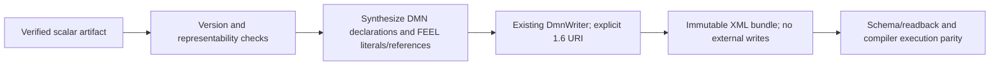

### Verification plan

Use JUnit 5/Surefire in `dmn-compiler` with focused exporter tests first, then affected generated-Java
tests and the complete reactor for the new shared public API. Validate artifact-only synthesis
without original sources; default 1.6 vocabulary; explicit unsupported-version rejection; exact
numeric values/nulls/false/empty/raw strings; imported references and regenerated bundle locations;
stable output; invalid IDs/names/characters; and producer/export/recompile behavioral parity.
Check the XML against authoritative DMN 1.6 schemas and an independent reader where available;
record unavailable checks as gaps, not conformance passes. Reuse approved dependency boundaries;
any additional external validator/dependency needs separate review.

This proposal is not implementation evidence. No Spark generator change is planned. Focused
export tests do not measure Spark routing. A full reactor remains required by the repository's
shared-contract verification rule and is regression evidence, not a DMNIR fallback metric.

### Implementation and completion evidence

Implemented `DmnIrScalarDmnExporter`, nested immutable `ExportedDmnBundle` and
`DmnIrExportException` in the compiler package. Existing writer defaults, schemas and backend
production code are unchanged; no dependency was added. The admission policy is documented in
`docs/dmnir.md#export-a-scalar-artifact-to-dmn-16`, including conservative names/IDs, absolute
fragment-free namespaces, matching element/variable names, alias ambiguity and XML attribute
normalization rejection. The exporter does not claim every reader-valid artifact is exportable.

The first focused run had seven tests, zero assertion failures and one setup error: a duplicate
ID was rejected by the reader before reaching the exporter. The test now checks that existing
reader boundary; no production correction was needed for it. Log:
`target/release-1.2-r12-05a-focused.log`. The next run passed eight focused exporter tests
(`target/release-1.2-r12-05a-focused-final.log`). A downstream run passed those eight tests and
one generated-Java test (`target/release-1.2-r12-05a-parity.log`). These runs do not measure
Spark native/fallback routing; counts/rates are N/A.

Tests use unmodified official OMG DMN16/DMNDI15/DI/DC XSDs stored as test resources with source
URLs and SHA-256 provenance in `dmn-compiler/src/test/resources/dmn16-schema/README.md`.
JDK XSD validation runs offline; no production schema download is introduced. Recompilation
checks lowered/optimized execution parity, exact numeric values, negative scale, null/false/empty
strings, raw escapes/Unicode, imports with repeated IDs and regenerated locations. Negative tests
cover unsupported versions, names/IDs, invalid XML characters, namespace forms and ambiguous
required imported names. The generated-Java test additionally compiles/executes a model recompiled
from exported XML. Independent DMN-engine validation remains an explicit gap for broader R12-05.

The user's Traffic Violation preview request was handled separately through the existing source
semantic model/XML writer, with an explicit 1.6 namespace and official-XSD validation:
`target/traffic-violation-source-model-preview-1.6.dmn`. This is **not portable-DMNIR export**;
the full model's tables/record types/context logic remain unsupported by the scalar wire profile.
It is not acceptance evidence for R12-05a or broader DMNIR support.

Final focused command:

```powershell
& 'C:/10-tools/apache-maven-3.9.12/bin/mvn.cmd' -o -B -ntp -Pformat `
  -pl dmn-generator-java -am spotless:apply `
  '-Dtest=DmnIrScalarDmnExporterTest,DmnJavaGeneratorTest#producedArtifactGeneratesExecutableJava' `
  '-Dsurefire.failIfNoSpecifiedTests=false' test
```

Result: **10 tests passed**, zero failures/errors/skips (nine exporter tests, one generated-Java
test extended to recompile/execute exported DMN). This adds null-typed declaration parity and
attribute whitespace admission checks. Log: `target/release-1.2-r12-05a-parity-final.log`.
Spark native/fallback routing is not measured/applicable to this focused run.

Full reactor `mvn -o -B -ntp -Pformat verify` passed: **562 tests**, zero failures/errors/skips;
all 15 reactor projects succeeded. Log: `target/release-1.2-r12-05a-reactor.log`.
Machine-readable evidence: `target/release-1.2-r12-05a-verification-summary.json`.

Current-run Spark regression SQL-action counters include all four instrumented suites:

| Suite | Native | Fallback | Unknown | Completed denominator | Failed SQL actions |
| --- | ---: | ---: | ---: | ---: | ---: |
| DmnIntegration | 13 | 0 | 0 | 13 | 0 |
| HybridIntegration | 2,952 | 119 | 0 | 3,071 | 60 |
| LiteralEscapingIntegration | 50 | 0 | 0 | 50 | 0 |
| TemporalChainIntegration | 19 | 0 | 0 | 19 | 0 |
| Total | 3,034 | 119 | 0 | 3,153 | 60 |

Native action rate **96.23%**; fallback action rate **3.77%**. The 60 failed SQL actions are
separate from the completed-action denominator and from the zero JUnit failures. These mixed
regression tests include deliberate fallback-path coverage; their action rate is not TCK coverage
or a DMNIR fallback rate. The established official Spark TCK checkpoint remains 3,391/3,391 native passes (100%),
zero fallback (0%); regression action counters do not replace it. No new full TCK run is claimed.

All **73 tooling tests** passed (`target/release-1.2-r12-05a-tools.log`); strict MkDocs build
passed (`target/release-1.2-r12-05a-docs.log`). Documentation validation passed for 14 modules and
70 maintained pages; whitespace checks passed. Broader R12-05 remains open: this subset does not
cover richer expressions, additional DMN versions or independent DMN-engine validation.

## 17. Structured scalar expressions — R12-02b/03b/04c/05b

Date: 2026-11-04. Status: complete for this bounded expression profile. Contract approved by the
user's subsequent “please continue”; focused, downstream and full-reactor verification passed.
Base: pushed commit `92d975c` on
`feature/release-1.2-dmnir`.

### Outcome and compatibility boundary

Extend the authoritative portable graph with recursive unary, binary and conditional expressions.
Prove source DMN → artifact → independent reload → existing interpreter/generated Java and
artifact → DMN 1.6 → recompiled execution for this profile. This is the next bounded step toward
Traffic Violation's arithmetic and suspension condition; records, field access, lexical bindings
and tables still require later slices. Do not claim the complete Traffic Violation model works.

Keep the existing `dmnir/v0/dmnir.proto` package and every existing field/enum number. Add only
the message/oneof fields below. Existing schema 0.0 artifacts retain their exact header and scalar
behavior. New expressions require **schema 0.1**, semantics `finmsg-dmnir-scalar-expressions/0`,
and exactly ordered capabilities `[dmnir.scalar, dmnir.scalar-expressions]`. A reader/consumer
must pin one of these two complete profiles; version/capability combinations are not inferred.
The current 0.0 reader must reject 0.1 artifacts. A new reader accepts both profiles but rejects
new expression nodes under a 0.0 header and unknown operations under either header.

The producer continues emitting 0.0 for literal/reference-only graphs, preserving existing
behavior. It emits 0.1 only when an admitted structured operation occurs. Consumers independently
check the selected profile before adaptation/export; parser acceptance alone never widens a
consumer. No new Maven module/dependency, runtime operator change or second stored policy is needed.

### Protobuf additions

Add these alternatives to the existing `DmnIrExpression.node` oneof:

```proto
DmnIrUnaryExpression unary = 4;
DmnIrBinaryExpression binary = 5;
DmnIrConditionalExpression conditional = 6;
```

Add messages and explicit wire operator registries:

```proto
message DmnIrUnaryExpression {
  DmnIrUnaryOperator operator = 1;
  DmnIrExpression operand = 2;
}
message DmnIrBinaryExpression {
  DmnIrBinaryOperator operator = 1;
  DmnIrExpression left = 2;
  DmnIrExpression right = 3;
}
message DmnIrConditionalExpression {
  DmnIrExpression condition = 1;
  DmnIrExpression then_expression = 2;
  DmnIrExpression else_expression = 3;
}
enum DmnIrUnaryOperator {
  UNARY_OPERATOR_UNSPECIFIED = 0;
  UNARY_OPERATOR_POSITIVE = 1;
  UNARY_OPERATOR_NEGATE = 2;
  UNARY_OPERATOR_NOT = 3;
}
enum DmnIrBinaryOperator {
  BINARY_OPERATOR_UNSPECIFIED = 0;
  BINARY_OPERATOR_ADD = 1;
  BINARY_OPERATOR_SUBTRACT = 2;
  BINARY_OPERATOR_MULTIPLY = 3;
  BINARY_OPERATOR_DIVIDE = 4;
  BINARY_OPERATOR_POWER = 5;
  BINARY_OPERATOR_EQUAL = 6;
  BINARY_OPERATOR_NOT_EQUAL = 7;
  BINARY_OPERATOR_LESS = 8;
  BINARY_OPERATOR_LESS_EQUAL = 9;
  BINARY_OPERATOR_GREATER = 10;
  BINARY_OPERATOR_GREATER_EQUAL = 11;
  BINARY_OPERATOR_AND = 12;
  BINARY_OPERATOR_OR = 13;
}
```

All child messages must be present; zero/unknown enum values are errors. Map operators explicitly
by name using exhaustive switches; never use Java enum ordinals. Types remain the existing scalar
enum and are required on every expression. Tree structure stores semantics once; no FEEL text or
optimizer output is embedded.

### Initial admission matrix

This profile deliberately admits fewer operator/type combinations than the complete Java runtime.
Static `NULL` type is distinct from a runtime null value held by a number/boolean/string declaration.

| Operation | Admitted operand types | Required result type |
| --- | --- | --- |
| Unary positive/negate | NUMBER | NUMBER |
| Unary not | BOOLEAN or NULL | BOOLEAN |
| Add/subtract/multiply/divide/power | NUMBER, NUMBER | NUMBER |
| Ordered comparisons | NUMBER/NUMBER or STRING/STRING | BOOLEAN |
| Equal/not equal | Any pair of the four existing scalar types | BOOLEAN |
| And/or | Each operand BOOLEAN or NULL | BOOLEAN |
| Conditional | Condition BOOLEAN or NULL; each branch matches declared result or is NULL | Declared scalar type |

Reject string concatenation, temporal arithmetic, collections, dynamic ANY and other signatures
until their contracts are reviewed. For example, a statically typed `null + 1` expression remains
outside this initial numeric signature, even though a nullable numeric input can propagate null.
Reuse existing runtime semantics for admitted operations: exact decimal behavior, division by
zero, power/domain errors, comparison/null behavior, boolean short-circuiting and conditional
branch selection must be demonstrated by parity tests, not reimplemented in the codec.

### Validation, execution and export

Wire preflight continues enforcing byte/message/field/depth/reference budgets before generated
message allocation. The verifier walks all child expressions with explicit depth accounting,
checks operator signatures/result types, and collects every global reference for dependency
validation. Conditions and both branches are validated even if one branch is unreachable at
runtime. Adversarial nesting, unknown operators and omitted children must fail predictably.

The producer traverses unoptimized Runtime IR, maps only admitted nodes and selects the required
profile from actual graph contents. The runtime adapter derives existing unary/binary/conditional
Runtime IR records. The exporter renders fully parenthesized FEEL using explicit operator tokens
and existing escaping; it neither folds nor reorders operations. Keep the current name/XML/version
admission restrictions and artifact-only bundle contract.

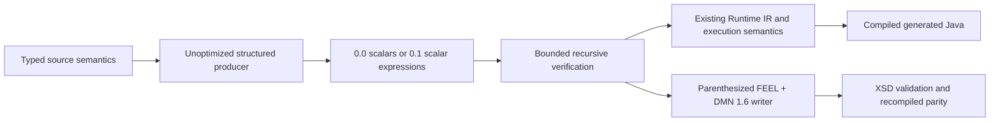

### Acceptance and implementation sequence

1. Extend schema and add binary golden vectors, pin operator numbers, preserve 0.0 fixtures and
   prove old-consumer rejection of new operations. No stable-v1 compatibility claim.
2. Extend the reader with the exact profile matrix, child/type/reference validation and budget
   boundary tests; reject unknown enum values, missing children and invalid 0.0/0.1 combinations.
3. Extend producer/runtime adaptation and execute a produced artifact in a separate JVM. Cover
   nested numeric expressions, decimal precision, nullable input propagation, equality, comparison,
   short-circuiting, lazy conditionals, shared dependencies and deterministic bytes.
4. Extend export; validate 1.6 XSD and compare lowered/optimized recompilation and generated-Java
   execution. Include `(ActualSpeed - SpeedLimit)` and `if DriverPoints + FinePoints >= 20 then
   "Yes" else "No"` using scalar inputs. These are isolated expression fixtures, not a flattened
   replacement for Traffic Violation's authoritative record/table graph.
5. Run focused JUnit/Surefire tests before the required shared-contract full reactor, tooling and
   docs checks. Record every measured run. Focused tests do not measure Spark routing; reactor
   regression action counters remain separate from official TCK conformance.

Implementation and completion evidence are recorded below.
Remaining Traffic Violation contracts: named/structural records and constraints, field identity,
context/local binding scope, table unary tests/ranges and UNIQUE policy, then full artifact-only
execution/export parity before using that complete model as evidence.

### Implemented contract and source normalization

The schema, bounded reader, producer, runtime adapter and DMN 1.6 exporter now implement the
reviewed 0.1 profile. Existing field/enum identities are preserved. Each consumer independently
pins exact 0.0/0.1 headers and capability lists. The producer selects 0.1 only for structured
graphs; literal/reference-only output remains 0.0. Runtime semantics and backend production code
are unchanged; no dependency or Maven module was added.

Source admission now precedes lowering, because the existing lowerer replaces type-proven null
operations with null constants. Unsupported source forms cannot use that normalization to enter
the profile. Literal nulls and ordinary null-typed name references remain admitted. The existing
source parser does not admit unary `+`; wire unary positive remains supported and exports as its
parenthesized operand (the runtime's identity semantics). The parser represents `not(...)` as a
named built-in invocation; the producer explicitly maps that one reviewed operation to unary NOT.
This does not admit general calls/functions or change the parser grammar.

### Per-run focused evidence

All counts below are individual runs, not cumulative coverage. Native/fallback counts and rates
are not measured/applicable to these focused schema/compiler/Java tests.

| Log suffix under `target/release-1.2-expressions-` | Tests | Failures | Errors | Outcome |
| --- | ---: | ---: | ---: | --- |
| `codec.log` | 25 | 1 | 0 | Boundary fixture used depth 8, which still admitted its nested message; corrected to 7 |
| `focused.log` | 39 | 1 | 1 | Exposed source unary-plus syntax and type-proven-null normalization assumptions |
| `parity.log` | 40 | 1 | 0 | Exposed actual named-invocation representation of `not(...)` |
| `parity-refined.log` | 21 | 0 | 0 | Corrected source admission/mapping and downstream parity passed |
| `parity-final.log` | 42 | 0 | 0 | Existing wire/reader tests, expanded profile tests, production, separate JVM, export and generated Java passed |
| `imported.log` | 1 | 0 | 0 | Nested imported reference with repeated element IDs and exported-bundle parity passed |
| `null-reference.log` | 1 | 0 | 0 | Preserved legacy null-typed input name reference and 0.0 emission |

No tests were skipped. Machine-readable focused evidence is in
`target/release-1.2-expressions-focused-summary.json` (the final null-reference run is also retained
in its separate log). Tests pin a golden serialized unary expression and all 16 explicit operator numbers;
reject unknown/zero operators, absent children, incompatible types and invalid profile/header
combinations; inspect unselected branches; and exercise depth/reference budget boundaries.
Execution/export tests cover all admitted operator kinds, exact decimals, runtime-null inputs,
wire-authored null operands/conditions, imported references, unary positive, conditional branches,
determinism and artifact-only execution in a separate JVM. Exported fixtures pass official DMN 1.6
XSD checks and lowered/optimized recompilation parity. Generated Java is compiled and executed
for numeric, logical, comparison and conditional examples, including wire unary positive.

### Previous consumer proof and generated example

The actual saved schema 0.0 reader/schema JARs were run in a separate JVM with only their own
bindings and Protobuf dependency. They accepted a 0.0 artifact and rejected the new 0.1 expression
artifact with `UNKNOWN_FIELD`, before code generation/execution. This is a measured local binary
compatibility probe, not a claim that all historic consumers were tested.

- Baseline codec SHA-256: `45193b232cdf5cc54ace5cb373f9b15222837b32e2a5ad465a641cf1e3a12fb5`.
- Baseline schema SHA-256: `d8eadcf07c0ae729ee1275519459c2f7d07b7b1eb602d20914c4bdf378b68144`.
- Saved files: `target/dmnir-0.0-baseline/codec.jar` and `schema.jar`.
- Probe: `target/ReadBaselineDmnIr.java`; its classpath excludes the new classes.

`target/GenerateStructuredDmnIrExample.java` produced an actual 0.1 binary and readable dump:
`target/traffic-expression-checks-0.1.dmnir` and `.textproto`. The artifact executes isolated
`ActualSpeed - SpeedLimit` and suspension-condition expressions; sample values produce Excess=30
and Suspend="Yes". Artifact-only DMN export is in `target/traffic-expression-checks-dmn/model-0000.dmn`.
These isolated fixtures are not the complete Traffic Violation model or a flattened replacement
for its named records/table/context. Unlike the earlier source-writer preview, this example really
passes through the portable artifact, reader, adapter and exporter.

### Full verification and remaining scope

All 73 tooling tests and the strict docs build passed (`target/release-1.2-expressions-tools.log`
and `target/release-1.2-expressions-docs.log`). An initial full-reactor tool dispatch produced no
reactor log. The subsequent run in `target/release-1.2-expressions-reactor.log` was intentionally
interrupted before completion to preserve the legacy null-typed reference case found during
review; no final routing totals or full-pass claim are inferred from that partial run.

The final source passed `mvn -o -B -ntp -Pformat verify`: **576 tests**, zero failures/errors/skips;
all 15 reactor projects succeeded. Maven exited 0. Log:
`target/release-1.2-expressions-reactor-final.log`. Machine-readable evidence:
`target/release-1.2-expressions-verification-summary.json`.

Current-run Spark regression SQL-action accounting includes all four instrumented suites:

| Suite | Native | Fallback | Unknown | Completed denominator | Failed SQL actions |
| --- | ---: | ---: | ---: | ---: | ---: |
| DmnIntegration | 13 | 0 | 0 | 13 | 0 |
| HybridIntegration | 2,952 | 119 | 0 | 3,071 | 60 |
| LiteralEscapingIntegration | 50 | 0 | 0 | 50 | 0 |
| TemporalChainIntegration | 19 | 0 | 0 | 19 | 0 |
| Total | 3,034 | 119 | 0 | 3,153 | 60 |

Native rate **96.23%**; fallback rate **3.77%** of completed SQL actions. Failed SQL actions
are counted separately from that denominator and the zero JUnit failures. These mixed regression
tests include deliberate fallback-path coverage; the rates are not DMNIR coverage or official
TCK case rates. The official TCK checkpoint remains a separate dated 3,391/3,391 native result
with zero fallback; no new full TCK run is claimed for this expression slice.

Broader R12-02/03/04/05 and release readiness remain open. Records/field access, local bindings,
decision tables, additional DMN export versions, independent DMN-engine validation, the DSL and
Rust proof remain future work. This change does not establish stable v1 wire compatibility or
complete Traffic Violation support. No version bump or new commit/push was performed for 0.1.

## 18. Named records and resolved field access — next release 1.2 contract

Date: 2026-11-04; implementation continued 2026-11-05. Status: contract approved by the user's
subsequent “please continue”; implementation, focused and full-reactor verification passed.
This continues the actual release task's R12-02/03/04/05 work. It is not a
separate example task. Prerequisite: completed schema 0.1 vertical slice in section 17.

### Proposed profile and scope

Introduce schema **0.2**, semantics `finmsg-dmnir-records/0`, with exact ordered capabilities
`[dmnir.scalar, dmnir.scalar-expressions, dmnir.records]`. Retain exact 0.0/0.1 acceptance and
emission for graphs that use no record declarations/types/field access. A record graph selects
0.2; older consumers reject it. Keep the current proto package and all existing tags/numbers.
No new dependency or Maven module is proposed.

Support named, non-empty, acyclic records with fields typed as one of the four current scalars
or another bundled named record. Preserve record identity/name, field names, optional source
field IDs and declaration field order. Address types by `(model namespace, record ID)` and fields
by `(source expression's resolved record type, field name)`. Dense field indexes are derived
locally and never serialized. Do not infer named type identity by structural equality: two named
records may have identical shapes while remaining different interchange declarations.

The first record slice admits record inputs, record global references, nested field access and
same-record-type/null conditional results. Record construction, record equality, anonymous/open
contexts, lists, recursive types, temporal fields, scalar aliases, collection flags and type/field
constraints remain unsupported and must be rejected rather than omitted. This covers unconstrained
types such as the existing `tDriver` and `tFine`; the complete `tViolation` still requires its date
field and allowed-value constraint. Full Traffic Violation remains gated on those contracts plus
decision tables and local bindings.

### Concrete additive wire layout

Add `repeated DmnIrRecordDefinition record_definitions = 6` to `DmnIrModel`.
Add `DmnIrReference record_type = 4` to `DmnIrVariable` without changing scalar field `type = 3`.
Add `DmnIrReference record_type = 7` to `DmnIrExpression`, outside its node oneof, and
`DmnIrFieldAccess field_access = 8` inside that oneof. For variables/expressions, exactly one of
supported scalar `type` or present `record_type` is valid. Scalar `UNSPECIFIED` is not a type.
The existing fields stay outside a new oneof to preserve the current generated Java API; the
verifier enforces exclusivity. Record fields use a new explicit type-reference oneof:

```proto
message DmnIrTypeReference {
  oneof kind {
    DmnIrScalarType scalar_type = 1;
    DmnIrReference record_type = 2;
  }
}
message DmnIrRecordDefinition {
  DmnIrElementIdentity identity = 1;
  repeated DmnIrRecordField fields = 2;
}
message DmnIrRecordField {
  optional string id = 1;
  string name = 2;
  DmnIrTypeReference type = 3;
}
message DmnIrFieldAccess {
  DmnIrExpression source = 1;
  string field_name = 2;
}
```

`DmnIrReference` has the same namespace/ID encoding, but record-type references resolve in the
type-definition index, not the executable declaration index. Validate identity uniqueness across
model/DRG/variable/type/optional-field IDs within each model. Type names and executable declaration
names occupy their respective semantic namespaces. Field names must be non-empty and unique
inside their record. Preserve field order as declaration metadata; this proposal does not promise
identical bytes for reordered record fields or introduce canonical content hashing.

### Validation and semantic boundaries

- Validate all record definitions, including unused definitions; reject empty or cyclic records,
  unknown scalar kinds, unresolved type IDs, illegal cross-model type references and simultaneous
  scalar/record type selections. Cross-model type references require a direct bundled import.
- Apply existing byte/depth/message/field budgets before allocation. Include type/field definitions
  in declaration budgets and every type reference in reference budgets. Bound acyclic record
  expansion using the existing depth/message limits so a small shared type DAG cannot expand into
  an unbounded RuntimeType tree. Detect cycles iteratively before expansion.
- A field-access source must have a resolved record type; its field must exist and the node's
  declared result must match the field type. Nested accesses remain typed at every node. Scalar,
  unknown, open-context and list-projection sources are rejected. Null record values propagate
  through existing runtime behavior; the field must still be statically valid.
- Record global references must match their declared named type identity. Conditional record
  branches use the same named type or null. Numeric/logical/ordered-comparison signatures remain
  the reviewed scalar signatures; do not admit general record operations implicitly.
- Distinguish structural wire validity from execution input policy. Derive existing RuntimeType
  field layouts and delegate native map coercion/validation to the current runtime. Test missing,
  explicit-null, extra and incompatible fields against direct compilation; document observed
  behavior before claiming parity. Do not invent a separate input coercion engine.

### Producer, execution and DMN export

Retain named type identity from analyzed source declarations and typed expression annotations.
The current Runtime IR expands named types structurally; it is insufficient to recover named
identity by itself. Reuse the existing semantic bindings for global references and field/type
resolution. Derive the portable graph before name-erasing execution optimizations, while keeping
the existing compiler facade and runtime unchanged. Reject unsupported item definitions and
constraints explicitly, even if unused by decision logic.

The adapter derives field indexes from the verified declaration order and emits existing
`RuntimePathExpression` nodes and context RuntimeTypes. Artifact consumers need no original XML,
FEEL parser or semantic analyzer. The exporter reconstructs `itemDefinition`/`itemComponent`
declarations and namespace-correct type QNames, preserving optional field IDs. Generated XML
prefixes are deterministic and separate from FEEL import aliases. The source model's business
namespace and the DMN 1.6 vocabulary namespace remain distinct. Keep existing export admission
restrictions for names/IDs and fail explicitly where names cannot be represented safely.

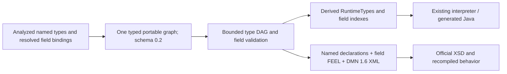

### Acceptance and work breakdown

1. Add additive wire fields/profile fixtures and old-reader rejection evidence; preserve 0.0/0.1
   golden vectors and exact header rules.
2. Add bounded type/field validation, cyclic/unresolved/ambiguous type rejection, expansion budgets,
   field/result typing and scalar/record exclusivity tests.
3. Extend source production and runtime adaptation. Prove distinct identities for same-shape named
   records, nested records, imported types with repeated IDs, runtime null behavior and deterministic
   output. Run an artifact-only consumer in a separate JVM.
4. Export named record declarations and field accesses to DMN 1.6; validate official XSD and compare
   direct compilation, artifact execution, generated Java and lowered/optimized recompilation.
   Cover `Driver.Points + Fine.Points` with record inputs, without pretending that supplied Fine
   input replaces the original model's decision table.
5. Use existing JUnit 5/Surefire; focused owning-module tests first, then shared-contract full
   reactor, tooling and strict documentation checks. Spark regression counters remain distinct
   from official TCK results; no new TCK result is implied by schema/adapter tests.

### Implementation and focused evidence (2026-11-05)

The approved 0.2 contract is implemented in the schema, bounded codec, source producer,
Runtime IR adapter and artifact-only DMN 1.6 exporter. Named identities are retained from
analyzed source declarations before Runtime IR expands them structurally. The consumer derives
memoized layouts; type-DAG expansion is bounded before adaptation. Validation diagnostics retain
model/type/field locations. A statically NULL field read derives the same constant-null execution
plan as the existing source lowerer, including native input containing a non-null field value.

Final focused JUnit/Surefire verification passed **74 tests, zero failures/errors/skips**:
4 wire-contract, 27 codec, 42 compiler and 1 generated-Java test
(`target/release-1.2-records-parity-final.log`). This includes record identity, nested/imported
records, conditional record/null results, required/extra/explicit-null input fields, nonzero field
indexes, deterministic production, separate-JVM artifact consumption, generated Java, official
DMN 1.6 XSD validation and recompiled lowered/optimized runtime parity. Native/fallback routing
is N/A for these focused tests.

Retained intermediate evidence: `release-1.2-records-compile.log` records the corrected adapter
compile error; `release-1.2-records-focused.log` records 70 tests with one existing facade error;
`release-1.2-records-runtime-parity.log` records four passing runtime parity tests;
`release-1.2-records-parity.log` records 73 passing tests. The Java extra-field/layout and NULL-field
regression probes each passed in `release-1.2-records-java-final.log`,
`release-1.2-records-java-layout.log` and `release-1.2-records-null-field.log`. Logs are under target/.

Advisory existing gap: DmnCompiledModel context-to-native conversion uses Map.copyOf and throws
for null-valued fields. No adjacent facade change is included. Core runtime and generated-Java
parity use Runtime IR directly and preserve null fields; this does not establish nullable context
support through that existing facade.

Generated synthetic artifacts: `target/record-expression-checks-0.2.dmnir`, its `.textproto`, and
`target/record-expression-checks-dmn/model-0000.dmn`. Execution with Driver.Points 15 and
Fine.Points 7 produced Total 22, Suspend Yes and the copied Driver record. The generated DMN was
pretty-printed with unchanged semantic XML fingerprint and passed the official 1.6 XSD. It is a
bounded record/field example, not the complete Traffic Violation model.

A separate JVM using retained actual 0.1 jars accepted the 0.1 expression artifact and rejected
0.2 with UNKNOWN_FIELD. Baseline codec SHA-256:
`2E9A55E48F78CAE8265EF3A7FA492E1744577676539537B8A1E40C3D20C0CAE7`;
schema SHA-256: `FD9946439A78CF2333A5D29EEA12A68D8D5BA5F659BD6F080197D7114DC0D9EA`.
Probe helpers and jars remain ignored target artifacts, not production dependencies.

Final full reactor passed **590 tests, zero failures/errors/skips**
(`target/release-1.2-records-reactor.log`; measured summary in
`target/release-1.2-records-verification-summary.json`). All **73 tooling tests**, strict MkDocs
and documentation facts/link checks passed (`target/release-1.2-records-tools.log`,
`target/release-1.2-records-docs-final.log`, `target/release-1.2-records-documentation-final.log`).

Current-run mixed Spark regression SQL-action accounting:

| Suite | Native | Fallback | Unknown | Completed denominator | Failed SQL actions |
| --- | ---: | ---: | ---: | ---: | ---: |
| DmnIntegration | 13 | 0 | 0 | 13 | 0 |
| HybridIntegration | 2,952 | 119 | 0 | 3,071 | 60 |
| LiteralEscapingIntegration | 50 | 0 | 0 | 50 | 0 |
| TemporalChainIntegration | 19 | 0 | 0 | 19 | 0 |
| Total | 3,034 | 119 | 0 | 3,153 | 60 |

Native rate **96.23%**, fallback rate **3.77%** of completed regression SQL actions. Failed SQL
actions are separate from that denominator and the zero JUnit failures. These suites include
deliberate fallback coverage; this is not a TCK result or a regression in the recorded official
**3,391/3,391 native passes, zero fallback** checkpoint. No new full TCK run is claimed.

Release 1.2 remains
open: temporal fields/constraints, tables and lexical contexts, broader DMN export/version support,
DSL/CLI, Rust consumption and release readiness are not completed by this bounded slice.

## 19. Boxed contexts and resolved local bindings — approved schema 0.3 slice

Date: 2026-11-06. Status: **implemented and verified**.
The user explicitly selected “Proceed with section 19” before implementation.
Continues R12-02/03/04/05 after the completed 0.2 record slice. The pushed checkpoint is
`aceec3c`, including the Linux artifact-consumer test launcher fix. GitHub feature CI
[run 42107758059](https://github.com/finmsg-io/dmn-compiler-toolkit/actions/runs/42107758059)
completed successfully. Feature pushes run reactor/formatting/tooling/docs without the full TCK;
main and pull requests retain the existing TCK gate. CI success is not a new full TCK result.

### Outcome and alternatives

Support sequential boxed DMN contexts with named intermediate bindings and one required final,
unnamed result expression. This admits Traffic Violation's `TotalPoints` calculation followed
by its suspension condition once the other model features are supported. It does not substitute
supplied Fine input for the original Fine decision table or establish full model support.

Recommended: store a binding identity and resolved local references in the authoritative graph;
derive lexical depths and slots in each consumer. Alternatives reviewed: serialized local slots
couple the portable format to frame allocation; name-only references require consumers to repeat
semantic resolution; inlining bindings loses declaration identity and sequential evaluation.
The recommendation extends the accepted identity-based representation rather than the ideation
SPEC-001 proposal's serialized depth/slot addresses.

### Additive schema 0.3 proposal

Exact header: schema 0.3, semantics `finmsg-dmnir-local-bindings/0`, ordered capabilities
`[dmnir.scalar, dmnir.scalar-expressions, dmnir.records, dmnir.local-bindings]`.
Existing 0.0/0.1/0.2 headers and tags remain accepted unchanged. Any local/context node requires
0.3; producers retain earlier profiles for graphs without these nodes. Old readers reject 0.3.

Add to the existing DmnIrExpression node oneof: `local_reference = 9`, `context = 10`.

```proto
message DmnIrLocalReference {
  string binding_id = 1;
}
message DmnIrLocalBinding {
  string binding_id = 1;
  DmnIrVariable variable = 2;
  DmnIrExpression value = 3;
}
message DmnIrContextExpression {
  repeated DmnIrLocalBinding bindings = 1;
  DmnIrExpression result = 2;
}
```

Binding IDs are nonempty opaque identities unique within an owning decision expression tree,
not model-global DRG IDs or runtime slots. Source variable IDs remain separate optional
interchange metadata; producers derive deterministic binding IDs from structural source paths.
Authoring tools supply binding IDs directly. Variable names are unique in each context;
the optional variable ID, when present, participates in existing model-wide source-ID uniqueness.
Binding order is semantic and must be retained. No type aliases, closures, mutation, loops,
anonymous record construction or context-without-result behavior is added.

### Scope, validation and execution

Each binding value sees ancestors and earlier bindings in its context. Its own binding becomes
visible only after its value is verified/evaluated. Reject self/forward references, sibling or
descendant scope escape, duplicate binding IDs/names, missing values/results and type mismatches.
Nested contexts may shadow outer names using distinct IDs; identity references remain resolved.
Local-reference result types exactly match their declaration. Binding values and the context
result use existing scalar/record assignability, including null. The context expression's
declared type matches its result under that same rule. Record identity remains nominal.

Global dependencies include references nested anywhere in binding values and final results;
local references never become DRG dependencies. Count bindings in declaration limits and local
references in reference limits, including wire preflight. Apply existing depth/message/string
and record-expansion budgets to every new node before consumer execution. Reject unbounded
recursion; use existing profile limits instead of introducing another independent limits API.

Source production reuses analyzed boxed expressions and resolved lexical binding paths; it does
not infer scope from names or reconstruct it from optimized Runtime IR. Adapt verified nodes to
existing RuntimeContextExpression/RuntimeContextEntry/RuntimeLocalReference, deriving frames,
depths and slots locally. Evaluate bindings once in declaration order in a fresh lexical frame.
No existing runtime production change is proposed; generated Java uses that same derived graph.

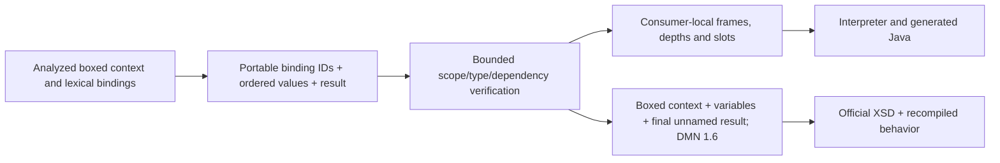

### Export boundary and acceptance work breakdown

Export boxed context declarations and final result from the artifact alone, retaining optional
variable IDs and declaration names. Do not encode local bindings as another stored export graph.
Reuse current export-safe identifier/name admission. If lexical shadowing makes a resolved
reference impossible to render faithfully by its retained name, reject export explicitly rather
than silently capturing a different variable. Nested expressions must retain context semantics;
round-trip tests determine the supported FEEL/boxed placement, with explicit rejection of
placements not representable by the existing writer. No original FEEL/XML is required.

1. Pin additive tags and exact headers; preserve existing golden vectors and probe actual saved
   0.2 consumers for rejection of the new artifact.
2. Test positive sequential/nested/outer references and record-valued locals; reject forward,
   self, escaped, duplicate, missing and incorrectly typed bindings plus budget boundaries.
3. Prove deterministic production and namespace-qualified global dependency collection, including
   the bounded `TotalPoints`/suspension boxed context with synthetic Driver/Fine record inputs.
4. Prove direct source, artifact interpreter, generated Java and exported/recompiled parity;
   cover null values, shadowing, repeat evaluation isolation and artifact-only separate-JVM use.
5. Validate exported XML against official DMN 1.6 XSD. Run existing JUnit 5/Surefire focused checks,
   then the shared-contract full reactor, 73 tooling tests, strict docs and link checks. Report
   mixed Spark action counters separately from official TCK evidence. Do not claim DSL/Rust or
   complete Traffic Violation coverage from this slice.

Affected modules: dmn-ir-protobuf, dmn-ir-codec, compiler portable package, generated-Java parity
tests and canonical DMNIR documentation. No dependency, release version, runtime facade fix,
new standalone planning file or publication is proposed. The reviewed gate is the new portable
wire/scope contract; accepted Option A/ADR-0026 remains unchanged.

### Implementation and evidence (2026-11-06)

Schema, bounded codec, source producer, Runtime IR adapter and DMN 1.6 exporter now implement
the approved 0.3 slice. Scope visibility is enforced on binding IDs. Source production uses
resolved declaration paths, preserves optional variable IDs and collects global dependencies
inside binding values/results. Export reconstructs boxed context XML and rejects hidden-name
capture or boxed nodes placed in FEEL-only operands.

Implementation refinement: existing RuntimeContextExpression scopes share one fresh decision
frame rather than allocating nested physical frames. The adapter mirrors source lowering:
distinct local IDs get distinct slots, all context-local references have derived depth zero,
and the decision records its derived local-slot count. Lexical visibility is still verified
before adaptation. No runtime production change or serialized frame address was introduced.

The final focused local-only run passed **11 tests, zero failures/errors/skips**: five codec,
five compiler parity and one generated-Java test (`target/release-1.2-locals-runtime-parity.log`).
Coverage includes sequential/nested/outer references, named-record locals/field access, duplicate
IDs/names, source-ID collisions, forward/self/escaped references, missing values/results,
type/header rejection, declaration/reference limits, deterministic production, null values,
repeat evaluation, artifact-only separate-JVM execution, exact-number generated Java, official
XSD validation and exported/recompiled lowered/optimized behavior. Native/fallback routing is
not measured by these focused tests and is N/A.

Retained earlier runs: `release-1.2-locals-compile.log` compiled the implementation;
`release-1.2-locals-focused.log` caught the fixture's unsupported repeated-string builder method;
`release-1.2-locals-parity.log` caught unnamed result handling (47 compiler tests, four errors);
`release-1.2-locals-parity-retry.log` caught the derived runtime frame/slot-count mismatch
(five compiler tests, one failure and three errors). These failed runs are not passing evidence.
Native/fallback routing is N/A for each of these focused/compile runs. Logs are under target/.

Actual emitted example: `target/local-expression-checks-0.3.dmnir` and `.textproto`, with
`target/local-expression-checks-dmn/model-0000.dmn`. Synthetic Driver.Points 15 plus nested local
Bonus 7 yields Suspend Yes. The DMN was pretty-printed with unchanged semantic XML fingerprint
and official 1.6 XSD success (`target/release-1.2-locals-pretty-print.log`). This is a local-context
example, not complete Traffic Violation or a decision-table implementation.

An isolated JVM using preserved 0.2 compiled classes packaged before schema regeneration accepted
the actual 0.2 artifact and rejected the actual 0.3 artifact with UNKNOWN_FIELD
(`target/release-1.2-locals-old-reader.log`). Saved codec SHA-256:
`926AD936C0A023648700C58B12CE09F47CAE9C9C2EB6886B0E35C6B37A1963ED`;
schema SHA-256: `CECF35FA6F4DB4E57055CF865546FC1208A346F3E23771EDEC0032628E859463`.
Probe helpers, generated artifacts and baseline jars remain ignored target files.

Full reactor passed **601 tests, zero failures/errors/skips**
(`target/release-1.2-locals-reactor.log`, measured summary
`target/release-1.2-locals-verification-summary.json`). All **73 tooling tests**, strict MkDocs
and documentation facts/link checks passed (`target/release-1.2-locals-tools.log`,
`target/release-1.2-locals-docs.log`, `target/release-1.2-locals-documentation.log`).

Current-run mixed Spark regression SQL-action accounting:

| Suite | Native | Fallback | Unknown | Completed denominator | Failed SQL actions |
| --- | ---: | ---: | ---: | ---: | ---: |
| DmnIntegration | 13 | 0 | 0 | 13 | 0 |
| HybridIntegration | 2,952 | 119 | 0 | 3,071 | 60 |
| LiteralEscapingIntegration | 50 | 0 | 0 | 50 | 0 |
| TemporalChainIntegration | 19 | 0 | 0 | 19 | 0 |
| Total | 3,034 | 119 | 0 | 3,153 | 60 |

Native rate **96.23%**, fallback rate **3.77%** of completed mixed regression actions. The 60
failed SQL actions are separate from that denominator and the zero JUnit failures. These suites
include deliberate fallback coverage; they do not replace or contradict the recorded official
**3,391/3,391 native passes, zero fallback** checkpoint. No new full TCK run is claimed.

Broader temporal/constraint semantics, tables, DSL/CLI, Rust and release readiness remain open.
The existing nullable-context compiler facade advisory remains unchanged.

## 20. Civil date values — proposed schema 0.4 contract

Date: 2026-11-06. Status on 2026-11-07: **implemented and verified**.
The user selected “Proceed with section 20” before implementation. Initial wire/calendar tests
passed; the broader parity run found an existing optimizer mismatch. Completion is not claimed.
Prerequisite: completed schema 0.3 (`1b128cf`). Continues R12-02/03/04/05; it does not reopen
Option A/ADR-0026. The Traffic Violation source declares tViolation.Date even though its current
decisions do not read that field. Date admission must therefore include retained unused types.

### Outcome and alternatives

Represent a timezone-free civil Gregorian date precisely in inputs, named-record fields,
literal expressions, local bindings and results. Support date references, field access,
conditionals, equality and date/date ordering through the existing execution operators.
No timestamp conversion, timezone inference, date arithmetic, time/date-time/duration values,
general date functions, constraints or decision tables are included.

Recommended encoding: explicit signed year, month and day. Alternatives reviewed: a canonical
ISO date string is readable but makes every target interpret a textual value grammar; epoch-day
encoding is compact but moves the Gregorian/year-range conversion into every exporter and
consumer. Structured civil fields make the calendar and bounds explicit and avoid accidental
midnight/UTC conversions. This stores a typed value, not source FEEL or a second logic graph.

### Additive wire and exact profile

Schema **0.4**, semantics `finmsg-dmnir-dates/0`, exact ordered capabilities
`[dmnir.scalar, dmnir.scalar-expressions, dmnir.records, dmnir.local-bindings, dmnir.date]`.
Preserve all previous tags, enum numbers and exact profiles. Add SCALAR_TYPE_DATE = 5 to the
existing scalar enum and `DmnIrDate date_value = 5` to DmnIrLiteral's value oneof:

```proto
message DmnIrDate {
  optional sint32 year = 1;
  optional uint32 month = 2;
  optional uint32 day = 3;
}
```

All three fields require explicit presence. Use the proleptic Gregorian calendar with signed
years **-999,999,999 through 999,999,999**, excluding year zero under the approved amendment.
Months are 1–12 and days must exist
in that month/year, with the divisible-by-4/100/400 leap-year rule applied across signed years.
Reject malformed dates rather than normalizing them (for example, February 30 cannot roll into
March). The schema's larger numeric storage domains do not widen these semantic bounds.

This range matches the existing LocalDate-backed execution boundary and retained TCK fixtures
in `1115-feel-date-function`; the codec remains independent of runtime/compiler modules. Neither
the wire contract nor its validation may depend on locale, system timezone, clock or host epoch.
Date values and the DATE scalar kind require profile 0.4 everywhere, including unused declarations.
Consumers independently pin the exact new profile; older consumers reject it. Producers select
0.4 only when dates are present and preserve earlier profile selection for existing models.

### Source, execution and export boundaries

Admit existing parsed date literals and the built-in `date` invocation with one valid constant
string argument. Resolve the built-in using existing source analysis. Convert its value once to
the structured date; do not store the invocation/string as executable FEEL. Reject dynamic,
invalid or other date constructor forms explicitly in this slice, including forms that an
optimizer might otherwise erase. Preserve named record identity and source IDs around date fields.

Native input coercion remains the current runtime policy: date inputs/fields use LocalDate or
null, and incompatible host values follow existing coercion behavior. Do not add automatic
string-to-date coercion. Derive RuntimeTypeKind.DATE and RuntimeConstantKind.DATE locally.
DATE/DATE ordered comparisons and existing scalar equality retain runtime null behavior;
mixed ordered comparisons, arithmetic and boolean operators on dates fail profile validation.
Conditional/local/record typing follows existing assignability rules, including explicit null.

Export `typeRef="date"` and synthesized `date("...")` literal FEEL. Keep FEEL date formatting
separate from the internal Java ISO string used by RuntimeConstantKind.DATE: the existing
`DmnRuntime.parseFeelDate` accepts positive extended years without a leading plus, while
LocalDate's ISO string includes that plus for years beyond 9999. Use deterministic digits,
four-digit minimum year magnitude and two-digit months/days. Preserve signed years.
For example, civil year 10000 exports as `date("10000-01-01")`; no timezone or time is invented.

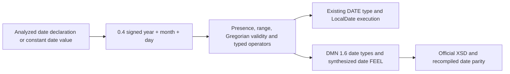

### Acceptance and work breakdown

1. Pin enum/tag/message golden vectors and exact headers. Probe preserved actual 0.3 compiled
   consumers for old-artifact acceptance and rejection of a new 0.4 artifact.
2. Validate DATE admission in every type position, including unused record fields, and date
   literal/type agreement. Reject missing civil components, zero/invalid month/day, invalid leap
   days, out-of-range years, unknown enum values and old headers carrying date values/types.
3. Prove source/adapter/generated-Java parity for literal/reference/field/local/conditional dates
   and date comparisons. Cover leap/non-leap centuries, year-zero rejection, negative years, years 9999 and
   10000, both range endpoints, null/missing/incompatible native values and exact round trips.
   Reuse existing JUnit 5/Surefire; focused owning/downstream checks precede the full reactor.
4. Export from the artifact alone, validate official DMN 1.6 XSD, recompile and compare both
   lowered/optimized execution. Run an artifact-only separate-JVM consumer and deterministic
   byte/export checks. Test date literals independently of the host timezone.
5. Run shared-contract full reactor, tooling, strict documentation/link checks and record per-run
   evidence. Keep mixed Spark regression SQL-action rates separate from official TCK results.

Affected modules: schema, bounded codec, compiler portable producer/adapter/exporter, Java
generator parity tests and canonical docs. Existing byte/message/depth/declaration/reference
limits apply; no extra date-specific resource-limit API or dependency is proposed. This does
not establish full temporal conformance or full Traffic Violation support: its allowed-values
constraint and Fine decision table remain explicit gaps after date admission.

### Approved amendment discovered during implementation

The user selected “Proceed with the amendment.” The amendment governs year-zero admission
and date normalization for this slice.

The original proposal incorrectly treated Java's full LocalDate domain as directly exportable
through FEEL date strings. Read-only normative verification found that DMN 1.6 sections
10.3.2.3.5 and 10.3.4.1 refer to XML Schema Part 2 Second Edition for date strings. That edition
disallows year-zero spelling and leading plus signs. Sources:
[DMN 1.6 specification](https://www.omg.org/spec/DMN/1.6/PDF),
[XML Schema date lexical rules](https://www.w3.org/TR/xmlschema-2/#dateTime-lexical-representation).
The downloaded normative PDF and text remain ignored target artifacts. The wire contract above
incorporates the approved correction.

Amendment scope:

1. Exclude year zero from portable date literals and source-date admission. Preserve explicit
   component presence and the remaining signed range. Reject noncanonical/invalid FEEL date
   strings. Treat year zero as a negative acceptance case, not a claimed conforming DMN export.
   Native input coercion remains existing runtime policy; wire/source date admission does not
   promise to repair every existing host-value validation behavior.
2. Extend the implementation boundary to RuntimeExpressionLowerer and ConstantFoldingPass only
   for date-constant normalization. Valid source DATE literals and folded date-string constructors
   must produce Java ISO date constants consumed by existing interpreter/generated Java, including
   the positive extended-year plus sign internally. FEEL export still uses no leading plus.
3. Correct constant-folding validation for valid four-digit negative years such as -0400 and
   -0001. Preserve rejection of year zero, impossible dates and malformed lexical forms. Do not
   add runtime/compiler module dependencies or change time/date-time/duration behavior.
4. Add focused lowering/optimizer regression tests and source/artifact/generated-Java/exported
   parity over these cases before full-reactor verification. Existing unrelated nullable-context
   facade behavior remains untouched. Revalidate affected official date TCK cases where feasible;
   do not replace the recorded whole-suite TCK evidence with a focused result.

Alternatives: keep year zero as an explicitly non-exportable DMNIR extension and document the
existing optimizer gap, or defer all date delivery. The recommended amendment avoids publishing
an export promise that cannot be fulfilled and resolves the demonstrated parity blocker.

Evidence so far: `target/release-1.2-dates-compile.log` caught a generated class-name mismatch in
the new helper; corrected before `target/release-1.2-dates-focused.log` passed five codec tests.
`target/release-1.2-dates-parity.log` passed those five codec tests and three of four compiler
tests, including the bundled policy and separate timezone consumers; the remaining compiler test
failed because the existing optimizer changed date("-0400-02-29") to null. Native/fallback routing
is N/A for these runs.

### Sophisticated model acceptance — user clarification

Traffic Violation is illustrative and must not define the IR architecture or the release ceiling.
Acceptance must compose supported features: multiple bundled models, namespace-qualified imports
and decision dependencies, nested named types, intermediate scopes, conditional results, exact
numeric/temporal boundaries and independent consumers. The date slice now has a two-model policy
fixture combining imported record types, nested date fields, an imported cutoff decision, local
date bindings, equality/ordering and conditional date results, plus separate JVM timezone checks.
Generated-Java parity also passed on a composed policy bundle.

The broader release still needs explicit profiles and composed-model evidence for constraints,
decision-table hit policies/output shapes, collections/filters/quantifiers, reusable functions/BKMs
and richer temporal behavior as established by the work-package feature inventory. Passing one
sample or isolated operator tests cannot establish support for those model families. DSL and Rust
must consume the published supported profiles and prove composed-model parity; unsupported
constructs remain explicit rejection, never erased metadata or a fallback claim.

### Implementation and verification on 2026-11-07

The codec rejects year zero in 0.4 and the producer checks the FEEL date spelling before
emitting a civil value. The lowerer and optimizer derive internal Java ISO constants for valid
dates. Constant-folded date-to-string results use the FEEL spelling. The amended focused run
passed 14 tests with zero failures, errors or skips (`target/release-1.2-dates-amended-parity.log`).
It covered codec, lowering, optimization, direct and artifact execution, DMN 1.6 round trips,
separate JVM timezones and generated Java. These tests did not measure Spark routing.

The first official focused date run executed 156 checks across the interpreter, Java and Spark.
150 passed and six failed. Two `string(date(...))` cases failed on each backend because a leading
plus leaked into the result after date normalization. Spark recorded 50/52 native passes (96.15%),
0/52 fallback passes (0%), zero unknown routes and zero compilation blocks. No errors were reported.
The optimizer now formats the folded string without the internal sign. The initial failure log
is retained at `target/release-1.2-dates-focused-tck.log`.

The corrected official date run passed 156/156 checks with zero failures, errors or skips.
Each of the interpreter, generated Java and Spark passed 52 cases. Spark recorded 52/52 native
passes (100%), 0/52 fallback passes (0%), zero unknown routes and zero compilation blocks.
Both targeted optimizer tests also passed. The run log and accounting are preserved in
`target/release-1.2-dates-focused-tck-final.log` and
`target/release-1.2-dates-focused-tck-accounting.json`. The established whole-suite checkpoint
remains recorded separately in `docs/tck-conformance.md`.

The emitted example `target/date-policy-0.4.dmnir` and its textproto contain two models with an
imported date cutoff, nested record fields, date locals, comparison and conditional results.
The artifact returned the input date in year 10000 for `Effective`. Both exported DMN documents
under `target/date-policy-dmn` passed official 1.6 XSD checks after pretty-printing. The saved 0.3
reader accepted its 0.3 artifact and rejected the new 0.4 artifact with UNKNOWN_FIELD. Logs are
`target/release-1.2-dates-artifact.log`, `target/release-1.2-dates-pretty-print.log` and
`target/release-1.2-dates-old-reader.log`.

The saved codec jar SHA-256 is `B8BE91F9604D2F7EA7D2C562471F8C70431382C3FC6BA4110309A7376D8F7739`.
The saved schema jar SHA-256 is `949873FD502D61E2EA519B892DA0478CD33490E2BD7744724F5CA226659CA24B`.
The full reactor and Spotless passed with **615 tests and zero failures, errors or skips**.
See `target/release-1.2-dates-reactor.log` and `target/release-1.2-dates-verification-summary.json`.
The 73 tooling tests, strict MkDocs build and link checks passed. See the `-tools.log`, `-docs.log`
and `-documentation.log` files with the `release-1.2-dates` prefix under `target`.

Mixed Spark SQL regression actions from the full reactor:

| Suite | Native | Fallback | Unknown | Completed | Failed actions |
| --- | ---: | ---: | ---: | ---: | ---: |
| DmnIntegration | 13 | 0 | 0 | 13 | 0 |
| HybridIntegration | 2,952 | 119 | 0 | 3,071 | 60 |
| LiteralEscapingIntegration | 50 | 0 | 0 | 50 | 0 |
| TemporalChainIntegration | 19 | 0 | 0 | 19 | 0 |
| Total | 3,034 | 119 | 0 | 3,153 | 60 |

The completed regression action rates were 96.23% native and 3.77% fallback. The failed actions
come from intentional failure tests and are counted separately. The official focused date
results and the established whole-suite TCK checkpoint have separate denominators.

## 21. Decision tables and structured unary tests — approved schema 0.5

Date 2026-11-07. Status **implemented and verified**. Schema 0.4 is available at `ac09016` and its
[feature CI passed](https://github.com/finmsg-io/dmn-compiler-toolkit/actions/runs/42348312005).

The next slice adds executable decision tables with `UNIQUE`, `FIRST` and `ANY`, ordered rules,
scalar columns, scalar or named-record results, and optional default outputs. A composed policy
bundle will combine imported dates, nested records, a multi-output table and a downstream boxed
context. Traffic Violation's Fine table supplies a second fixture with constraints handled in a
later slice. The compiler currently parses and writes item constraints. Runtime type lowering
does not retain them, so constraint enforcement needs its own reviewed contract.

Retain the structured table as the single decision body. Flattening rules into conditionals
would obscure hit policies, defaults and column identities needed for export. Storing FEEL cells
would require every independent consumer to parse FEEL. This design follows the ideation
SPEC-001 direction of typed columns and ordered rules while leaving runtime indexes derived.

### Wire proposal

Schema 0.5 uses `finmsg-dmnir-tables/0` and appends `dmnir.tables` to the exact ordered 0.4
capabilities. `DmnIrDecision` adds `decision_table = 5` beside the existing `expression = 4`.
The verifier requires exactly one body. Older profiles retain their existing body and header rules.

```proto
enum DmnIrTableHitPolicy {
  TABLE_HIT_POLICY_UNSPECIFIED = 0;
  TABLE_HIT_POLICY_UNIQUE = 1;
  TABLE_HIT_POLICY_FIRST = 2;
  TABLE_HIT_POLICY_ANY = 3;
}
message DmnIrDecisionTable {
  optional string id = 1;
  DmnIrTableHitPolicy hit_policy = 2;
  repeated DmnIrTableInput inputs = 3;
  repeated DmnIrTableOutput outputs = 4;
  repeated DmnIrTableRule rules = 5;
}
message DmnIrTableInput {
  optional string id = 1;
  optional string label = 2;
  DmnIrExpression expression = 3;
  DmnIrScalarType type = 4;
}
message DmnIrTableOutput {
  optional string id = 1;
  optional string name = 2;
  DmnIrScalarType type = 3;
  DmnIrExpression default_expression = 4;
}
message DmnIrTableRule {
  optional string id = 1;
  repeated DmnIrUnaryTests input_entries = 2;
  repeated DmnIrExpression output_entries = 3;
}
message DmnIrUnaryTests {
  bool wildcard = 1;
  bool negated = 2;
  repeated DmnIrUnaryTest tests = 3;
}
message DmnIrUnaryTest {
  oneof test {
    DmnIrTestComparison comparison = 1;
    DmnIrTestRange range = 2;
  }
}
message DmnIrTestComparison {
  DmnIrBinaryOperator operator = 1;
  DmnIrExpression endpoint = 2;
}
message DmnIrTestRange {
  DmnIrExpression lower = 1;
  DmnIrExpression upper = 2;
  bool lower_inclusive = 3;
  bool upper_inclusive = 4;
}
```

### Execution and export boundaries

- Require at least one input, output and rule. Preserve all three orders. Each rule has one
  test group per input and one expression per output. Derive rule indexes from order. Retain
  available table, column and rule IDs as model-local source identities and check uniqueness.
- `-` maps to a wildcard with an empty test list and no negation. Other groups have at least one
  alternative and may negate the group's match result. A bare scalar test becomes equality.
  Comparison operators are limited to equality, inequality and the four ordered comparisons.
  Ordered comparisons and bounded ranges use matching number, string or date types. Equality
  and inequality accept matching scalar types or an explicit null endpoint. Range endpoints
  are required. An evaluated range with lower greater than upper matches no value.
- Column expressions, endpoints and outputs use the existing FEEL-renderable scalar subset.
  They can read globals or record fields. Candidate-bound predicates using `?`, general list
  tests and boxed expressions inside table cells are deferred. Record-valued table results
  come from multiple scalar output columns. Output names and types must match the decision's
  named record fields in declaration order. A single output matches the scalar result type.
- The current runtime supplies hit-policy behavior. `UNIQUE` reports overlap, `FIRST` uses the
  earliest match and `ANY` reports unequal matched results. With no matches, each column uses
  its default expression or null. A multi-output result retains the names and null fields.
- Verify dependencies and type compatibility throughout table bodies. Preflight counts columns
  and rules toward declaration limits and applies existing wire budgets to entries and tests.
  Reject other hit policies, aggregation, clause value domains, rule annotations and item
  constraints before production. Preserve admitted IDs and labels in synthesized DMN 1.6.

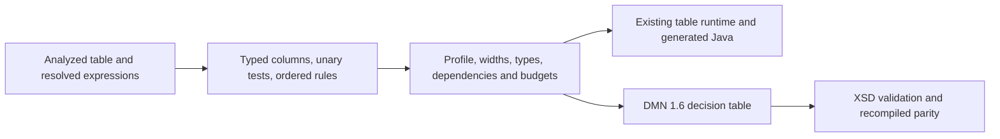

### Acceptance

1. Pin wire tags and headers. Test earlier reader rejection and earlier artifact acceptance.
2. Exercise malformed shapes, duplicate IDs, illegal test groups, missing bounds, incorrect
   types, undeclared dependencies, old profiles and size limits in the bounded codec.
3. Verify no-match defaults, null candidates, open/closed endpoints, disjunction and negation.
   Exercise overlapping `UNIQUE` and `FIRST` rules and equal/unequal `ANY` results.
4. Compare direct compilation, artifact execution, generated Java and recompiled DMN across
   the composed policy and standalone Fine fixtures. Validate against official DMN 1.6 XSD,
   verify determinism and run an artifact-only consumer in a separate JVM.
5. Run JUnit 5/Surefire focused tests, the full reactor, tooling and strict documentation checks.

The slice touches the portable schema, codec, compiler adapters and their tests and docs.
It reuses existing source analysis, runtime table execution and DMN writing. The public wire
change is the review boundary. The accepted representation architecture remains ADR-0026.


### Implementation and verification

The producer retains table, column and rule identities and binds cell references using the
existing semantic analyzer. The bounded reader checks table shape, result types, dependencies,
unary tests and declaration budgets. The runtime adapter derives local rule indexes, and DMN 1.6
synthesis writes the same table with normalized FEEL. An artifact-only JVM process runs the
composed policy from bytes. The Fine fixture is extracted from the existing Traffic Violation
model with its item constraint removed for this slice.

The saved 0.4 binaries accepted a 0.4 artifact and rejected a 0.5 table with `UNKNOWN_FIELD`.
The current reader accepted both. The compatibility harness and input artifacts are in
`target/dmnir-0.4-baseline`.

The focused runs found and corrected a missing 0.5 namespace declaration for named result
types and supplied the Fine fixture's complete input record. A generated-Java parity check
then exposed the missing all-null record default. The Java emitter preserves the record shape
on no match and enforces the existing runtime's `UNIQUE` and `ANY` overlap rules.

The focused DMNIR and Java suites passed 113 tests before the Java emitter correction.
The final full reactor passed 623 tests with zero failures, errors or skips, including 16 Java
generator tests. The separate generated-Java Fine check passed all six cases. See
`target/release-1.2-tables-focused-complete.log`, `target/release-1.2-tables-reactor.log` and
`target/release-1.2-tables-generated-fine-final.log`. The focused runs did not measure Spark
routing. The reactor measured 3,034 native actions (96.23%) and 119 fallback actions (3.77%)
of 3,153 completed SQL actions across four Spark suites, with zero unknown and 60 failed actions
counted separately. These are regression-suite actions. No new official TCK was run for this slice.

All 73 tooling tests, strict MkDocs and documentation facts and maintained-link checks passed.

The full Traffic Violation model still requires item constraints. Collections, functions,
authoring DSL and independent Rust execution remain open.

## 22. Scalar constraints on record fields

Date 2026-11-07. Status **implemented and verified locally**. The bounded outcome is to preserve an admitted
field domain through DMN import, portable execution, Java generation and artifact-only DMN 1.6
export. The existing frontend parses both item-constraint spellings, and semantic analysis
checks unary-test operand types. Runtime type lowering currently drops the domain. The
[DMN 1.6 schema](https://www.omg.org/spec/DMN/20240513/DMN16.xsd) allows `typeConstraint`
on a typed item component. [OMG's operational-semantics issue](https://issues.omg.org/issues/DMN18-70)
records an open question about when constraints apply. The timing and diagnostic below are
proposed DMNIR profile behavior.

### Additive schema 0.6

Use `finmsg-dmnir-field-constraints/0` and append `dmnir.field-constraints` to the exact ordered
0.5 capability list. Add a presence-bearing `DmnIrUnaryTests constraint = 4` to
`DmnIrRecordField`. Store the tests on their declaring field, including unused declarations and
fields reached through imported named types. Keep the existing record type reference and
all 0.0 through 0.5 wire tags.

- Admit constraints on scalar record fields with boolean, number, string or civil-date bases.
  Reuse 0.5 unary-test groups and comparison/range typing. Endpoints must be constants:
  normalize signed decimal literals and supported constant date spellings before validation.
  Admit explicit null as an equality or inequality endpoint under the existing test rules.
- Reject empty test groups, unbounded ranges, dynamic endpoints, candidate-bound predicates,
  constraints on collections or whole records, and top-level constrained scalar type aliases.
  Apply the existing wire budgets, field declaration limits and model-local identity checks.
- Accept one source constraint per field using either `allowedValues` or `typeConstraint`.
  Diagnose duplicate constraint children before either can overwrite the other in the frontend.
  Export the normalized domain as `typeConstraint` in synthesized DMN 1.6. The legacy element
  spelling and vendor styling are outside the portable semantics.

### Execution and compatibility

Proposed default for schema 0.6 consumers is **enforcement**. Carry the field domain into
derived execution metadata and share one matcher across portable runtime and generated Java.
Test a structurally accepted record when it enters a model input slot or is bound as a
decision result, traversing nested records in field order. At this profile, record-valued
local bindings take a record already checked at a slot, select between such values, or
produce null. A null record has no field values to check. A null field is tested against its
domain using the same matching rules as a table candidate. Report the first domain violation
as an evaluation error with a stable field path and omit the rejected value. Preserve existing
structural conversion rules, including their treatment of missing or ill-typed fields.

Limit the new execution behavior to models derived from verified 0.6 artifacts. The ordinary
DMN compiler and Spark paths keep their current behavior for source models. For disallowed
values, test the re-export path by producing a fresh portable artifact from the synthesized
DMN. Compare ordinary direct compilation on valid values. Carrying the constraint as export
metadata alone would preserve XML round trips but would leave independent consumers without
an agreed runtime contract. Applying the new checks to ordinary source execution would
change existing runtime and Spark behavior and is a separate compatibility decision.

The full Traffic Violation fixture also includes a terminal decision name ending in `?`.
Allow an XML-safe display name for a decision that is never rendered as a FEEL reference.
Keep the existing FEEL name validation for actual references and retain the original terminal
name, ID and variable name. Verify this rule with both referenced and unreferenced decisions.

### Acceptance

1. Verify exact headers and tags, 0.5 reader rejection, acceptance of earlier artifacts,
   malformed tests and bounded validation. Reject unsupported source constraints explicitly.
2. Exercise the full Traffic Violation source and compare both decisions on valid inputs
   through direct compilation, portable execution, generated Java and recompiled DMN 1.6.
   Check the emitted constraint and terminal decision against the official DMN 1.6 XSD.
3. Extend the composed policy with an imported nested record containing number and date
   constraints, a decision table and a downstream boxed context. Cover open and closed
   boundaries, explicit null, invalid input and invalid decision output. Compare violation
   diagnostics across portable runtime, generated Java and artifacts reproduced from DMN.
4. Prove deterministic artifacts and XML, execute from bytes in a separate JVM, and run
   focused JUnit 5/Surefire, full reactor, tooling and strict documentation checks.

Review covers the public wire addition, the portable violation policy and the narrow export
name rule. Changes would touch the portable schema and codec, frontend and compiler adapters,
derived Runtime IR and Java execution, with no new dependencies or publication.

### Usage checkpoint and handover

The user asked to continue after the section 22 review request. The five-hour window had 18%
remaining, so the implementation was deferred and the full official Spark TCK ran against
the source committed as `1bae5dc`. Maven exited 0. All 3,391 distinct cases passed natively
(100.00%), with 0 fallback (0.00%), unknown routes, failures, execution errors, compilation
errors, compilation blocks, expected rejections or skips. The pinned suite revision was
`20274cd2ba9cad805db6114f331c743f4b2603a1`. See the
[Spark conformance record](../../docs/tck-conformance.md#native-spark-sql-checkpoint-2026-10-26).

### Implementation and verification

Schema 0.6 stores constant unary-test domains on scalar record fields. The runtime and Java
generator use the same domain matcher after structural conversion at input and decision
bindings. DMN 1.6 export emits the normalized `typeConstraint` element and preserves the
original terminal decision name in Traffic Violation. Referenced decision names still undergo
FEEL name checks. The complete Traffic Violation model and the imported policy passed portable,
Java and DMN 1.6 round-trip checks. The imported policy also passed artifact-only execution
in a separate JVM and reproduced invalid input and invalid result diagnostics after re-export.

The saved 0.5 reader accepted a 0.5 artifact and rejected the new wire field as `UNKNOWN_FIELD`.
The current reader accepted both profiles. The saved binaries, artifacts and compatibility
harness are in `target/dmnir-0.5-baseline`.

The final focused run passed 135 tests with no failures, errors or skips
(`target/release-1.2-field-constraints-focused-verified.log`). The focused suites did not
measure Spark routing. The full reactor passed 630 tests with no failures, errors or skips
(`target/release-1.2-field-constraints-reactor.log`). Across four Spark regression suites,
3,034 of 3,153 completed SQL actions were native (96.23%), 119 fell back (3.77%), and none
had unknown routing. The suites counted 60 failed SQL actions separately. This was a
regression-suite run. The official schema 0.6 checkpoint is recorded below.
All 73 tooling tests, strict MkDocs and documentation facts and maintained-link checks passed.

The 0.6 source was pushed as `abedbb7`. Its first full Spark TCK run at the 30-second limit
passed 3,390/3,391 cases natively (99.97%), with zero fallback and a timeout in `0035#001`.
The complete rerun at 120 seconds passed all 3,391 cases natively (100.00%) with zero
fallback (0.00%), unknown routes, failures, execution or compilation errors, rejections or
skips. Its case ledger matches the retained baseline.
[Spark conformance record](../../docs/tck-conformance.md#native-spark-sql-checkpoint-2026-10-26)

## 23. Named scalar collections and typed list values

Date 2026-11-07. Status **implemented and verified locally**. This slice retains named collection
declarations and ordered list constructors. The direct runtime already supports typed list
construction and conversion. The portable graph needs stable declaration identities so that
artifact-only DMN export can emit named collection declarations and qualified type references.
SPEC-001 provides prior art for an ordered list expression. This proposal adds the declaration
identity needed by the accepted interchange architecture.

### Additive schema 0.7

Use `finmsg-dmnir-scalar-collections/0` and append `dmnir.scalar-collections` to the exact
ordered 0.6 capabilities. Keep all prior fields and use these additions.

| Owner | Field | Tag |
| --- | --- | ---: |
| `DmnIrModel` | `repeated DmnIrCollectionDefinition collection_definitions` | 7 |
| `DmnIrCollectionDefinition` | `DmnIrElementIdentity identity` | 1 |
| `DmnIrCollectionDefinition` | `DmnIrScalarType element_type` | 2 |
| `DmnIrVariable` | `DmnIrReference collection_type` | 5 |
| `DmnIrExpression` | `DmnIrReference collection_type` | 11 |
| `DmnIrExpression.node` | `DmnIrListExpression list` | 12 |
| `DmnIrTypeReference.kind` | `DmnIrReference collection_type` | 3 |
| `DmnIrListExpression` | `repeated DmnIrExpression elements` | 1 |

Exactly one scalar, record or collection type may be selected. Resolve collection references
by namespace and element ID under the existing direct-import rules. Use the model-local ID
and type-name uniqueness rules across records and collections. Admit boolean, number, string
and civil-date elements, each nullable. A list expression uses a declared collection type
and has only scalar elements compatible with that declaration. An empty list still carries
its collection type. List values can appear in inputs, results, named record fields and boxed
local bindings. A global or local reference retains its declared type. A conditional admits
the same named collection on both branches or a collection and explicit null.

### Execution and export

Use existing list evaluation and conversion in the portable adapter and generated Java.
Retain element order, duplicate elements and null elements. Keep null, an empty list and a
list with a null element distinct. Reuse native boundary singleton promotion for a valid
scalar input to a collection. Portable expression typing requires an explicit list constructor
or a compatible collection value. Source literals get their named type from the expected
declaration, including empty constructors and conditional branches.

Export the named item definition with `isCollection="true"`, a child `typeRef`, and the
original declaration ID. Emit a FEEL list constructor with escaped scalar elements. The
existing writer currently emits a top-level item-definition type as an attribute. The DMN 1.6
path needs the child element for a schema-valid collection definition.

Reject nested collections, lists of records, constrained collections, anonymous collection
declarations, filters/indexing, collection-valued table cells and list functions in this
profile. Apply existing wire/message/declaration budgets to collection definitions, type
references and list elements.

### Acceptance

1. Pin the additive tags and exact header. Verify old-reader rejection and old-artifact
   acceptance. Reject malformed types, missing imports, mixed element kinds and oversized lists.
2. Extend the composed policy with an imported named collection type, a list in a nested
   record, a table-derived scalar and a boxed list result. Verify duplicates, empty and null
   lists, null members, singleton inputs and exact number/date values.
3. Compare direct compilation, artifact-only execution in a separate JVM, generated Java
   and recompiled DMN 1.6. Check the original collection identities, the DMN 1.6 XSD and
   deterministic output, then run focused tests, full reactor and documentation checks.

Review covers the public wire addition and list typing, coercion and interchange rules.
The change would touch the schema, bounded codec, compiler adapters, XML writer and tests,
and reuse existing runtime and Java list operations.

### Implementation and verification

The two-model policy retained imported date and numeric collection identities, list fields
inside a nested constrained record, a table-derived fee and a boxed list result. Direct
compilation, artifact-only runtime, DMN 1.6 export and recompiled execution agreed. A separate
JVM consumed the artifact from bytes. The generated-Java fixture exercised the imported
collection, table result and boxed list values. Tests checked duplicates, null members, null
and empty lists, exact numbers and dates, and scalar-to-singleton input promotion.

The saved 0.6 reader accepted 0.6 and rejected 0.7 with `UNKNOWN_FIELD`. The current reader
accepted both. Compatibility evidence is in `target/dmnir-0.6-baseline`.

The final focused run passed 140 tests, with no Spark routing measurements. The full reactor
passed 635 tests with zero failures, errors or skips. It measured 3,034 native actions (96.23%)
and 119 fallback actions (3.77%) among 3,153 completed Spark regression SQL actions, with zero
unknown routes and 60 failed actions counted separately. The official 0.7 checkpoint below
uses a separate case denominator. All 73 tooling tests, strict MkDocs and documentation facts
and maintained-link checks passed. Logs are in `target/release-1.2-collections-focused-final.log`
and `target/release-1.2-collections-reactor.log`.

The full official Spark TCK on pushed 0.7 source `bd5f509` passed 3,391/3,391 cases natively
(100.00%) with zero fallback (0.00%), unknown routes, failures, execution or compilation
errors, rejections or skips. The 120-second run matched the retained case ledger. See the
[Spark conformance record](../../docs/tck-conformance.md#native-spark-sql-checkpoint-2026-10-26).

## 24. Boolean filters on named scalar collections

Date 2026-11-07. Status **implemented and verified locally on 2026-11-08**. Add FEEL boolean filters to the named scalar
collections in 0.7. Reuse the existing parser, semantic binding for implicit `item`, and
Runtime IR filter. The [OMG list and filter semantics](https://www.omg.org/spec/DMN/1.5/PDF)
describe retaining elements whose predicate is true. In the current toolkit the interpreter
copies filtered results with `List.copyOf`, which throws if the predicate retained a null
member. Generated Java retains such members. The slice includes an interpreter parity fix.

### Additive schema 0.8

Use `finmsg-dmnir-scalar-filters/0` and append `dmnir.scalar-filters` to the exact ordered 0.7
capabilities. Add `DmnIrFilterExpression filter = 13` to the existing `DmnIrExpression.node`
oneof. The new message has `DmnIrExpression source = 1`, `string item_binding_id = 2` and
`DmnIrExpression predicate = 3`. All existing tags retain their meanings.

- The source and result have the same namespace-qualified collection type from 0.7. The item
  type is the scalar element type from that declaration. Derive it once and use existing
  `DmnIrLocalReference` nodes to refer to the item by binding ID.
- Resolve the source in the outer scope. Bind the non-empty, decision-local unique item ID
  only while verifying the predicate. The predicate has static boolean type and may read
  the item, resolved outer locals and declared global dependencies. A boolean expression
  may evaluate to null. Apply existing declaration, depth and reference budgets.
- Evaluate the source once. A null source yields null. For an empty list, return an empty
  list without evaluating the predicate. Retain each element whose predicate evaluates to
  true, including null members. Preserve order and duplicates. False and null results omit
  the candidate. Keep interpreter results immutable while allowing retained nulls.
- Admit chained filters in source positions. Defer filters inside a predicate, scalar
  source promotion within the filter operation, implicit record member scopes, collection
  functions, quantifiers and numeric indexing. Numeric indexing needs its own boundary:
  the current interpreter uses exact integer conversion while generated Java truncates.
- Export normalized FEEL bracket syntax with `item` bound only inside the predicate. Reject
  an artifact for XML export if rendering a resolved reference would capture a different
  binding. Slot numbers are derived by each consumer.

### Acceptance

1. Pin the field tags and exact profile, verify rejection by a saved 0.7 reader, and test
   missing bodies, invalid types, duplicate IDs, escaped scope and undeclared dependencies.
2. Extend the composed policy with an imported scalar collection, a table-derived cutoff
   and a boxed local used by the predicate. Test chained filters, exact boundaries,
   duplicate and null members, null and empty sources, and false or null predicate results.
3. Compare direct compilation, artifact execution in a separate JVM, generated Java and
   recompiled DMN 1.6. Verify deterministic artifacts, XSD validation and capture rejection.
4. Run focused JUnit/Surefire, the affected official list/filter cases, full reactor and
   documentation checks. Keep focused TCK and reactor routing accounting separate.

Review covers the public wire field and predicate semantics, including preserving selected
null members in direct interpretation. The slice touches the schema, codec, compiler
adapters and runtime filter path, with no new dependencies or publication.

The user asked to continue after the section 24 review request. The five-hour window had
23% remaining before the official 0.7 baseline and 17% after it. The usage checkpoint took
priority over implementation. Implementation resumed after the user directed it to continue.

### Implementation and verification

The codec enforces collection identity, boolean predicates, item binding scope, and declared
dependencies. The producer resolves the item, the adapter derives the runtime slot, and DMN 1.6
export renders the bracket expression while checking name capture. The composed policy passed
direct interpretation, artifact-only execution in a separate JVM, generated Java, and
artifact-only DMN 1.6 export and recompiled evaluation. Tests cover order, duplicates, retained
nulls, null and empty sources, nullable predicates, and XML name capture.

The saved 0.7 reader accepted a 0.7 artifact and rejected the new filter field with
`UNKNOWN_FIELD`. The current reader accepted both. See `target/dmnir-0.7-baseline`.

The first focused run exposed a runtime lexical-frame mismatch. An early full run after
fixing the mismatch failed one indexed-join assertion because the runtime change also affected
record-valued filters. That run measured 3,030 native actions (96.22%) and 119 fallback actions
(3.78%) among 3,149 completed Spark regression actions, with zero unknown and 56 failed SQL
actions counted separately. The final fix limits shared frames and null-preserving results
to typed scalar boolean filters. The indexed-join retest passed, measuring six native actions
(100%), zero fallback (0%), and six expected failed SQL actions counted separately.

Final focused verification passed 131 DMNIR and Java generator tests and the indexed-join
regression. The focused official list/filter TCK passed all 41 cases on each of interpreter,
generated Java and Spark. All 41 Spark cases ran natively (100%) with zero fallback (0%),
failures, execution or compilation errors, rejections or skips. Evidence:
`target/release-1.2-scalar-filters-parity-retry.log` and
`target/release-1.2-scalar-filters-tck-final-accounting.json`.

The full reactor passed 640 tests with zero failures, errors or skips. It measured 3,034
native actions (96.23%) and 119 fallback actions (3.77%) among 3,153 completed Spark regression
actions, with zero unknown and 60 failed actions counted separately. This routing denominator
is separate from the official TCK. See `target/release-1.2-scalar-filters-reactor-verified.log`.
All 73 tooling tests, strict MkDocs and documentation facts and maintained-link checks passed.

## 25. Fixed-signature FEEL built-ins (schema 0.9)

The user directed implementation after reviewing the 0.9 proposal. The contract below
is implemented in the producer, verifier, runtime adapter and artifact-only DMN exporter.

Use semantics `finmsg-dmnir-builtin-calls/0` and append `dmnir.builtin-calls` to the exact
ordered 0.8 capabilities. Add `DmnIrBuiltinCall builtin_call = 14` to
`DmnIrExpression.node`. The call has `DmnIrBuiltinOperation operation = 1` and
`repeated DmnIrExpression arguments = 2`. Enum value zero is unspecified and rejected.
The enum identifies a particular typed signature. This keeps existing IDs unambiguous
when admitting more overloads.

| Enum value | Signature | Result for non-null inputs |
| --- | --- | --- |
| `BUILTIN_OPERATION_ABS_NUMBER = 1` | `abs(number) -> number` | Exact decimal magnitude |
| `BUILTIN_OPERATION_STRING_LENGTH = 2` | `string length(string) -> number` | Unicode code-point count |
| `BUILTIN_OPERATION_CONTAINS_STRING = 3` | `contains(string, string) -> boolean` | Case-sensitive substring match, with an empty substring always matching |

Verify exact arity, static argument types and result type, and apply existing expression
and scope budgets to every argument. Evaluate arguments once in source order. Each signature
returns null if any argument evaluates to null. Match strings without Unicode normalization.
The producer resolves positional calls through the existing FEEL built-in resolution and
admits only the listed signatures with the required static types. Preserve the existing
representations for unary `not` and constant `date`. Named built-in arguments, aggregate
overloads and other signatures remain outside this profile.

Reuse Runtime IR built-in operations and existing runtime behavior. DMN 1.6 export renders
the equivalent positional FEEL call and checks that the function name resolves to the intended
built-in. Consumers derive dispatch locally from the enum.

Use the existing Maven JUnit/Surefire harness. Pin the enum and field IDs, reject invalid
calls and confirm that a saved 0.8 reader accepts 0.8 artifacts and rejects a 0.9 call.
Extend the composed policy with a built-in inside a filter predicate. Cover exact decimals,
empty strings, supplementary characters, composed and decomposed text, and null arguments.
Compare direct execution, separate-JVM artifact execution, generated Java and recompiled
artifact-only DMN 1.6 with XSD validation. Record artifact and expected-value vectors for
the independent Rust consumer. Run affected official cases and the full reactor with
separate routing accounting.

### Implementation evidence

The codec tests pin the operation IDs and field tags and reject missing or unknown
operations, incorrect arity and types, and references outside the caller scope. The saved
0.8 reader accepts a 0.8 artifact and rejects the new call with `UNKNOWN_FIELD`.
The current reader accepts both. See `target/dmnir-0.8-baseline` for the binaries and vectors.

The composed two-model fixture exercises `abs` in a filter using an imported list and a
table-derived cutoff. It passed direct evaluation, artifact-only execution in a separate
JVM, and XSD validation and recompiled evaluation of artifact-only DMN 1.6. A mutated
artifact checks that export rejects function-name capture. An initial round-trip test
exposed missing namespace declarations for 0.9 imports, which the verified run covers.
Generated Java and the artifact interpreter agree on the composed filter and the scalar
vectors for exact decimals, Unicode code points, empty strings and explicit null inputs.
The scalar vectors also check that numeric `abs` can feed arithmetic.

The full reactor passed 645 tests outside the optional TCK runner, with no failures,
errors or skips. The selected official `abs`, `string length` and `contains` suites
passed 33 cases on each of interpreter, generated Java and Spark SQL. Spark passed all
33 cases natively (100%) with zero fallback (0%) or unknown routes. These official
suites exercise the existing backends and are separate from the DMNIR parity fixtures.
See `target/release-1.2-builtin-reactor-verified.log` and
`target/release-1.2-builtin-tck-accounting.json`.

Across the four instrumented Spark regression suites, 3,034 of 3,153 completed
actions ran natively (96.23%), 119 used fallback (3.77%), and none had an unknown
route. Sixty failed SQL actions were counted separately. Spotless, all 73 tooling
tests, strict MkDocs, and the documentation facts and maintained-link checks passed.

## 26. Resolved named FEEL BKMs (schema 0.10)

The user approved this contract. The schema, bounded verifier, producer, runtime
adapter and DMN 1.6 exporter implement it.

Use semantics `finmsg-dmnir-named-feel-bkms/0` and append `dmnir.named-feel-bkms` to the
exact ordered 0.9 capabilities. Add `repeated DmnIrBkm bkms = 8` to `DmnIrModel`,
`repeated DmnIrReference knowledge_dependencies = 6` to `DmnIrDecision`, and
`DmnIrBkmCall bkm_call = 15` to `DmnIrExpression.node`.

- `DmnIrBkm` has `DmnIrElementIdentity identity = 1`,
  `repeated DmnIrBkmParameter parameters = 2`, `DmnIrVariable variable = 3` for the
  typed result declaration, `DmnIrExpression body = 4` and
  `repeated DmnIrReference knowledge_dependencies = 5`. Admit expression-bodied
  FEEL BKMs with declared result types and check the body against the result declaration.
- `DmnIrBkmParameter` has `string binding_id = 1` and `DmnIrVariable variable = 2`.
  Parameter declaration order defines positional binding. Verify unique names and binding IDs
  within the function scope. Existing local reference nodes address parameters by binding ID.
- `DmnIrBkmCall` has `DmnIrReference target = 1` and
  `repeated DmnIrBkmArgument arguments = 2`. An argument has
  `uint32 parameter_position = 1` (one-based) and `DmnIrExpression expression = 2`.
  Resolve positional and named source calls to these same formal positions. Preserve the
  argument list in source evaluation order. Every formal position must occur exactly once.
- Verify argument and result types against the declaration, including qualified record and
  collection identities. Verify that each call targets a declared knowledge dependency in
  the same model or a direct import. Reject missing and duplicate dependencies, cycles and
  out-of-scope references. Apply declaration, dependency depth and expression budgets to the
  BKM graph, including dependency chains spanning bundled models.
- Evaluate each argument once in the caller's scope. Invoke the body with a fresh frame,
  placing values into their formal positions, including null values. A body can read its
  parameters and locals and call its declared knowledge dependencies. Derive BKM order
  and slots independently of the existing decision evaluation order.

Use Runtime IR function definitions and invocation support for execution. Export a FEEL
BKM with its declaration, formals, expression body and knowledge requirements. Emit named
arguments in the stored order if formal positions differ from positional order. Validate
qualified call names and references during export. Defer BKM decision-table bodies, direct
global capture, recursive calls, inline function values and external function kinds.

Use the same Maven harness and parity stages as 0.9. Extend the composed policy with a local
BKM that calls an imported BKM and a decision that calls it with reordered named arguments.
Include positional calls, a parameter shadowing an outer name, nullable arguments and a
structured type with qualified identity. Test wrong arity, missing or duplicate positions,
undeclared and wrong-kind targets, mismatched types and cycles across bundled models.
Check the prior reader boundary, XSD validation, the affected official cases and the
full reactor. The DMN 1.6 export gates use the
[OMG DMN 1.6 specification and schema](https://www.omg.org/spec/DMN/1.6).

Review applies to the proposed public field tags, signatures, binding and evaluation rules.
The target is the DMNIR schema, verifier, compiler adapters, artifact execution and DMN 1.6
export. These slices require no new dependencies or publication.

### Implementation and verification

The composed fixture covers a local BKM calling an imported BKM in arithmetic, a
qualified record parameter, a shadowing formal, positional, reordered named and
boxed calls, and null values. Direct interpretation, separate-JVM artifact execution,
and XSD-validated DMN 1.6 export and recompilation agreed. Generated Java independently
verified reordered and nullable calls. The saved 0.9 reader accepted a 0.9 artifact
and rejected 0.10 with `UNKNOWN_FIELD`. The current reader accepted both.

The first full TCK run passed all 3,391 cases with 3,377 native (99.59%) and 14
fallback (0.41%). The fallback cases were in suites 0037, 0038, 0086 and 0087.
The fix confines BKM return-type inference to DMNIR production, preserving the
existing compiler input to Spark. The final full pinned Spark TCK passed **3,391/3,391
natively (100%), zero fallback (0%)**, with zero failures, unknown routes or
compilation blocks. See `target/release-1.2-bkm-reactor-and-full-spark-final.log`
and `target/release-1.2-bkm-full-spark-accounting.json`.

The final reactor passed 650 tests outside the TCK runner with no failures, errors or
skips. The separate Spark regression actions recorded 3,034 native (96.23%), 119
fallback (3.77%), and zero unknown across 3,153 completed actions, with 60 failed
actions counted separately. Spotless, 73 tooling tests, strict MkDocs and maintained
documentation checks passed. This run completed the usage checkpoint. The 0.10
implementation was pushed as `ceb52d5`.

## 27. Inline FEEL functions and lexical capture (schema 0.11)

Use semantics `finmsg-dmnir-inline-feel/0` and append `dmnir.inline-feel` to the exact
ordered 0.10 capabilities. Admit a FEEL function declared in a boxed context and called
later in that context, and a FEEL function literal invoked immediately. Both forms use the
same typed body and capture contract. A call can appear wherever the existing profile
admits an expression of its result type and the source and exporter can represent it.

### Wire shape

- Add `DmnIrClosureInvocation closure_invocation = 16` to `DmnIrExpression.node`.
  Its `target` oneof contains `string local_binding_id = 1` or `DmnIrClosure inline = 2`.
  Field 3 is `repeated DmnIrExpression arguments` in positional evaluation order.
- Add `DmnIrClosureBinding closure = 4` to `DmnIrLocalBinding`. A value binding keeps
  the existing `binding_id`, `variable` and `value`. A closure binding uses the existing
  `binding_id` with `closure` and leaves `variable` and `value` unset. The new message
  has `string name = 1`, `optional string id = 2` for the local information item, and
  `DmnIrClosure definition = 3`.
- `DmnIrClosure` has `repeated DmnIrBkmParameter parameters = 1`,
  `DmnIrTypeReference result_type = 2`, `repeated string captured_binding_ids = 3`, and
  `DmnIrExpression body = 4`. Reuse the BKM formal's binding ID and typed variable shape.
  Parameters, captures and results use existing scalar, record or collection types.
  Closure signatures stay in the closure declarations. Existing value types and tags
  retain their meanings.

### Scope and evaluation

- A closure can capture earlier value bindings visible at its definition, including BKM
  parameters and an enclosing filter's item. The capture list must equal the outer value
  references used by the body, with unique IDs in ascending unsigned UTF-8 byte order.
  Check each capture against the definition scope before entering the body. Within the
  body, only these captures, its formals and its own value bindings are visible. Bound BKM
  calls still require the enclosing declaration's knowledge dependencies.
- A closure binding becomes callable after its definition. Reject value references to
  closure bindings, calls to value bindings, forward references, recursion, nested closure
  definitions or closure calls within a closure body, and direct global reads within a
  closure body. A global value can be assigned to a local before the closure is created.
  Require unique formal names and unique binding IDs within the enclosing declaration.
  Verify exact arity and type assignability using the existing nullable and qualified type
  rules. Count formals, declarations, captures, local targets and body nodes against the
  existing budgets, including the pre-allocation wire scan.
- Capture the bound values when the definition is evaluated. Later shadowing does not
  change which values it reads. A call evaluates arguments once from left to right in
  the caller's scope and runs the body in a fresh frame. Preserve null arguments and
  captures. Calls return the typed body result. Runtime IR and generated Java derive
  slots and lexical depths locally. No runtime slot or Java-specific type is stored.
- The producer admits typed positional calls and emits only captures proven by semantic
  bindings. DMN 1.6 export reconstructs local boxed function definitions and FEEL calls,
  or a parenthesized function literal for an immediate call. Reject export if a name
  would resolve to a different binding or the body cannot be rendered in its expression
  position. Validate against the [OMG DMN 1.6 schema](https://www.omg.org/spec/DMN/1.6).
  Named closure arguments, passing or returning functions as values, external functions
  and general higher-order calls remain outside this profile.

### Acceptance

1. Use the existing Maven JUnit/Surefire harness. Pin the new fields and ordered header.
   Verify that a saved 0.10 reader accepts 0.10 and rejects 0.11. Exercise missing bodies,
   invalid or surplus captures, escaped scope, wrong call targets, duplicate bindings,
   mismatched types and wire limits.
2. Extend the composed policy with a closure that captures the table-derived cutoff and
   is called from a filter. Include a repeated call, an immediate call, a later shadowing
   binding, nullable capture and argument vectors, and a qualified structured type.
   Confirm definition-time binding and fresh frames per call.
3. Compare direct evaluation, separate-JVM artifact execution, generated Java and
   recompiled artifact-only DMN 1.6. Include an XML capture rejection case. Record the
   portable input and expected-value vectors for independent consumers.
4. Run the affected official cases and the full reactor. Report official Spark routing
   separately from the regression-action denominator.

Review covers the new public wire fields, the first supported call forms, and scope and
evaluation behavior. The implementation would touch the DMNIR schema, verifier, source
producer, Runtime IR adapter and exporter, plus any parity fixes needed by the approved
profile. No new dependencies or publication are required.

The weekly usage window reached 20% remaining during review preparation. The full
pinned Spark TCK rerun on `ceb52d5` passed all 3,391 executable cases natively
(100%), with zero fallback (0%), failures, execution or compilation errors,
expected rejections, or unknown routes. See `target/release-1.2-inline-feel-checkpoint.log`
and `target/release-1.2-inline-feel-checkpoint-accounting.json`. This run verifies the
0.10 baseline.

### Implementation and verification

After the user directed work to continue below the usage checkpoint, the schema,
verifier, producer, runtime adapter and DMN 1.6 exporter implemented the reviewed
call forms. The XML frontend and FEEL parser preserve the boxed function kind so
portable production can reject external kinds. The existing compiler continues
to use its original function typing mode.

The composed policy verified a table-derived capture, repeated calls from a filter,
later name shadowing, an immediately invoked literal, and a qualified record
parameter. Direct execution, separate-JVM artifact execution, and XSD-validated
DMN 1.6 export and recompilation agreed. Generated Java verified repeated calls
and null arguments and captures. The verifier tests covered missing bodies, capture
scope and use, duplicate capture IDs, invalid targets, arity and argument types.
Export rejected a mutated formal name that would hide a capture. The saved 0.10
reader accepted 0.10 and rejected the new closure field with `UNKNOWN_FIELD`.

The full reactor passed 654 tests outside the TCK runner with zero failures,
errors or skips. The full pinned Spark TCK passed **3,391/3,391 natively (100%)**
with zero fallback (0%), failures, execution or compilation errors, expected
rejections or unknown routes. See `target/release-1.2-closure-reactor-spark.log`
and `target/release-1.2-closure-full-spark-accounting.json`.

The separate Spark regression suites recorded 3,034 native actions (96.23%),
119 fallback actions (3.77%) and zero unknown across 3,153 completed actions.
Sixty failed SQL actions were counted separately. Spotless, 73 tooling tests,
strict MkDocs and maintained documentation checks passed. This implementation
remains local.

## 28. Rust artifact-only proof (R12-09a)

The user selected Rust as the next implementation target. Start with the smallest
complete artifact-to-generated-code path, using schema 0.0. The broader Rust v0
profile in R12-00 remains a follow-up to this proof.

- Accept major 0, minor 0, semantics `finmsg-dmnir-scalar/0` and exactly
  `dmnir.scalar`. Admit bundled models, direct imports, typed scalar literals
  and resolved scalar references. Use namespace and element ID as public input
  and result keys. Keep the declared decision evaluation order.
- Preserve null, boolean, string and exact decimal coefficient and scale. This
  slice carries decimal values and performs no arithmetic. Reject unsupported
  profiles, malformed wire data, unresolved or undeclared references, type
  mismatches and invalid schedules before creating generated output.
- Use the checked-in schema as the binding source and apply wire budgets before
  decode. Pin the Rust toolchain and any decoder or build dependencies before
  implementation. Keep the generated crate free of protobuf and JVM dependencies.
- Prove the path using a Java-produced 0.0 artifact and a separate Rust process
  whose only model input is that artifact. Generate a crate, build it offline
  and invoke its evaluator with typed inputs. Compare named outputs with the
  existing Java artifact adapter for a bundled import, exact decimal, Unicode
  string and explicit null. Run the generation twice and compare output bytes.
  Include malformed, oversized and unsupported artifacts, plus a saved 0.1
  artifact as a deliberate rejection. Keep input and result vectors reusable by
  the DSL parity suite.

The initial Rust 1.95.0 toolchain probe passed. The user then requested the latest
stable Rust and directed implementation to continue below the usage checkpoint.
The prototype pins Rust 1.99.1, Prost 0.14.4 and vendored Protobuf compiler package
3.2.0, with a Cargo lockfile. [Rust 1.99.1 release announcement](https://blog.rust-lang.org/2026/10/15/Rust-1.99.1/)

The Java fixture exporter produced a bundled 0.0 artifact and checked the expected
decimal, Unicode, boolean and null outputs against the Java artifact adapter. A
separate Rust process generated the same source twice. The generated crate compiled
and executed offline and matched those outputs, including coefficient and scale.
Negative tests cover duplicate and truncated wire fields, the byte budget, 0.1
rejection, dependency order and undeclared references. See the
[`dmn-generator-rust` README](../../dmn-generator-rust/README.md) for the build and
fixture entry points. The broader R12-09 profile remains open. The latest full
Spark checkpoint remains the 0.11 run in section 27.

The prototype is committed in the toolkit repository as `f381e0d`. The separate
Rust artifact parity workflow checks out only the generator and schema trees, uses
the matching Rust 1.99.1 container, checks that Java is absent, and runs the locked
tests offline after fetching dependencies. The same sparse layout passed all three
Rust tests locally on Windows with Java removed from PATH. The prototype and CI
commits were pushed, and the first hosted Linux workflow passed at `713f300`.
[GitHub Actions run](https://github.com/finmsg-io/dmn-compiler-toolkit/actions/runs/42704961619)

## 29. Rust scalar expression execution (R12-09b)

Extend the Rust generator to the comparison and conditional subset of DMNIR 0.1.
Reuse the existing exact `finmsg-dmnir-scalar-expressions/0` header and ordered
`dmnir.scalar`, `dmnir.scalar-expressions` capabilities. The 0.0 producer and
consumer contract remains available. This slice requires no new wire fields,
dependencies, output crate API changes or publishing steps.

- Admit numeric unary plus and negation, boolean `not`, scalar equality and
  inequality, numeric and string ordering, `and`, `or`, and conditionals.
  Match the Java verifier's admitted signatures for these operators. Reject
  arithmetic binary operators in this first slice, including in unselected branches.
- Compare exact decimals numerically across scales. Use the sign and digit
  sequences with virtual zero padding, without allocating a widened decimal or
  converting to floating point. Unary negation preserves the scale and keeps zero
  canonical. Match Java string ordering by comparing UTF-16 code units.
- Use the existing artifact evaluator's scalar equality semantics. Two nulls
  compare equal, a single null compares unequal, and mismatched non-null types
  yield null. Ordered comparisons yield null if either operand is null.
  `and` and `or` use three-valued short-circuit logic. A conditional evaluates
  its condition once and evaluates only the selected branch. False and null
  conditions select the else branch.
- Validate both operands and both branches before emitting output. Apply the
  same depth, node, field and reference budgets to nested expressions. Reject
  invalid signatures, missing operands, undeclared references and any structured
  node under a 0.0 header. Keep the generated crate free of dependencies.
- Add a Java-produced 0.1 fixture with a conditional over nullable numeric,
  boolean and string inputs. Verify numeric equality across different scales,
  supplementary characters in ordering, mixed-type equality, the three-valued
  truth table, and null branch selection. Check each expected output in the
  Java adapter and the generated Rust crate. Keep the 0.0 fixture and a rejected
  0.1 arithmetic artifact. Verify deterministic generation and run the hosted
  Java-free Rust parity workflow after a separately authorized push.

Review covers the admitted operator subset and its observable value semantics.
Decimal binary arithmetic and the table profile remain separate Rust slices.

### Implementation and verification

The generator accepts the reviewed 0.1 subset and still accepts 0.0. The Java
fixture exporter checked all nine Boolean input pairs, exact decimal comparison
and negation across scales, UTF-16 ordering of a supplementary character, mixed
types and nulls. It also produced a verified wire-only unary-plus case. The
generated Rust crates for 0.0 and 0.1 built and ran offline, and both generated
deterministically across separate invocations.

All six outer Rust tests passed on 1.99.1. They include the two generated-crate
parity runs, dependency and schedule checks, rejected artifacts, recursive wire
depth, and validation of an unselected branch with unsupported arithmetic. The
hosted Java-free Rust parity run passed on `a781815`. No Java, Spark or wire schema
code changed. The full Spark checkpoint in section 27 still applies to that code.
[GitHub Actions run](https://github.com/finmsg-io/dmn-compiler-toolkit/actions/runs/42706711804)

## 30. Rust exact decimal addition and subtraction (R12-09c)

Extend the admitted DMNIR 0.1 subset with `ADD` and `SUBTRACT`. Both operands and
the result must be statically numeric. Keep the existing header, tags, input and
result types, and dependency-free generated crate.

- Evaluate operands once in source order. Return null if either value is null.
  Compute signed decimal coefficients exactly at the greater operand scale.
  Preserve that scale through cancellation, including a canonical zero coefficient.
  This matches the existing Java artifact evaluator's numeric operations.
- Validate the whole graph before generation. Track the longest chain of numeric
  additions and subtractions through expressions and resolved decision references.
  Take the maximum across the condition and both branches. Admit chains of at most 128
  operations, counting only these two operators. The existing limits of 4,096
  coefficient digits and absolute scale 4,096 bound each accepted result to
  12,416 coefficient digits. Reject an artifact whose longest chain exceeds the
  limit before creating output. This is a Rust admission limit.
- Use signed digit arithmetic in the generated crate. Scale alignment, carry,
  borrow and sign handling must avoid binary floating point. Generated conditionals
  and Boolean operators retain their existing lazy evaluation.
- Produce a Java-backed 0.1 fixture for chained arithmetic and a conditional that
  compares a computed amount. Verify exact coefficient and scale for mixed scales
  and signs, carry, borrow, cancellation, negative scales, maximum scale difference,
  and nullable inputs. Include a dependency chain at the admission limit and one
  beyond it. Keep the previous fixtures and an artifact with a still-unsupported
  operator. Compare generated output bytes across invocations and run the Java-free
  parity workflow after an authorized push.

Review covers the exact arithmetic and the 128-operation chain limit.
Multiplication, division, powers and decision tables remain separate slices.

### Implementation and verification

The Java exporter checked nine input pairs against its artifact adapter. The
generated Rust crate matched all results and preserved scale, including
cancellation and an 8,192-place scale difference. It builds and runs offline,
with deterministic source across separate generator invocations. All nine Rust
tests passed. The verifier accepts a 128-operation dependency chain, rejects 129,
and rejects a separate Java-produced multiplication fixture before writing output.
The prior addition/subtraction rejection fixture is now an acceptance case.
The Rust changes were pushed as `5872c59` and hosted parity passed.
[GitHub Actions run](https://github.com/finmsg-io/dmn-compiler-toolkit/actions/runs/42892134159)
The usage checkpoint reran the full
pinned Spark TCK with **3,391/3,391 native passes (100%)** and zero fallback,
failures, execution or compilation errors, expected rejections or unknown routes.
See `target/release-1.2-rust-arithmetic-spark-checkpoint.log` and
`target/release-1.2-rust-arithmetic-spark-checkpoint-accounting.json`.

## 31. Rust exact decimal multiplication (R12-09d)

Extend the Rust subset of schema 0.1 with numeric `MULTIPLY`. Evaluate operands
once in order, propagate null, multiply their signed coefficients exactly, and
set the result scale to the sum of the operand scales. Keep zero canonical while
preserving that scale. This matches the Java artifact evaluator's numeric
multiplication. Retain the existing input limits, wire profile and crate API.

- Compute conservative numeric bounds before emitting output. An input can have
  up to 4,096 coefficient digits and scale between −4,096 and 4,096. A literal
  contributes its exact bounds, and a resolved decision reference uses the bound
  already derived for its producer. Unary signs preserve bounds. Conditionals
  join the possible numeric branch bounds. Track coefficient digits, the scale
  interval, and an upper bound for `digits - scale` for nonzero values.
- For a product, add both digit bounds, the scale intervals and the magnitude
  bounds. For addition or subtraction, use the larger possible operand scale and
  account for scale alignment and at most one additional carry digit. Preserve
  the 128-operation additive chain limit. When multiplication occurs in the
  graph, reject numeric expressions that could exceed 32,768 coefficient digits
  or absolute scale 8,192. This admits a product of two maximum-sized inputs and
  their addition, while rejecting some chained products at the default input limits.
- Use dependency-free base-10⁹ coefficient limbs and bounded carry propagation.
  Before writing output, reject graphs whose worst-case total exceeds 8,388,608
  limb products. Charge each multiplication by the product of its operand limb
  bounds, including nodes in unselected branches. Accepted graphs require no
  new runtime error or output type.
- Verify exact coefficient and scale with a Java-produced fixture and offline
  generated Rust. Cover mixed signs, cancellation after a product, zero, null,
  extreme input scales, limb boundaries, a sum of products, and arithmetic
  across decision references. Exercise rejection for each bound, including a
  rejected product hidden in an unselected branch. Keep a Java-produced division
  or power artifact as the unsupported-operation case.

Review covers the three admission limits and the exact multiplication contract.
Division, powers and decision tables remain separate slices.

### Implementation and verification

The generator derives conservative coefficient, scale and work bounds from
the verified graph. It keeps the existing additive chain limit and generates
exact decimal multiplication without adding a dependency or changing the
generated crate API.

The Java and generated Rust results agree for signed products, zero and null,
limb boundaries, extreme scales and two 4,096-digit inputs. The composed fixture
includes a sum of products, cancellation and a conditional over the product.
Separate tests verify the accepted edges and rejection beyond all three
multiplication limits, including a product in an unselected branch. A
Java-produced division artifact remains rejected before output is created.
All 13 Rust tests passed locally, including deterministic generation and offline
execution. The multiplication slice was pushed as `d21c51a` and hosted parity passed.
Spark production code is unchanged from the full checkpoint in section 30.
[GitHub Actions run](https://github.com/finmsg-io/dmn-compiler-toolkit/actions/runs/42893434594)

## 32. Rust DECIMAL128 division (R12-09e)

Admit numeric `DIVIDE` in the Rust subset of schema 0.1. Keep the wire header,
tags, typed input and result API, and dependency-free generated crate. Evaluate
both operands once in order. A null operand or a zero divisor yields null.

- Match the Java artifact evaluator's `BigDecimal.divide` with
  `MathContext.DECIMAL128`. Round inexact results to 34 significant digits using
  half-even rounding. For an exact quotient, preserve the scale closest to the
  dividend scale minus the divisor scale that represents the value within the
  precision. A zero dividend uses the preferred scale. Compare results by
  coefficient and scale. [BigDecimal](https://docs.oracle.com/en/java/javase/25/docs/api/java.base/java/math/BigDecimal.html)
  [MathContext](https://docs.oracle.com/en/java/javase/25/docs/api/java.base/java/math/MathContext.html)
- Use unsigned decimal limb long division. Align coefficient lengths with
  virtual decimal zeros and track the signed scale separately. Produce at most
  34 significant digits and one guard digit. Use the final remainder to distinguish
  a tie from a discarded nonzero tail. Handle a rounding carry that adds a leading
  digit and retain preferred-scale trailing zeros when precision permits.
- Bound division before generation. For operand coefficient bounds `L` and `R`,
  extend the preferred-scale interval downward by `L` and upward by `33 + R`
  to cover the possible quotient scale. Admit a quotient only when that interval
  fits absolute scale 32,768. Track its at-most-34-digit coefficient and conservative
  magnitude through references and conditional branches. Additive expressions
  and conditionals receiving a division result may carry scales through 32,768
  within the existing 32,768-digit coefficient and 128-operation additive limits.
  Multiplication retains its 8,192-scale and existing work limits.
- Charge each division `720 × ceil((max(L, R) + 2) / 9)` limb visits, based on the
  aligned remainder width and at most 35 quotient digits. Reject before output
  if the artifact-wide sum exceeds 8,388,608 visits. Include division nodes in
  unselected branches. Keep this budget separate from multiplication work.
- Verify Java and offline generated Rust parity on terminating quotients,
  preferred-scale examples, repeating quotients, half-even ties with even and
  odd retained digits, sticky remainders, leading carry, extreme scales, zero,
  null, signs, and division mixed with prior operations. Include generated
  boundary vectors and a power artifact as the next rejection fixture.

Review covers DECIMAL128 scale and rounding semantics and the new division
admission limits. Powers and decision tables remain separate slices.

### Implementation and verification

The Rust generator emits dependency-free decimal long division. It tracks a
guard digit and sticky remainder, preserves preferred scale for exact quotients
where precision permits, and returns null for a null operand or zero divisor.
The verifier checks scale and total division work before writing output.

The Java fixture exporter checked 118 vectors against the artifact adapter and
wrote exact coefficient and scale expectations. Offline generated Rust matched
them all. The vectors include half-even ties, leading carry, repeating and
terminating quotients, mixed arithmetic, nulls, and extreme scales. The generator
produced identical output across separate invocations. All 16 Rust tests passed,
including division work and scale rejection and the unsupported power fixture.
The implementation was pushed as `0280cff`. Hosted Rust parity and Maven CI
passed. The full Spark usage checkpoint passed 3,391/3,391 cases natively (100%)
with zero fallback (0%), failures, execution or compilation errors, expected
rejections or unknown routes. See `target/release-1.2-rust-division-spark-checkpoint.log`
and `target/release-1.2-rust-division-spark-checkpoint-accounting.json`.
[Rust CI run](https://github.com/finmsg-io/dmn-compiler-toolkit/actions/runs/42895256329)

## 33. Rust named records and resolved field access (R12-09f)

The agreed initial Rust profile includes structured inputs. This slice accepts
the exact DMNIR 0.2 header, `finmsg-dmnir-records/0`, and its ordered scalar,
scalar-expression and record capabilities. It retains 0.0 and the admitted 0.1
operations.

The generated value API adds `Value::Record(BTreeMap<String, Value>)`. Typed
record inputs require the declared fields, allow explicit nulls at each level,
and preserve additional fields. Invalid typed input values return an evaluation
error, consistent with the Rust scalar input contract. A field read evaluates
its source once and propagates a null source. Record references and conditional
branches retain their namespace-qualified type identities during verification.

The bounded wire scanner admits the record and field-access fields. The verifier
checks type identity and imports, duplicate names and IDs, matching field types,
acyclic declarations and the existing 32-level and 50,000-expanded-type budgets.
It derives shared type descriptions locally for the generated crate, which
continues to build without dependencies.

The Java and offline generated Rust outputs agree for imported nested records,
nullable intermediate fields, conditional record results, Unicode strings,
extra fields and arithmetic over a scalar field. Negative tests cover invalid
typed inputs, cycles, imports, field result types, nominal result mismatches,
duplicate fields, old-profile rejection and depth/expansion budgets. All 20
Rust tests passed locally, including deterministic generation of the record
fixture. The record implementation was pushed as `3b7f1e4`.

## 34. Rust sequential local contexts (R12-09g)

Accept the exact DMNIR 0.3 local-bindings profile alongside prior admitted
profiles. Resolve local references by decision-local binding ID. Evaluate each
binding once in source order, expose it after its initializer, and restore outer
visibility after a nested context. Permit nested name shadowing while requiring
unique names within each context and unique binding IDs per decision. Validate
source variable IDs against the model ID scope. Preserve nominal record types
and numeric bounds through locals. Require a final result assignable to the
context type. Existing wire depth, declaration, reference and expanded-type
budgets apply. Closures remain outside this profile.

The implementation emits dependency-free Rust block expressions. The Java
fixture reader verifies a 0.3 artifact derived from the record fixture, then its
runtime adapter compares ten nullable input vectors against the original model.
Generated Rust passes the same record assertions, including exact decimals,
Unicode, extra fields and record-valued locals. All 23 Rust tests passed locally,
including deterministic generation, offline compilation, forward and escaped
reference rejection, duplicate IDs/names, type mismatch, missing result,
old-profile rejection and the 128-operation arithmetic-chain boundary.
Rust tests do not measure Spark native/fallback routing, so counts and rates
are not applicable. No Spark production sources changed in this slice.
