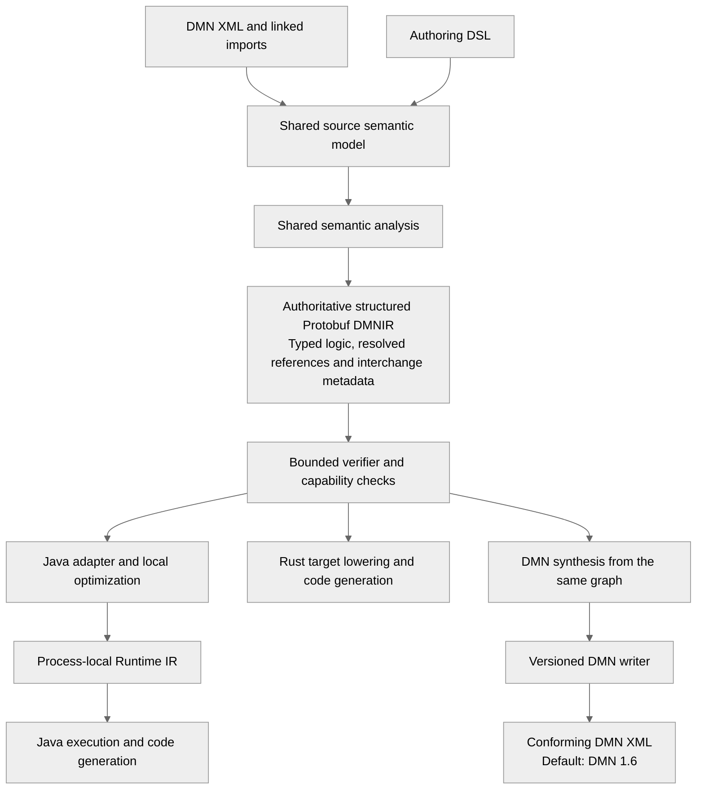
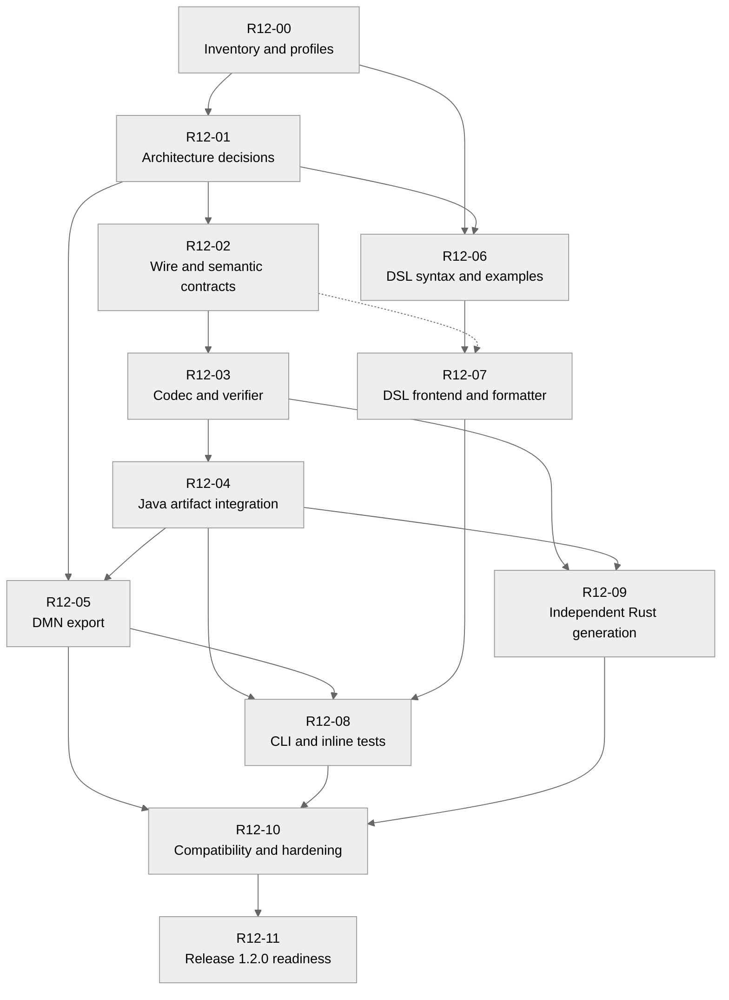
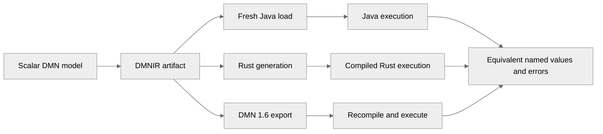
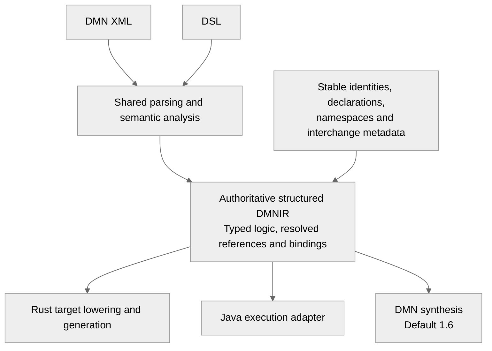
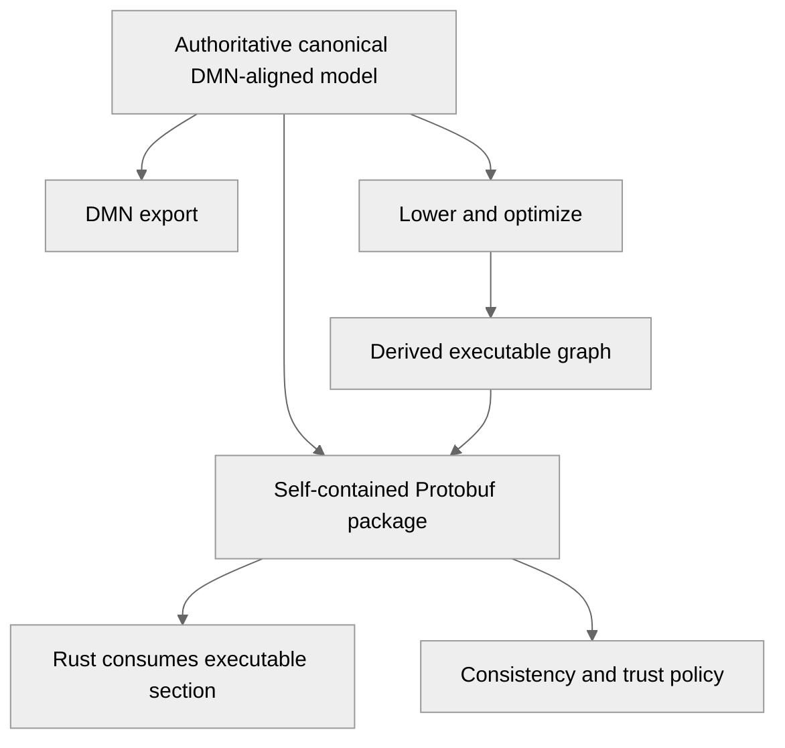
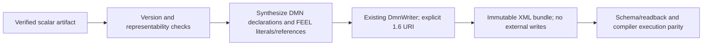

# Release 1.2.0 work package — DMNIR and decision authoring

Date: 2026-11-03. Status: active — bounded scalar slices through R12-05a complete and verified; broader release work remains.
Delivery owner: unassigned. Protobuf and **Option A** were approved on 2026-11-03.
Accepted representation architecture: [ADR-0026](../../docs/architecture/adr/adr-0026-structured-portable-dmnir.md).
Current branch: `feature/release-1.2-dmnir`. Wire fields and other detailed contracts remain in design.

## 1. Outcome and release scope

Deliver versioned **DMNIR** containing sufficient executable meaning for independent generators
and sufficient DMN-aligned information to regenerate conforming DMN. A concise `.decision` DSL
feeds the existing compiler semantics. DMN export defaults to **1.6**.

Mandatory outcomes:

- DMN XML and linked imports compile into a validated portable `.dmnir` artifact.
- An export-capable artifact alone generates valid DMN 1.6 without original source documents.
- Explicit target-version selection has a published feature matrix and deterministic rejection
  of unsupported versions/features. DMN 1.5 is the first additional candidate, reviewed in R12-00.
- DSL authoring supports types, inputs, literal decisions, decision tables, imports, reusable
  functions/BKMs, documentation and inline tests through shared semantic analysis.
- Formatter, precise diagnostics and CLI/API workflows make authoring practical.
- Java loads artifacts and demonstrates interpreter/generated-Java parity.
- Standalone Rust consumes artifacts and generates compilable executable Rust for a declared
  initial capability profile, without DMN XML, FEEL parsing or JVM compiler services.
- Determinism, bounded validation, compatibility fixtures and clean-consumer documentation.

Proposed initial Rust profile: exact numbers, booleans, strings, nulls, structured inputs,
dependencies, conditionals and a decision table. Unsupported operations must be rejected before
generation. Confirm this boundary in R12-00: full Rust FEEL/DMN conformance is not implied.

Toolkit release 1.2.0, DMN standard version, DSL version, wire version and semantic-runtime
version are independent version axes. No product version is changed by this planning task.

Deferred: Go/C++/Wasm, latency/zero-allocation promises, package registry, OR-Tools, LSP,
VS Code/KIE synchronization, graphical debugging and automatic diagram layout. Valid export
must not depend on automatic layout. Exact original XML/comments/layout recovery is not promised.

## 2. Source evidence and reconciliation

Ideation root: `C:\00-finmsg.io\dmn-compiler-toolkit-ideation`.

| Source | Contribution / required reconciliation |
| --- | --- |
| `doc/IDEA-003-portable-runtime-ir-artifact.md` | Portable executable meaning, capabilities, hostile-input handling and artifact lifecycle |
| `doc/IDEA-004-decision-authoring-dsl.md` | Canonical authoring model, stable identities, source authority and export fidelity |
| `doc/IDEA-010-native-multi-language-code-generation-and-visual-tooling.md` | Rust consumption proof; broader tooling remains deferred |
| `doc/SPEC-001-runtime-ir-protobuf.md` | Candidate execution layout; requires gap analysis against current production IR |
| `proto/dmn_ir_v1.proto` | Candidate schema; do not freeze field/operation IDs without reconciliation |
| `doc/SPEC-002-decision-authoring-dsl.md` | DSL and CLI proposals; replace its 1.5 default with requested 1.6 |
| `examples/credit_risk.decision` | Readability fixture requiring semantic review before positive acceptance use |

Observed toolkit baseline: parent POM is 1.1.0; immutable Runtime IR is process-local;
[ADR-0025](../../docs/architecture/adr/adr-0025-runtime-ir-persistence-and-compatibility-boundary.md)
requires a separate versioned persistence contract. XML reader/writer infrastructure, FEEL,
semantic analysis, Java/Spark generators and a conformance harness already exist. Inspection
is not fresh execution/conformance evidence.

The [roadmap](../../docs/roadmap.md) already includes authoring and reverse export ambitions.
R12-01 must reconcile broad lossless/decompiler wording with information lost by optimization.
XML validity, behavioral equivalence, TCK coverage and original-source fidelity are separate claims.

The credit-risk example combines UNIQUE with a catch-all rule: review overlapping matches and
choose the intended policy before adoption. SPEC-001's illustrative floating-point Rust arithmetic
is not an acceptable exact-number contract. Ideation proposals do not override accepted ADRs.

## 3. Accepted architecture and remaining contract gates

The user selected **Option A** after the alternatives review in section 11. The representation
architecture is accepted in ADR-0026; implementation is incremental and not yet complete.



Decision logic is stored once. Portable DMNIR retains the structured operations and declarations
needed for standard DMN synthesis. Generated dense execution slots and aggressive optimizations
belong to derived consumer representations. Do not add mandatory separate export/execution
policies or use original source files as an export dependency. The source semantic model,
portable DMNIR and Java Runtime IR remain separate contracts.

Detailed contracts still required before their respective implementation slices:

1. Stable model/element identities, namespaces, declarations, import bindings, provenance,
   export classifications and mappings from source semantics to the resolved graph.
2. Protobuf ownership, package, field IDs, presence, exact values, bounds and compatibility.
   Do not reuse semantic protobuf messages or serialize Java records.
3. Version/capability policy, operation registry and canonical content identity. Validate one
   authoritative graph and its metadata; there is no pair of stored policies to reconcile.
4. Concrete acyclic module graph for schema/codec, verification/adapters, DSL frontend, export,
   CLI and Rust. Keep serialization dependencies out of the execution runtime.
5. APIs/CLI, diagnostics, import resolution, grammar/stability and measured consumer profiles.

Follow normative [architecture principles](../../docs/architecture/chapters/02-Architecture%20Principles.md):
AP-001/002/013 semantic correctness and standards alignment; AP-003/004/009 isolated passes and
acyclic dependencies; AP-005/008 immutability/determinism; AP-006/012 independent runtimes and
backends; AP-010/016 typed stable contracts; AP-014/017 tests/documentation; AP-019/020 security
and diagnostics. Map slices to relevant AR-001–AR-012 in the
[architecture specification](../../docs/architecture/architecture-spec.md), retaining their
existing UNREVIEWED status rather than silently accepting them.

## 4. Required contracts

- Inventory types, inputs, decisions, BKMs, linked imports, dependencies, evaluation order,
  global slots, lexical frames/captures, constants, expressions, tables and public outputs.
  Classify decision services, boxed expressions, host functions and optimizer-specific nodes
  as supported, capability-gated or rejected; never silently omit semantics.
- Specify decimal precision/rounding/errors without binary-float substitution; temporal precision,
  offsets/timezones and distinct duration kinds; missing versus null; ordering; FEEL coercion,
  equality, function binding, table hit policies, priority and aggregation.
- Define explicit wire IDs, reserved retired fields, schema/semantic versions, required features,
  model manifest, public identities and optional source maps. Java enum ordinals are not wire IDs.
- Specify cross-language canonical bytes: map/order rules, unknown fields, defaults/presence,
  numeric encoding, digest coverage and provenance excluded from identity. Protobuf deterministic
  serialization alone is not a cross-language canonicalization contract.
- Bound byte size, depth and counts; validate references, slots, cycles, types, operations,
  table arity and graph/metadata consistency before generation. Unknown required capabilities
  and incompatible semantic/major versions fail early with stable diagnostics.
- Define integrity and trust policy. Digests detect changes; they do not authenticate producers.
  Signing/key distribution is a separate optional deployment concern.
- Classify export as exact, normalized, extension or unavailable. Initial authoring profile
  admits standard exact/normalized constructs. Never silently downgrade or invent extensions.
- Export reconstructs IDs, names, namespaces, types, requirements, imports and FEEL/table logic.
  Require equivalent behavior, not original XML spelling/layout. Define version-specific rejection
  and one authoritative source per model; adopting edited generated DMN is an explicit workflow.

## 5. Work breakdown

Sizes are relative planning indicators (S/M/L), not dates. Assign an owner and ready slice contract
before implementing each item. R12-00 remains in progress; bounded implementation slices
R12-02a, R12-03a and R12-04a are complete, as recorded in sections 12–14. Their broader parent
work items remain incomplete.

| ID | Deliverable / affected responsibilities | Dependencies | Size | Exit evidence |
| --- | --- | --- | --- | --- |
| R12-00 | Inventory IR/optimizer/XML support; agree execution/export/DSL/Rust/version matrices and baseline | None | M | Every current node/operation classified; representative and negative corpus selected; exact commands/toolchains recorded |
| R12-01 | Representation decision, identity, dependency graph and roadmap reconciliation | 00 | L | Option A accepted in ADR-0026; detailed identity/module contracts remain open; preserve one authoritative graph and runtime isolation |
| R12-02 | Wire/schema, semantic value contract, operation registry, canonicalization and compatibility policy | 01 | L | Current-IR representability matrix and cross-language golden vectors, including incompatible versions/capabilities |
| R12-03 | Bounded codec and structural/semantic verifier | 02 | L | Deterministic encoding; malformed/truncated/oversized/unknown-node/bad-reference artifacts fail before codegen |
| R12-04 | Java export/load adapters and compiler facade | 03 | L | Linked DMN artifact loads in a separate process without source; interpreter/generated-Java parity over declared profile |
| R12-05 | Artifact-to-DMN transform and version-aware writer | 01, 04 | L | Artifact-only default 1.6 export; selected-version validation/rejection; official-schema and independent-reader checks; execution parity |
| R12-06 | DSL syntax laboratory, examples, grammar, fidelity and identity policy | 00, 01 | M | Scalar, table and imported-BKM examples reviewed; FEEL boundaries, escaping, nulls and hit policies unambiguous |
| R12-07 | DSL parser, canonical lowering, diagnostics and formatter | 06; 02 for artifact integration | L | Shared semantics, source ranges, bounded parsing, idempotent formatting and DMN/DSL parity; imports/functions covered |
| R12-08 | CLI/API, inline tests and user instructions | 04, 05, 07 | M | Fresh consumer can check/format/test/compile DSL and export DMN; tests excluded from production payload; documented errors/exit codes |
| R12-09 | Independent Rust validator/adapter, generator and runtime support | 03, 04 | L | Artifact-only consumer; generated crate compiles/runs; exact named value/error parity; unsupported features rejected up front |
| R12-10 | Compatibility, security, determinism and regression hardening | 05, 08, 09 | L | Old/new fixtures, canonical vectors, adversarial tests, clean consumers and existing-backend regression evidence |
| R12-11 | Release 1.2.0 readiness and compatibility/sample/release documentation | 10 | M | Reactor/conformance/docs/release gates pass; measured support/limitations recorded; publishing authorized separately |

The dependency graph follows the work-item table. Dashed edges identify the additional
artifact-integration dependency of R12-07.



Dependencies do not authorize additional agents or simultaneous edits. Split rows into smaller
evidence-backed slices as necessary.

First vertical milestone: prove these paths with equivalent observable results.



Expand to tables,
imports/BKMs and remaining declared features. Do not stabilize wire/DSL contracts from a toy alone.

## 6. Acceptance scenarios

1. Identical sources/options/toolchain produce identical canonical artifacts and digests.
   Declaration reordering preserves documented semantics and deterministic scheduling.
2. An export-capable artifact in a fresh directory, without original sources, exports DMN 1.6
   by default; schema validation, read-back and execution preserve named results/errors.
3. Unsupported target versions/features fail with model identity and feature/version diagnostics,
   without silently weakened output.
4. Equivalent DSL and DMN with structured types, tables and imported BKMs execute equivalently
   through shared FEEL/semantic analysis. DSL compilation does not require generated XML.
5. Formatting twice is unchanged. Invalid embedded FEEL, quoted names and ambiguous delimiters
   produce actionable diagnostics at original DSL ranges.
6. Rust receives only the artifact and generates a compilable crate executing supported decisions
   with exact Java-reference value/error parity, without XML/FEEL/JVM compiler services.
7. Decimal/temporal boundaries, null/missing, captures, table overlaps and imports either match
   semantics or fail capability negotiation. Rejections are not execution passes.
8. Hostile size/depth, invalid slots/cycles, unknown operations, corruption, incompatible versions
   and inconsistent declarations, bindings or graph metadata are rejected deterministically.
9. Optimized/unoptimized execution and exported DMN preserve declared behavior; missing original
   expressions and diagrams are never presented as recovered source.
10. Fresh external Java and Rust consumers reproduce the documented sample with pinned toolchains
    and schema, without repository-internal Java compiler object access.

## 7. Verification and release gates

Use the existing Maven/JUnit/TCK harness and
[evidence-backed method](../../docs/dev/evidence-backed-spec-driven-development.md).
R12-00 records precise commands, supported JDK/Rust toolchains, authoritative OMG schemas and
independent validator. Verify official version resources at implementation time. A DMN 1.5 TCK
result alone does not prove DMN 1.6 conformance.

Use `C:\10-tools\apache-maven-3.9.12\bin\mvn.cmd`. Run focused tests first, downstream checks
for shared changes, and the full reactor for schema/POM/module-contract changes. Compile/run
generated Java/Rust; test artifact and XML round trips, official-schema validation and independent
reading. Define canonical value/error comparison for decimal/temporal results; incidental JSON
spelling is not the semantic contract.

Release requires the full declared interpreter/Java/Spark conformance inventory and affected gRPC
integration. Report execution passes, expected rejections, failures, compilation/runtime errors
and unsupported cases separately. Spark native/fallback/unknown counts and rates use the actual
executable denominator; SQL-action rates remain separate from TCK cases. Rust publishes its own
supported denominator and rejected inventory. Subset success is not whole-DMN conformance.
Avoid repeating expensive unchanged verification.

For this documentation-only preparation: documentation/link validation, strict MkDocs and
`git diff --check`. Native/fallback counts and rates are not measured/applicable.

Each completed slice records commands, tool versions, revision, fixture inventory, outcomes,
limitations and evidence links. Update canonical specs/ADRs/roadmap/TODOs as decisions and code
justify it. Release publication requires explicit authorization under the guardrails.

## 8. Risks and readiness questions

| Risk / decision | Resolution gate |
| --- | --- |
| Distilled execution data cannot regenerate equivalent DMN | 01 chooses retained information; prove artifact-only export before schema stability |
| Export and execution adapters diverge | Derive both from one authoritative graph; 04/05/09/10 prove behavioral parity |
| Semantic protobuf loses authoring intent | 00/01 gap analysis before choosing reuse/extensions |
| Rust libraries diverge from FEEL semantics | 02/09 exact contract and boundary corpus; explicit rejection |
| Broad version claims exceed evidence | 00/05 per-version matrix and distinct XML/behavior/conformance evidence |
| DSL is concise but ambiguous/unpleasant | 06 readability review on business-shaped examples before stable grammar |
| Wire format creates maintenance obligations | 02/10 compatibility fixtures, owner and migration/deprecation policy |
| Release expands into IDE/native ecosystem | Keep deferred scope explicit; review additions before implementation |

## 9. Continuation prompt

Read `prompts/actual-task.md`, the general prompt, guardrails, this package, architecture principles,
ADR-0025 and referenced ideation inputs. Continue the active R12-00 inventory, baseline and profile review. Use accepted Option A from ADR-0026. Review remaining profile/version and wire-contract
questions at their slice gates; do not reopen the accepted representation choice.
Deliver the smallest ready vertical slice with executable evidence. Keep DMN 1.6 default export,
artifact-only DMN generation and independent Rust consumption mandatory. Do not freeze the draft
schema, inherit the old 1.5 default, infer whole-DMN coverage from a Rust subset, or publish
externally without authorization.


## 10. R12-00 inventory — 2026-11-03

Status: in progress. This is inspected source evidence and a proposed support matrix, not a
new schema or an accepted architecture decision. Baseline revision:
`3ca79721f85d4cf8b18400f8e0017cc0f8fe6740`; planning changes are uncommitted.

### Selected encoding and verified references

Protobuf is selected for the portable wire format. The schema remains separate from
`dmn-protobuf` semantic messages and from Java runtime records, as required by ADR-0025.
Reserve retired IDs, use explicit presence where zero is a valid slot/index, and reject unknown
required operations rather than accepting a decoded message as valid executable meaning.
[Protobuf's guide](https://protobuf.dev/programming-guides/proto3/) describes schema evolution;
[its canonicalization guidance](https://protobuf.dev/programming-guides/serialization-not-canonical/)
requires a format-specific identity algorithm rather than assuming deterministic encoding is canonical.

[OMG DMN 1.6](https://www.omg.org/spec/DMN/1.6/) lists the normative
[DMN16.xsd](https://www.omg.org/spec/DMN/20240513/DMN16.xsd), DMNDI 1.5 and DI/DC dependencies.
The schema dependency closure, local checksums and independent engine still need pinning.
The corresponding [DMN 1.5 resources](https://www.omg.org/spec/DMN/1.5/About-DMN)
provide the candidate additional export target. No full 1.6 behavior claim has been verified.

### Expression coverage matrix

Every sealed `RuntimeExpression` alternative is listed below. Portable Java/export scope is
proposed to cover all listed pure FEEL forms; until implemented, every row is **not verified**.
A draft analogue is only a shape match, not proof of field-level semantic completeness.
Rust v0 includes only the reviewed scalar/structured/table subset; other nodes require explicit
capability rejection. Listed scalar operations still require precise operator/type validation.

| Current Java expression | Ideation schema analogue | Proposed Rust v0 |
| --- | --- | --- |
| `RuntimeConstant` | constant | Include within declared scalar/structured profile |
| `RuntimeValueReference` | slot_ref | Include within declared scalar/structured profile |
| `RuntimeUnaryExpression` | unary | Include within declared scalar/structured profile |
| `RuntimeBinaryExpression` | binary | Include within declared scalar/structured profile |
| `RuntimeConditionalExpression` | if_expr | Include within declared scalar/structured profile |
| `RuntimeListExpression` | list | Reject pending later capability |
| `RuntimeFunctionCall` | builtin (built-ins only; named dispatch needs review) | Reject pending later capability |
| `RuntimeContextExpression` | context | Include within declared scalar/structured profile |
| `RuntimeLocalReference` | local_ref | Reject pending later capability |
| `RuntimePathExpression` | path | Include within declared scalar/structured profile |
| `RuntimeRangeExpression` | range | Reject pending later capability |
| `RuntimeFilterExpression` | filter | Reject pending later capability |
| `RuntimeBetweenExpression` | between | Reject pending later capability |
| `RuntimeInExpression` | in_expr | Reject pending later capability |
| `RuntimeInstanceOfExpression` | instance_of | Reject pending later capability |
| `RuntimeUnaryTestsExpression` | Missing explicit expression form | Reject pending later capability |
| `RuntimeForExpression` | for_expr | Reject pending later capability |
| `RuntimeQuantifiedExpression` | quantified | Reject pending later capability |
| `RuntimeFunctionDefinition` | Missing explicit expression form | Reject pending later capability |
| `RuntimeInvocationExpression` | call (named function versus target needs review) | Reject pending later capability |
| `RuntimeDescendantExpression` | Missing explicit expression form | Reject pending later capability |
| `RuntimeDecisionTableReference` | Missing explicit expression form | Reject pending later capability |
| `RuntimeRelationExpression` | Missing explicit expression form | Reject pending later capability |

Decision tables are a separate decision logic form, outside the 23 expression alternatives.
All seven policies exist in Java: UNIQUE, FIRST, PRIORITY, ANY, COLLECT, RULE_ORDER, OUTPUT_ORDER.
Proposed Rust v0 supports UNIQUE only; others fail capability validation. Java aggregation is an
optional SUM/MIN/MAX/COUNT; the draft's explicit LIST/UNSPECIFIED needs an intentional mapping.
The draft table output lacks Java's `allowedValues`, which carries priority ordering semantics.
The draft BKM lacks dependency and function-kind parity with `RuntimeBkm`.

All 13 binary operators, three unary operators and six unary-test comparison operators have
named analogues in the draft; map by explicit contract, never by Java enum ordinal. Unary tests
also include range/expression alternatives, negation and wildcard state. Preserve these invariants.
All 15 `RuntimeTypeKind` alternatives have draft analogues except generic `DURATION`; resolve
its relation to the two concrete duration kinds before schema readiness.

### Built-in registry reconciliation

All 90 current built-ins are classified below. Each has a draft name analogue and a different
numeric ID. This is an intentional-looking zero-reservation shift, not proof of compatibility.
Use an explicit mapping; neither registry is silently changed. Proposed portable Java scope
includes each operation under the shared semantic contract; Rust v0 rejects built-ins until
individually admitted by a subsequent capability. None is artifact-tested yet.

| Built-in | Java dispatch ID | Ideation wire ID | Rust v0 |
| --- | --- | --- | --- |
| `NOT` | 0 | 1 | Reject |
| `STRING` | 1 | 2 | Reject |
| `NUMBER` | 2 | 3 | Reject |
| `DATE` | 3 | 4 | Reject |
| `TIME` | 4 | 5 | Reject |
| `DATE_AND_TIME` | 5 | 6 | Reject |
| `DURATION` | 6 | 7 | Reject |
| `COUNT` | 7 | 8 | Reject |
| `SUM` | 8 | 9 | Reject |
| `MIN` | 9 | 10 | Reject |
| `MAX` | 10 | 11 | Reject |
| `ABS` | 11 | 12 | Reject |
| `SUBSTRING` | 12 | 13 | Reject |
| `SUBSTRING_BEFORE` | 13 | 14 | Reject |
| `SUBSTRING_AFTER` | 14 | 15 | Reject |
| `STRING_LENGTH` | 15 | 16 | Reject |
| `UPPER_CASE` | 16 | 17 | Reject |
| `LOWER_CASE` | 17 | 18 | Reject |
| `CONTAINS` | 18 | 19 | Reject |
| `STARTS_WITH` | 19 | 20 | Reject |
| `ENDS_WITH` | 20 | 21 | Reject |
| `MATCHES` | 21 | 22 | Reject |
| `REPLACE` | 22 | 23 | Reject |
| `SPLIT` | 23 | 24 | Reject |
| `FLOOR` | 24 | 25 | Reject |
| `CEILING` | 25 | 26 | Reject |
| `DECIMAL` | 26 | 27 | Reject |
| `ROUND_HALF_UP` | 27 | 28 | Reject |
| `ROUND_HALF_EVEN` | 28 | 29 | Reject |
| `SUBLIST` | 29 | 30 | Reject |
| `CONCATENATE` | 30 | 31 | Reject |
| `DISTINCT_VALUES` | 31 | 32 | Reject |
| `FLATTEN` | 32 | 33 | Reject |
| `REVERSE` | 33 | 34 | Reject |
| `INDEX_OF` | 34 | 35 | Reject |
| `YEARS_AND_MONTHS_DURATION` | 35 | 36 | Reject |
| `SORT` | 36 | 37 | Reject |
| `LIST_REPLACE` | 37 | 38 | Reject |
| `IS` | 38 | 39 | Reject |
| `MEAN` | 39 | 40 | Reject |
| `MEDIAN` | 40 | 41 | Reject |
| `MODE` | 41 | 42 | Reject |
| `STDDEV` | 42 | 43 | Reject |
| `SQRT` | 43 | 44 | Reject |
| `EXP` | 44 | 45 | Reject |
| `LOG` | 45 | 46 | Reject |
| `MODULO` | 46 | 47 | Reject |
| `EVEN` | 47 | 48 | Reject |
| `ODD` | 48 | 49 | Reject |
| `PRODUCT` | 49 | 50 | Reject |
| `ALL` | 50 | 51 | Reject |
| `ANY` | 51 | 52 | Reject |
| `INSERT_BEFORE` | 52 | 53 | Reject |
| `REMOVE` | 53 | 54 | Reject |
| `APPEND` | 54 | 55 | Reject |
| `UNION` | 55 | 56 | Reject |
| `LIST_CONTAINS` | 56 | 57 | Reject |
| `ROUND_UP` | 57 | 58 | Reject |
| `ROUND_DOWN` | 58 | 59 | Reject |
| `STRING_JOIN` | 59 | 60 | Reject |
| `DAY_AND_TIME_DURATION` | 60 | 61 | Reject |
| `GET_ENTRIES` | 61 | 62 | Reject |
| `GET_VALUE` | 62 | 63 | Reject |
| `RANGE` | 63 | 64 | Reject |
| `DAY_OF_YEAR` | 64 | 65 | Reject |
| `DAY_OF_WEEK` | 65 | 66 | Reject |
| `WEEK_OF_YEAR` | 66 | 67 | Reject |
| `MONTH_OF_YEAR` | 67 | 68 | Reject |
| `CONTEXT` | 68 | 69 | Reject |
| `CONTEXT_PUT` | 69 | 70 | Reject |
| `CONTEXT_MERGE` | 70 | 71 | Reject |
| `PMT` | 71 | 72 | Reject |
| `PMT2` | 72 | 73 | Reject |
| `NOW` | 73 | 74 | Reject |
| `TODAY` | 74 | 75 | Reject |
| `ROUND_HALF_DOWN` | 75 | 76 | Reject |
| `DURING` | 76 | 77 | Reject |
| `BEFORE` | 77 | 78 | Reject |
| `AFTER` | 78 | 79 | Reject |
| `MEETS` | 79 | 80 | Reject |
| `MET_BY` | 80 | 81 | Reject |
| `OVERLAPS` | 81 | 82 | Reject |
| `OVERLAPS_BEFORE` | 82 | 83 | Reject |
| `OVERLAPS_AFTER` | 83 | 84 | Reject |
| `FINISHES` | 84 | 85 | Reject |
| `FINISHED_BY` | 85 | 86 | Reject |
| `INCLUDES` | 86 | 87 | Reject |
| `STARTS` | 87 | 88 | Reject |
| `STARTED_BY` | 88 | 89 | Reject |
| `COINCIDES` | 89 | 90 | Reject |

### Structural gaps and export implications

- `RuntimeModel`, `RuntimeInput` and `RuntimeDecision` lack source names/namespaces; compiler
  `RuntimeModelIndex` has source-address information during lowering but is not a persistence API.
  Retain stable public identities before flattening. Reordering declarations need not preserve
  existing slot IDs; canonicalization must explicitly define the intended guarantee.
- `RuntimeCanonicalValue` uses BigDecimal, Java local date/time plus optional zone, and
  TemporalAmount. Define portable numeric and temporal representations instead of serializing
  those classes. The candidate raw-string constant/pool sentinel design needs presence validation.
- `RuntimeIrOptimizer` retains the model and adds constant/builtin traversal metadata;
  `dmn-optimizer/DmnOptimizer` separately applies semantic transformations. These are different
  optimization layers. Traversal ordinals must not become stable public identities.
- `RuntimeFunctionDefinition` distinguishes body/external/local-frame size; `RuntimeBkm` includes
  FEEL/JAVA/PMML kind. Portable core should reject JAVA/PMML and external bodies until an explicit
  host capability/policy exists; do not hide them inside a generic function call.
- `DmnWriter` writes semantic `Definitions`; no artifact-to-Definitions adapter exists.
  `DefinitionsWriter` currently defaults an absent model namespace to DMN 1.5. Implement the
  new DMNIR export default explicitly without casually changing the existing writer contract.
- DMN enums include 1.1–1.7, but namespace detection handles 1.2–1.6 only. Enum membership is
  not a supported-version guarantee. Proposed new export targets: default 1.6 and explicit 1.5;
  reject others until covered by a reviewed matrix and tests.

### Proposed corpus and baseline command

Reuse current fixtures: Traffic Violation for table behavior; `discount-calculation` for linked
imports; `loan-approval` for structured multi-model decisions; `ranked-loan-products` for priority
and lists (outside initial Rust); and focused Runtime IR tests for closures, relations, unary
tests and temporal boundaries. Add malformed artifact/version/limit fixtures in R12-03.
Review the ideation credit-risk UNIQUE/catch-all overlap before adopting it as a passing case.

Existing runner: Maven Surefire/JUnit 5. Focused baseline command (PowerShell):

```powershell
& 'C:/10-tools/apache-maven-3.9.12/bin/mvn.cmd' -o -B -ntp -pl dmn-runtime-ir -am `
  '-Dtest=RuntimeIrInvariantTest,RuntimeIrOptimizerTest,RuntimeIrLowererTest,RuntimeIrPipelineIntegrationTest' `
  '-Dsurefire.failIfNoSpecifiedTests=false' test
```

Toolchain inspected: Maven 3.9.12; Maven's JDK is Azul 25.0.2 under `C:/10-tools`, while PATH
Java is a separate Azul 25.0.2 installation. Rust/rustc and Cargo are 1.95.0. No standalone
`protoc` was found on PATH; the existing Maven protobuf plugin resolves its configured compiler.
Baseline log: `target/release-1.2-r12-00-baseline.log`. **BUILD SUCCESS: 27 tests, zero failures,
errors or skips; Maven exit 0.** The four selected Runtime IR suites ran; upstream modules
built successfully but their tests were not selected. This is not a full-reactor test run.
Native/fallback counts and rates: not measured/applicable to these Runtime IR tests.

### R12-01 initial proposal — superseded by accepted Option A

The initial recommendation was a two-section package. After reviewing alternatives, the user
selected Option A: one authoritative structured graph plus interchange metadata. ADR-0026 and
section 3 supersede the initial recommendation. No second stored policy is required.

R12-00 inventory and focused baseline evidence are recorded above. Remaining readiness work:
review the exact Java/export/Rust feature profiles, pin schema dependencies and independent
validation tooling, and finalize module/identity/capability contracts in the relevant slices.
Do not mark the complete R12-00 or R12-01 items done solely from the representation approval.

## 11. R12-01 alternatives review — Option A accepted

The user requested alternatives review before implementation, then selected **Option A** on
2026-11-03. Protobuf and the single resolved structured representation are accepted in ADR-0026.
The comparison below preserves the reviewed rationale; it is not implementation evidence.

### Comparison

| Alternative | Rust consumer | DMN generation from artifact | Main benefit | Main cost / risk |
| --- | --- | --- | --- | --- |
| A — One resolved, structured DMNIR plus interchange metadata | Typed expressions, explicit references, bindings and decision-table semantics; generator does target lowering | Export the same structured logic using stable identities, namespaces and declarations | One authoritative representation of decision logic; avoids duplicate policies | Must retain exportable structure and define target-independent normalization; cannot persist arbitrary destructive optimizations in the authoritative graph |
| B — Canonical export model plus separate executable graph | Consumes pre-lowered executable section | Export the retained canonical section | Strong authoring fidelity and freedom to optimize execution independently | Duplicated logic, larger artifact and a difficult consistency/trust contract |
| C — Executable graph only, with reverse synthesis | Consumes pre-lowered executable graph | Reconstruct normalized FEEL/DMN from slots, types and operations | Small execution-focused format | Every admitted operation needs a proven DMN mapping; lost names, types, imports and structure still require metadata; arbitrary optimized graphs may be unexportable |
| D — Executable graph plus embedded original DMN or DSL | Consumes pre-lowered executable graph | Return or recompile embedded sources | Convenient archival bundle and original-source access | Retains source/compiler dependence for conversion and may carry stale policy; weak fit for a distilled intermediate contract |

These are qualitative design trade-offs, not measured artifact-size or performance results.
All alternatives require versioning, capabilities, validation and exact semantic value contracts.
No alternative requires XML, ANTLR or semantic protobuf dependencies in the execution runtime.

### A — One resolved, structured representation



The graph is compiler-resolved, not raw FEEL text: types, operation identities, dependencies,
function binding and lexical references are explicit. Rust does not repeat FEEL parsing or
semantic analysis. Retain structured tables, contexts, functions and expressions with standard
DMN mappings. Stable source identities are distinct from dense execution slots.

The DSL remains an authoring frontend. It need not expose slots, wire tags or generated IDs.
Local execution adapters/generators may derive optimized graphs; those are not a second
authoritative policy in the portable artifact. DMN synthesis may normalize syntax and structure,
but must preserve declared observable behavior. The retained metadata is a dedicated portable
contract, not an embedded semantic-protobuf `Definitions` message.

### B — Two representations in one package



This is the initial recommendation from section 10. It fits consumers that need already optimized
execution graphs plus rich authoring preservation. The release must declare the authoritative
section and what happens when sections disagree. Checksums establish integrity, not behavioral
equivalence. A verifier checking each section independently cannot establish their equivalence.
Re-lowering, a restricted reproducible transformation, or an explicit trusted-producer policy is
needed; Rust-side verification must not quietly require the Java compiler. This cost deserves
review before committing to two sections.

### C and D — Reasons to limit their roles

C can be viable for a tightly bounded exportable instruction set, provided sufficient identities
and declarations survive. It becomes less lean as reverse synthesis grows to recover tables,
functions, imports and type declarations. It should not promise arbitrary optimized-IR export.

D is useful as an optional provenance/archive feature. Embedded original source alone does not
satisfy the goal of reconstructing standards-conforming DMN from defined intermediate semantics,
especially when changing DMN versions or when DSL/compiler versions are unavailable.

### Accepted selection and consequences

The accepted selection is **A for release 1.2**: one authoritative, typed, resolved and structured Protobuf DMNIR,
with enough portable declaration/interchange metadata to synthesize DMN 1.6. It directly serves
the user's distilled-format goal and avoids proving equivalence between two stored policies.
The initial two-section recommendation remains a viable B alternative if persistent aggressive
optimization or rich source fidelity is a higher priority than a single logic representation.

Consequences of accepted Option A:

- The portable graph is not identical to current process-local `RuntimeModel`; retain only the
  additional standard structure/metadata required by the agreed profiles.
- Existing Java execution adapts the graph into process-local Runtime IR. Rust performs target
  lowering from resolved operations, not DMN source interpretation or semantic name resolution.
- Optimize derived execution artifacts locally. Persisting an optional optimized cache becomes
  a separate compatibility/trust proposal rather than a mandatory release 1.2 section.
- DMN export guarantees valid normalized equivalent models for the declared portable profile;
  it does not recover original authoring syntax, comments or diagrams.
- R12-02 must prove feasibility with scalar, table, imported-BKM and lexical-scope fixtures before
  freezing a stable wire version. R12-04/05/09 adapters consume the same graph; section 3 now
  shows the accepted architecture. The diagram under B describes the rejected alternative only.

Decision recorded: **A approved**. Do not ask for the representation decision again.
The experimental scalar schema, bounded reader and execution adapter are implemented in
R12-02a/R12-03a/R12-04a below; broader expression capabilities remain future work.


## 12. First schema slice — R12-02a

Status: complete for this bounded scalar schema slice. Focused tests, formatting and
verification across the original and resumed reactor stages passed.
Architecture prerequisite: accepted ADR-0026. This bounded slice
establishes a compilable experimental scalar wire contract; it does not complete R12-02 or
claim model compilation, safe loading, DMN export or Rust execution.

### Observable outcome

A self-contained Protobuf artifact can represent a scalar model with named inputs and decisions,
exact literals and resolved global references. Generated bindings can round-trip this data
without original DMN/DSL sources, semantic protobuf messages or Java Runtime IR objects.
One typed structured expression is authoritative for each decision.

### Initial contract responsibilities

| Contract | Required meaning |
| --- | --- |
| Artifact header | Separate schema version, semantic profile and required capabilities; missing/unsupported values are validation failures |
| Model identity | Stable model ID, namespace and name; model namespace is distinct from the DMN standard XML namespace |
| Element identity | Stable source element ID, display name and variable name where they differ; no public slot identity |
| Input declaration | Element identity and resolved scalar type |
| Decision declaration | Identity, resolved type, explicit dependencies and one structured expression |
| Global reference | Unambiguous resolved model/element identity; imports retain enough binding metadata for later export |
| Expression | Resolved result type and an explicit node alternative; initially literal or global reference |
| Literal | Distinct null, boolean, string and exact-decimal alternatives; false/empty/zero must retain their node presence |
| Exact number | A specified decimal representation without float/double; bounds and normalization must be defined before codec readiness |

Do not add opaque FEEL source text as executable logic, a second export expression, XML payloads,
Java class names, or enum/traversal ordinals. Additional operations, tables, functions and lexical
binding forms follow in subsequent R12-02 slices before stable wire release.

### Acceptance scenarios and verification

1. Encode/decode a model with namespaced identities and two decisions referencing an input and
   a previous decision; all names, types, dependencies and resolved references survive.
2. Round-trip a decimal beyond binary64 precision and a nonzero fractional scale exactly.
3. Distinguish explicit null, false, empty string and numeric zero from an absent expression node.
4. Retain the artifact/profile information necessary for later bounded capability rejection.
5. Compile generated bindings using the existing pinned Protobuf toolchain. Test real binary
   round trips through the existing Maven/JUnit harness; do not rely only on descriptor snapshots.

The schema module must have no project production dependency on semantic protobuf, frontend,
semantic analysis or Runtime IR. A separate verifier/adapter owns executable validity; generated
Protobuf parsers alone must not be exposed as a safe model-loading API.

Verification scope: owning module and downstream consumers; full reactor if adding a module or
changing the parent POM. Documentation/link checks, strict MkDocs and diff checks also apply.
### Implemented experimental contract

- New default-reactor module: `dmn-ir-protobuf`. Production dependency: `protobuf-java` only;
  generated bindings use the parent's pinned protoc/runtime version 4.31.1. Tests use JUnit 5.
- Schema: [dmnir/v0/dmnir.proto](../../dmn-ir-protobuf/src/main/proto/dmnir/v0/dmnir.proto).
  Protobuf package `io.finmsg.dmn.dmnir.v0`; Java package `io.finmsg.dmn.dmnir.proto.v0`.
  The experimental header uses explicit schema major/minor `0.0`, semantics label
  `finmsg-dmnir-scalar/0` and capability `dmnir.scalar`. These labels describe this slice,
  not complete FEEL/DMN support. They do not freeze the eventual stable v1 contract.
- One typed expression per decision; initial node alternatives are literal and resolved global
  reference. Root model, bundled models/imports, declared dependencies and evaluation order
  carry stable namespace/element identities, without execution slots or a second logic graph.
- Identity preserves model/DRG names separately from variable IDs/names. Import locations are
  optional interchange hints, never source-loading instructions.
- Literal alternatives explicitly preserve null, false, empty string and zero. Initial scalar
  types are null, boolean, number and string. Message/oneof presence plus optional scalar fields
  distinguish absent nodes, absent decimal scale and absent schema-version components from zero.
- Decimal value is an ASCII integer coefficient times ten to the negative signed scale. Integer
  grammar is `0|-?[1-9][0-9]*`; no leading plus/zeros or negative zero. Scale/trailing coefficient
  zeros survive unchanged. Numeric equality is distinct from content/byte identity; no generic
  Protobuf canonical hashing is claimed. Bounded parsing and numeric expansion limits are
  explicitly verifier responsibilities and are not implemented by generated messages.

### Focused completion evidence

Command:

```powershell
& 'C:/10-tools/apache-maven-3.9.12/bin/mvn.cmd' -o -B -ntp -Pformat `
  -pl dmn-ir-protobuf -am spotless:apply test
```

Result: **BUILD SUCCESS; four tests, zero failures/errors/skips; Maven exit 0**.
Tests: [DmnIrWireContractTest](../../dmn-ir-protobuf/src/test/java/io/finmsg/dmn/dmnir/proto/v0/DmnIrWireContractTest.java).
The linked-model round trip includes distinct namespaces with the same element ID, a prior
local decision reference, import alias and separate variable names/IDs. Decimal vectors include
values beyond binary64 precision, negative fractional values, trailing zeros and negative scale.
Presence vectors distinguish all explicit default literals from absent nodes and zero versions
from missing version components. Unknown required capability labels survive decoding for a later
verifier to reject. Successful parsing intentionally does not assert artifact validity.
Log: `target/release-1.2-r12-02a-focused.log`.
Native/fallback counts and rates: not measured/applicable to this schema test run.

The initial full-reactor `-Pformat verify` was interrupted at the user's pause request during
`SparkSqlHybridIntegrationTest`; it did not finish. Log: `target/release-1.2-r12-02a-reactor.log`.
All modules before Spark completed their verification phases. The completed first Spark suite
reported 13 native SQL actions (100.00%), zero fallback (0.00%), zero unknown and zero failed;
the interrupted hybrid suite has no final routing totals, so no combined total is available.

On resume, no Maven/test JVMs remained. Refresh the current upstream artifacts locally without
rerunning their completed tests, then resume the remaining reactor modules:

```powershell
& 'C:/10-tools/apache-maven-3.9.12/bin/mvn.cmd' -o -B -ntp -DskipTests `
  -pl dmn-ir-protobuf,dmn-generator-java,dmn-optimizer -am install
& 'C:/10-tools/apache-maven-3.9.12/bin/mvn.cmd' -o -B -ntp -Pformat `
  -rf :dmn-generator-sparksql verify
```

The upstream local installation passed; it executes no tests and has no SQL routing denominator.
Logs: `target/release-1.2-r12-02a-resume-upstream.log` and
`target/release-1.2-r12-02a-reactor-resume.log`. Spark verification completed with **172 tests,
zero failures/errors/skips**; gRPC and smoke modules also completed successfully. Current-run
routing evidence from all four instrumented Spark suites is:

| Suite | Native actions | Fallback actions | Unknown | Completed-action denominator | Failed SQL actions |
| --- | --- | --- | --- | --- | --- |
| SparkSqlDmnIntegrationTest | 13 (100.00%) | 0 (0.00%) | 0 | 13 | 0 |
| SparkSqlHybridIntegrationTest | 2,952 (96.13%) | 119 (3.87%) | 0 | 3,071 | 60 |
| SparkSqlLiteralEscapingIntegrationTest | 50 (100.00%) | 0 (0.00%) | 0 | 50 | 0 |
| SparkSqlTemporalChainIntegrationTest | 19 (100.00%) | 0 (0.00%) | 0 | 19 | 0 |
| Sum | 3,034 (96.23%) | 119 (3.77%) | 0 | 3,153 | 60 |

These are the helper's completed SQL-action rates, with failed actions reported separately.
The 60 failed SQL actions are distinct from JUnit failures (zero in the Spark module).
Suites without instrumentation do not supply a routing denominator. These are
default-reactor checks, not the opt-in official TCK. Do not combine SQL actions from the aborted
run with the restarted suites or call this a single uninterrupted clean-reactor run.
Wire evolution fixtures, safe decoding, canonical identity, validation, Java execution/export
adapters and Rust generation remain future slices. Negative structural/semantic artifact
validation belongs to R12-03 and remains required.


### Final R12-02a verification and next action

The resumed Maven invocation exited **0 / BUILD SUCCESS**. Spark SQL, gRPC and smoke verification
passed; earlier modules completed before the user-requested pause. Combining completed suite
outcomes from both logs, with resumed results replacing restarted suites, gives **517 JUnit tests
across 51 suites, zero failures/errors/skips**. This is verification across interrupted/resumed
stages, not one uninterrupted clean build and not official TCK evidence.
Machine-readable run summary: `target/release-1.2-r12-02a-verification-summary.json`.

Additional checks: **73 repository tooling tests passed**; canonical documentation/link checks
passed for **13 modules**; strict MkDocs build and `git diff --check` passed. The produced schema
JAR contains `dmnir/v0/dmnir.proto` and generated `DmnIrArtifact` bindings. These checks do not
establish a stable wire version or semantic conformance of a generated backend.

At R12-02a completion, the next action was bounded scalar validation; section 13 records its
implementation. Execution adaptation remains a separate gate. Broader structured expressions,
tables, functions and lexical scopes remain in R12-02; their adapters, DMN 1.6 synthesis, DSL and
Rust proof remain later delivery work. No release/version bump, commit, push or publication was
performed for this slice.


## 13. Bounded scalar reader — R12-03a

Status: complete for this bounded scalar profile; focused, reactor, formatting and documentation checks passed.
Prerequisite: the experimental R12-02a scalar schema and accepted ADR-0026. This is a bounded
subset of R12-03, not a claim that future expression forms or the complete release are verified.

### Outcome and boundary

`dmn-ir-codec` reads bytes into an immutable verified-artifact wrapper only after bounded wire
and graph checks. It depends on `dmn-ir-protobuf` and `protobuf-java`, with no frontend, semantic
model, compiler or execution-runtime dependency. Runtime APIs remain unchanged. The schema
module remains generated-only. This module split implements the existing layer-isolation and
serialization-boundary requirements without introducing a second authoritative graph.

Canonical API/policy documentation: [experimental reader guide](../../docs/dmnir.md).
Implementation: [DmnIrArtifactReader](../../dmn-ir-codec/src/main/java/io/finmsg/dmn/dmnir/codec/DmnIrArtifactReader.java).

### Implemented policy

- Exact schema **0.0**, semantics `finmsg-dmnir-scalar/0`, required capability `dmnir.scalar`.
  Missing/duplicate capabilities, unsupported versions/features and unknown wire fields fail.
- Snapshot caller bytes after a byte-length check; scan known wire fields before generated
  decoding. Bound depth, message/field counts, string bytes, models, declarations and references.
  Reject duplicate singular/oneof selections, wrong wire types, overflowed lengths/scalars,
  malformed UTF-8 and truncated messages. No import locations are fetched.
- Validate model namespaces, model/element/variable identities and names, import aliases and
  bundled targets, direct-import visibility, declared dependencies, scalar types, literal forms,
  and exact decimal syntax/scale. Scalars are nullable; no other coercions are introduced.
- Preserve unused declared requirements. Reject duplicate/self dependencies and undeclared
  expression references. Validate a complete unique decision schedule and dependency ordering,
  rejecting cycles without recursive graph traversal.
- Return a wrapper whose constructor is private and whose artifact is immutable. Reader limits
  are immutable and per-read state is independent. Fail-fast diagnostics have stable codes and
  indexed paths without untrusted payload values or raw parser messages.
- Default budgets: 4 MiB input, depth 32 (configuration cap 64), 50,000 messages, 200,000 fields,
  16,384 UTF-8 bytes per string, 128 models, 10,000 declarations, 50,000 reference occurrences,
  4,096 coefficient digits and absolute scale 4,096. Numeric expansion is not performed.
  Configurable budgets describe reader allocations; callers must separately bound file/network
  ingestion before constructing a byte array.

Strict experimental wire acceptance is deliberately narrower than generic Protobuf parsing.
It is not a canonical-byte/digest contract, a signature/authentication mechanism, or full DMN
schema/FEEL conformance. Advanced expressions, tables, functions, temporal values, compiler
adapters, execution, DMN export and Rust generation remain subsequent work.

### Acceptance and focused evidence

Tests use the existing Maven/JUnit harness with real serialized artifacts. They cover linked
models and immutable results, nullable/default literals, exact decimals and signed scale,
compatibility/identity/import/type/reference/schedule rejection, cycles, overflow/truncation,
unknown/duplicate wire fields, exact byte/UTF-8/declaration/decimal boundaries, deterministic
failure diagnostics, reader reuse, and **500 deterministic malformed inputs**.

```powershell
& 'C:/10-tools/apache-maven-3.9.12/bin/mvn.cmd' -o -B -ntp -Pformat `
  -pl dmn-ir-codec -am spotless:apply test
```

Initial focused run: **14 codec + four wire tests passed**, zero failures/errors/skips.
Log: `target/release-1.2-r12-03a-focused.log`.
After adding deterministic malformed-input and exact-budget cases: **16 codec + four wire tests
passed**, zero failures/errors/skips. Log: `target/release-1.2-r12-03a-focused-final.log`.
Native/fallback counts and rates: not measured/applicable to either focused run.

### Completed verification

Full reactor command: `mvn -o -B -ntp -Pformat verify`.
Result: **BUILD SUCCESS; 533 JUnit tests, zero failures/errors/skips**.
Log: `target/release-1.2-r12-03a-reactor.log`.

Review then made scalar validation an explicit allowlist of the four current types so a future
schema enum extension cannot silently expand support. The final codec source and upstream wire
bindings passed **20 tests, formatting and verify**, with zero failures/errors/skips:
`mvn -o -B -ntp -Pformat -pl dmn-ir-codec -am spotless:apply verify`.
Log: `target/release-1.2-r12-03a-allowlist-verify.log`. This focused follow-up validates the final
codec change after the full run; no other production source changed. Native/fallback counts and
rates are not measured/applicable to that focused run. Do not add repeated focused tests to the
full-reactor total or describe the full run as occurring after the allowlist refinement.

Current full-run Spark SQL-action evidence from all four instrumented suites:

| Suite | Native actions | Fallback actions | Unknown | Completed-action denominator | Failed SQL actions |
| --- | --- | --- | --- | --- | --- |
| SparkSqlDmnIntegrationTest | 13 (100.00%) | 0 (0.00%) | 0 | 13 | 0 |
| SparkSqlHybridIntegrationTest | 2,952 (96.13%) | 119 (3.87%) | 0 | 3,071 | 60 |
| SparkSqlLiteralEscapingIntegrationTest | 50 (100.00%) | 0 (0.00%) | 0 | 50 | 0 |
| SparkSqlTemporalChainIntegrationTest | 19 (100.00%) | 0 (0.00%) | 0 | 19 | 0 |
| Sum | 3,034 (96.23%) | 119 (3.77%) | 0 | 3,153 | 60 |

These are completed-action rates, with failed actions separately accounted for. JUnit failures
and errors are zero. They are not official TCK case coverage. Although numerically equal to the
prior slice's totals, these figures were independently extracted from the current run's log.
Machine-readable summary: `target/release-1.2-r12-03a-verification-summary.json`.

Additional verification: **73 repository tooling tests passed**, documentation/link facts passed
for **14 modules**, strict MkDocs build passed, and `git diff --check` passed.
Logs: `target/release-1.2-r12-03a-tools.log` and `target/release-1.2-r12-03a-docs.log`.

Next functional slice: adapt verified scalar DMNIR into process-local Runtime IR and prove actual
execution parity, while retaining source identities for DMN synthesis. Broader R12-02/R12-03 and
all DMN export/DSL/Rust release gates remain open. No version bump, commit, push or publication.


## 14. Verified scalar execution adaptation — R12-04a

Status: complete for this bounded slice; focused execution, generated-Java and full-reactor
verification passed. Prerequisites: accepted Option A/ADR-0026 and the completed R12-02a/R12-03a scalar
wire/reader slices. This does not complete the broader R12-04 producer and advanced-feature scope.

### Outcome and architecture

The compiler-layer [DmnIrRuntimeAdapter](../../dmn-compiler/src/main/java/io/finmsg/dmn/compiler/dmnir/DmnIrRuntimeAdapter.java)
accepts a reader-created `VerifiedArtifact`, derives process-local Runtime IR, retains stable
identity bindings and delegates scalar evaluation to the existing `DmnRuntime`. No XML or FEEL
parsing occurs on the artifact execution path. The original verified graph remains available
through `source()` for later DMN synthesis; derived Runtime IR is not a second stored policy.

The existing `dmn-compiler` module gains downward dependencies on `dmn-ir-codec` and
`dmn-ir-protobuf`. Neither execution runtime nor Runtime IR gains a portable-schema dependency.
Java generator production dependencies are unchanged; its existing compiler test dependency
supplies the new adapter. No additional Maven module is introduced in this slice.

### Implemented behavior

- Pin schema 0.0, semantics `finmsg-dmnir-scalar/0` and the single `dmnir.scalar` capability
  independently at this consumer boundary. A future reader extension must not silently extend
  the adapter. Only verified literal/reference scalar graphs are admitted.
- Allocate deterministic dense local IDs/slots by namespace and source element ID. Preserve the
  artifact's validated schedule and dependencies. Lower constants/references into existing
  immutable Runtime IR records without altering their contracts.
- Preserve element names, optional variable IDs, variable names, types and source identities in
  binding maps. The public key is `ElementId(modelNamespace, elementId)`; variable IDs and local
  slots are not external addressing contracts. Duplicate element IDs across namespaces stay distinct.
- Evaluate all bundled decisions with fresh per-call slot state. Require all input identities;
  reject unknown or missing keys before evaluation. Explicit null differs from omission, and
  null-typed inputs require null. Other coercions are delegated to the existing runtime; no
  independent FEEL coercion engine is introduced.
- Preserve exact decimal coefficient/scale through bounded scientific lexical values rather than
  exponent expansion. Preserve raw string contents without quoting/unescaping them again.
  Results include explicit null entries and are returned in an unmodifiable ordered map.
  Native host objects are not deep-copied; use immutable inputs when sharing across calls.

The adapter's input-binding errors are new experimental API errors, not changes to existing
compiler/runtime caller behavior. The profile still excludes arithmetic nodes, tables, functions,
collections and temporal values. It is not a stable v1 wire or complete DMN conformance claim.

### Acceptance and evidence

[Adapter tests](../../dmn-compiler/src/test/java/io/finmsg/dmn/compiler/dmnir/DmnIrRuntimeAdapterTest.java)
cover artifact-only execution; exact decimal scale and negative scale; null, false and empty/raw
strings; retained IDs/names; imported identity isolation; deterministic declaration reordering;
immutable metadata/result maps; missing/unknown/null-typed input rejection; repeated and 20-way
concurrent evaluation. Observable scalar values and coercions match synthetic DMN 1.6 compilation
through both lowered and optimized modes. Imported-output parity is also checked. These fixtures
are paired definitions; no DMN-to-DMNIR producer is implemented by this test.

[Generated-Java parity](../../dmn-generator-java/src/test/java/io/finmsg/dmn/generator/java/DmnJavaGeneratorTest.java)
uses the `verifiedPortableArtifactGeneratesCompilableJavaWithScalarParity` test: artifact bytes
are validated/adapted, optimized companion metadata is derived, Java source is generated and
compiled with the JDK, then execution results are compared with the interpreter. Numeric
comparison is semantic decimal equality; it does not promise incidental scale or JSON spelling
identity after backend optimizations. Repeated generation produces identical source.

Initial focused command: `mvn -o -B -ntp -Pformat -pl dmn-compiler -am spotless:apply
-Dtest=DmnIrRuntimeAdapterTest -Dsurefire.failIfNoSpecifiedTests=false test`.
Result: **eight tests passed**, zero failures/errors/skips.
Log: `target/release-1.2-r12-04a-focused.log`.

After adding generated-source execution:

```powershell
& 'C:/10-tools/apache-maven-3.9.12/bin/mvn.cmd' -o -B -ntp -Pformat `
  -pl dmn-generator-java -am spotless:apply `
  '-Dtest=DmnIrRuntimeAdapterTest,DmnJavaGeneratorTest#verifiedPortableArtifactGeneratesCompilableJavaWithScalarParity' `
  '-Dsurefire.failIfNoSpecifiedTests=false' test
```

Result: **nine tests passed**, zero failures/errors/skips.
Log: `target/release-1.2-r12-04a-generator-focused.log`.
Native/fallback counts and rates are not measured/applicable to either focused run.

Full reactor passed with `mvn -o -B -ntp -Pformat verify` because dependencies and a public
shared adapter contract changed: **542 tests**, zero failures/errors/skips; all 15 reactor
projects succeeded. Log: `target/release-1.2-r12-04a-reactor.log`.
Machine-readable evidence: `target/release-1.2-r12-04a-verification-summary.json`.

Current-run Spark SQL action accounting includes all four instrumented suites:

| Suite | Native | Fallback | Unknown | Completed denominator | Failed SQL actions |
| --- | ---: | ---: | ---: | ---: | ---: |
| DmnIntegration | 13 | 0 | 0 | 13 | 0 |
| HybridIntegration | 2,952 | 119 | 0 | 3,071 | 60 |
| LiteralEscapingIntegration | 50 | 0 | 0 | 50 | 0 |
| TemporalChainIntegration | 19 | 0 | 0 | 19 | 0 |
| Total | 3,034 | 119 | 0 | 3,153 | 60 |

Native rate: **96.23%**; fallback rate: **3.77%**. The 60 failed SQL actions are separate
from the completed-action denominator and from JUnit failures. These are backend regression
metrics, not official TCK conformance results.

All **73 tooling tests** passed (`target/release-1.2-r12-04a-tools.log`). Strict MkDocs build
passed (`target/release-1.2-r12-04a-docs.log`); documentation verification passed for 14 modules
and 70 pages. Whitespace validation passed with `git diff --ignore-submodules=all --check`.

DMN-to-artifact emission, DMN 1.6 synthesis, DSL and Rust proof remain later work. No version
bump, commit, push or publication was performed.

## 15. Scalar DMN producer — R12-04b

Status: complete for this bounded scalar slice. Producer contract approved by the user's
subsequent “please continue”; focused and full-reactor verification passed.
This extends the completed scalar reader/adapter without widening schema 0.0 or its capability.

### Proposed boundary

Add an experimental `DmnIrScalarProducer` in `dmn-compiler`, alongside the runtime adapter.
Its `produce(DmnSource, DmnModelResolver)` entry point returns a reader-created
`VerifiedArtifact`; a convenience overload supports a model without imports. Reuse the existing
model loader, FEEL parser, model-set semantic analyzer and unoptimized Runtime IR lowerer.
Do not change existing `DmnCompiler.compile` behavior or add production dependencies.

Successful output preserves model/element/variable identities, names, import aliases and optional
location hints. Convert resolved runtime references back to namespace-qualified element IDs;
never serialize process-local slots. Serialize only scalar constants and global references.
Preserve exact decimals through coefficient and signed scale and retain explicit nulls/false/empty
strings. Run emitted bytes through the existing bounded reader before returning success.

Reject invalid source models, unsupported expressions/types and declarations that cannot be
represented faithfully by this profile. In particular, do not optimize arithmetic or function
calls into literals to bypass the profile. Do not silently drop BKMs, decision services, tables,
named type definitions or other semantic declarations absent from the scalar wire contract.
Original XML, source paths and FEEL source are not embedded in the artifact.

Proposed failure contract: a dedicated `DmnIrProductionException` with a stable category
(`SOURCE_INVALID`, `UNSUPPORTED_PROFILE`, `ARTIFACT_INVALID`), optional source element identity
and retained compiler diagnostics for source errors. No partial artifact is returned. Reader
limit/validation failures remain available as the cause. Producer ordering is deterministic by
model namespace and element identity; evaluation order is topological with stable tie-breaking.
This is repeatable producer output, not a universal canonical encoding or content-hash contract.

```mermaid
flowchart LR
    XML["DMN source + resolver"] --> Load["Existing loader and semantic analysis"]
    Load --> Lower["Unoptimized lowering + retained declarations"]
    Lower --> Profile["Scalar profile admission"]
    Profile --> Wire["One portable graph; stable identities"]
    Wire --> Read["Bounded reader"]
    Read --> Verified["VerifiedArtifact"]
    Verified --> Execute["Existing runtime adapter / Java generator"]
```



### Verification plan

Use the existing JUnit 5 / Maven Surefire harness. Focused command:
`mvn -o -B -ntp -Pformat -pl dmn-compiler -am test
-Dtest=DmnIrScalarProducerTest -Dsurefire.failIfNoSpecifiedTests=false`.

- Compile synthetic DMN 1.6 scalar fixtures into bytes, discard source/compiler results, reload
  with the reader and execute via the adapter. Compare against existing lowered/optimized DMN
  compilation; verify exact scalar values and coercion behavior.
- Cover imported references with repeated element IDs across namespaces, retained variable IDs,
  raw escaped/Unicode strings, null, false, empty strings and exact decimal boundaries.
- Require identical bytes for repeated production and reordered equivalent declarations/resolver
  entries. Verify schedule/dependencies through the reader, not incidental local slot numbering.
- Reject malformed DMN/FEEL, missing imports, arithmetic even when constant-foldable, tables,
  BKMs, decision services and unsupported types/declarations without returning partial output.
- Exercise existing reader resource limits on emitted artifacts. Produce bytes for a separate
  JVM consumer test to establish source-independent loading/execution.
- Add generated-Java compilation/execution parity for a produced artifact. Run the full reactor
  for the new public contract, tooling tests, strict docs and documentation verification.

### Implementation and current evidence

`DmnIrScalarProducer` and `DmnIrProductionException` are implemented in `dmn-compiler` without
new dependencies or changes to existing compiler entry points. The producer uses namespace-sorted
semantic models and the lowerer's declaration index to recover stable references, then sorts
wire declarations/dependencies and derives a stable topological schedule. The bounded reader
creates the returned verified wrapper. The XML archival metadata excluded by schema 0.0 remains
excluded: source formatting, labels, documentation, diagrams and source locations are not retained.

The initial five producer tests passed (`target/release-1.2-r12-04b-focused-retry.log`);
the original sandbox attempt was stopped after reporting access denial. An expanded run passed
nine producer tests plus generated-Java parity (`target/release-1.2-r12-04b-parity.log`).
Adding structural rejection cases exposed a table reaching lowering before profile admission:
the intermediate run had ten tests, one failure (`target/release-1.2-r12-04b-focused-final.log`).
Early table rejection fixed that producer-boundary failure. No existing lowering behavior changed.

Final focused command:

```powershell
& 'C:/10-tools/apache-maven-3.9.12/bin/mvn.cmd' -o -B -ntp -Pformat `
  -pl dmn-generator-java -am spotless:apply `
  '-Dtest=DmnIrScalarProducerTest,DmnJavaGeneratorTest#producedArtifactGeneratesExecutableJava' `
  '-Dsurefire.failIfNoSpecifiedTests=false' test
```

Result: **11 tests passed**, zero failures/errors/skips (ten producer tests, one generated-Java
test). Log: `target/release-1.2-r12-04b-parity-final.log`. Native/fallback routing counts and rates
are not measured/applicable to these focused compiler/generator runs.

Evidence includes exact decimal/null/false/empty-string execution, direct lowered/optimized DMN
parity, deterministic declaration reordering and repeat output, import identity isolation with
repeated IDs, retained import hints/variable IDs, malformed FEEL diagnostics, missing imports,
unsupported temporal inputs/named types/arithmetic/tables/BKMs/services and emitted-string reader
limits. A separate JVM receives only a binary artifact path and executes it; it receives no DMN
source or resolver. Generated Java consumes produced bytes, compiles and matches interpreter values.
Raw string/Unicode and negative-scale wire behavior are covered in the prior adapter slice;
dedicated producer lexical-boundary expansion remains future corpus work.

Full reactor command `mvn -o -B -ntp -Pformat verify` passed: **553 tests**, zero
failures/errors/skips; all 15 reactor projects succeeded.
Log: `target/release-1.2-r12-04b-reactor.log`.
Summary: `target/release-1.2-r12-04b-verification-summary.json`.

Current-run Spark SQL action accounting includes all four instrumented suites:

| Suite | Native | Fallback | Unknown | Completed denominator | Failed SQL actions |
| --- | ---: | ---: | ---: | ---: | ---: |
| DmnIntegration | 13 | 0 | 0 | 13 | 0 |
| HybridIntegration | 2,952 | 119 | 0 | 3,071 | 60 |
| LiteralEscapingIntegration | 50 | 0 | 0 | 50 | 0 |
| TemporalChainIntegration | 19 | 0 | 0 | 19 | 0 |
| Total | 3,034 | 119 | 0 | 3,153 | 60 |

Native rate: **96.23%**; fallback rate: **3.77%**. Failed SQL actions are separate from the
completed-action denominator and JUnit failures. These are regression metrics, not official
TCK conformance results.

All **73 tooling tests** passed (`target/release-1.2-r12-04b-tools.log`), strict MkDocs build
passed (`target/release-1.2-r12-04b-docs.log`) and documentation validation passed for 14 modules
and 70 maintained pages. Requested module READMEs were added in `dmn-ir-protobuf` and
`dmn-ir-codec`; their relative file targets and whitespace checks passed.
DMN synthesis, broader expressions, DSL and Rust remain outside this slice.

## 16. Artifact-only scalar DMN export — R12-05a

Status: complete for this bounded scalar subset. Contract approved by the user's subsequent
“please continue”; focused, downstream and full-reactor verification passed.
Prerequisites: completed scalar schema, reader, producer and execution adapter.

### Proposed outcome and boundary

Add `DmnIrScalarDmnExporter` in `dmn-compiler`, reusing its existing XML frontend dependency.
`export(VerifiedArtifact)` defaults to DMN 1.6; `export(VerifiedArtifact, DmnVersion)` supports
only explicitly implemented versions. Initially admit **1.6 only** and reject other enum values
before returning output. Additional versions require their own evidence; do not infer support
from the existing enum's entries. Do not change the existing writer's DMN 1.5 fallback default.

Return an immutable `ExportedDmnBundle` with a root document name and all bundled model documents
as UTF-8 XML. Document names are generated deterministically (`model-0000.dmn`, etc.) by sorted
model namespace. Treat retained import locations as source hints; regenerate locations to address
the exported bundle, never retrieve or write to original locations. The exporter performs no
filesystem/network writes. Expose document contents as immutable strings to avoid mutable arrays.

Synthesize `Definitions` from the authoritative portable graph and explicitly select the DMN 1.6
vocabulary URI. Reuse `DmnWriter` to escape XML and serialize. Emit FEEL scalar literals from
structured values, not original source text. Map stable references to correct local/imported
variable references and information requirements; retain IDs/names and import aliases where
representable. Preserve numeric value and observable behavior; normalized FEEL spelling and
incidental decimal scale after reparsing are not XML lexical-fidelity promises.

The current reader admits broader identity/name strings than standard XML IDs and unambiguous
FEEL variable references. Export must reject unrepresentable IDs, invalid XML characters,
ambiguous variable/import names and unsupported cross-model reference forms explicitly rather
than renaming stable identities or emitting invalid DMN. Specify these checks in tests before
claiming the entire scalar artifact profile is exportable. A dedicated export exception should
distinguish unsupported version from unrepresentable artifact and retain an optional stable
element identity. Do not return a partial bundle on failure.



### Verification plan

Use JUnit 5/Surefire in `dmn-compiler` with focused exporter tests first, then affected generated-Java
tests and the complete reactor for the new shared public API. Validate artifact-only synthesis
without original sources; default 1.6 vocabulary; explicit unsupported-version rejection; exact
numeric values/nulls/false/empty/raw strings; imported references and regenerated bundle locations;
stable output; invalid IDs/names/characters; and producer/export/recompile behavioral parity.
Check the XML against authoritative DMN 1.6 schemas and an independent reader where available;
record unavailable checks as gaps, not conformance passes. Reuse approved dependency boundaries;
any additional external validator/dependency needs separate review.

This proposal is not implementation evidence. No Spark generator change is planned. Focused
export tests do not measure Spark routing. A full reactor remains required by the repository's
shared-contract verification rule and is regression evidence, not a DMNIR fallback metric.

### Implementation and completion evidence

Implemented `DmnIrScalarDmnExporter`, nested immutable `ExportedDmnBundle` and
`DmnIrExportException` in the compiler package. Existing writer defaults, schemas and backend
production code are unchanged; no dependency was added. The admission policy is documented in
`docs/dmnir.md#export-a-scalar-artifact-to-dmn-16`, including conservative names/IDs, absolute
fragment-free namespaces, matching element/variable names, alias ambiguity and XML attribute
normalization rejection. The exporter does not claim every reader-valid artifact is exportable.

The first focused run had seven tests, zero assertion failures and one setup error: a duplicate
ID was rejected by the reader before reaching the exporter. The test now checks that existing
reader boundary; no production correction was needed for it. Log:
`target/release-1.2-r12-05a-focused.log`. The next run passed eight focused exporter tests
(`target/release-1.2-r12-05a-focused-final.log`). A downstream run passed those eight tests and
one generated-Java test (`target/release-1.2-r12-05a-parity.log`). These runs do not measure
Spark native/fallback routing; counts/rates are N/A.

Tests use unmodified official OMG DMN16/DMNDI15/DI/DC XSDs stored as test resources with source
URLs and SHA-256 provenance in `dmn-compiler/src/test/resources/dmn16-schema/README.md`.
JDK XSD validation runs offline; no production schema download is introduced. Recompilation
checks lowered/optimized execution parity, exact numeric values, negative scale, null/false/empty
strings, raw escapes/Unicode, imports with repeated IDs and regenerated locations. Negative tests
cover unsupported versions, names/IDs, invalid XML characters, namespace forms and ambiguous
required imported names. The generated-Java test additionally compiles/executes a model recompiled
from exported XML. Independent DMN-engine validation remains an explicit gap for broader R12-05.

The user's Traffic Violation preview request was handled separately through the existing source
semantic model/XML writer, with an explicit 1.6 namespace and official-XSD validation:
`target/traffic-violation-source-model-preview-1.6.dmn`. This is **not portable-DMNIR export**;
the full model's tables/record types/context logic remain unsupported by the scalar wire profile.
It is not acceptance evidence for R12-05a or broader DMNIR support.

Final focused command:

```powershell
& 'C:/10-tools/apache-maven-3.9.12/bin/mvn.cmd' -o -B -ntp -Pformat `
  -pl dmn-generator-java -am spotless:apply `
  '-Dtest=DmnIrScalarDmnExporterTest,DmnJavaGeneratorTest#producedArtifactGeneratesExecutableJava' `
  '-Dsurefire.failIfNoSpecifiedTests=false' test
```

Result: **10 tests passed**, zero failures/errors/skips (nine exporter tests, one generated-Java
test extended to recompile/execute exported DMN). This adds null-typed declaration parity and
attribute whitespace admission checks. Log: `target/release-1.2-r12-05a-parity-final.log`.
Spark native/fallback routing is not measured/applicable to this focused run.

Full reactor `mvn -o -B -ntp -Pformat verify` passed: **562 tests**, zero failures/errors/skips;
all 15 reactor projects succeeded. Log: `target/release-1.2-r12-05a-reactor.log`.
Machine-readable evidence: `target/release-1.2-r12-05a-verification-summary.json`.

Current-run Spark regression SQL-action counters include all four instrumented suites:

| Suite | Native | Fallback | Unknown | Completed denominator | Failed SQL actions |
| --- | ---: | ---: | ---: | ---: | ---: |
| DmnIntegration | 13 | 0 | 0 | 13 | 0 |
| HybridIntegration | 2,952 | 119 | 0 | 3,071 | 60 |
| LiteralEscapingIntegration | 50 | 0 | 0 | 50 | 0 |
| TemporalChainIntegration | 19 | 0 | 0 | 19 | 0 |
| Total | 3,034 | 119 | 0 | 3,153 | 60 |

Native action rate **96.23%**; fallback action rate **3.77%**. The 60 failed SQL actions are
separate from the completed-action denominator and from the zero JUnit failures. These mixed
regression tests include deliberate fallback-path coverage; their action rate is not TCK coverage
or a DMNIR fallback rate. The established official Spark TCK checkpoint remains 3,391/3,391 native passes (100%),
zero fallback (0%); regression action counters do not replace it. No new full TCK run is claimed.

All **73 tooling tests** passed (`target/release-1.2-r12-05a-tools.log`); strict MkDocs build
passed (`target/release-1.2-r12-05a-docs.log`). Documentation validation passed for 14 modules and
70 maintained pages; whitespace checks passed. Broader R12-05 remains open: this subset does not
cover richer expressions, additional DMN versions or independent DMN-engine validation.
